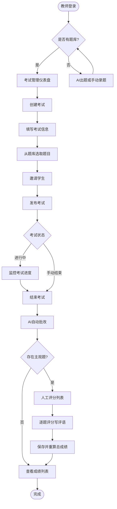
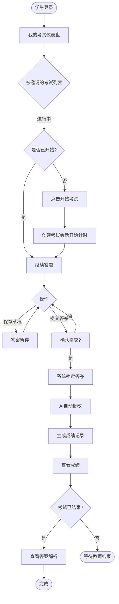
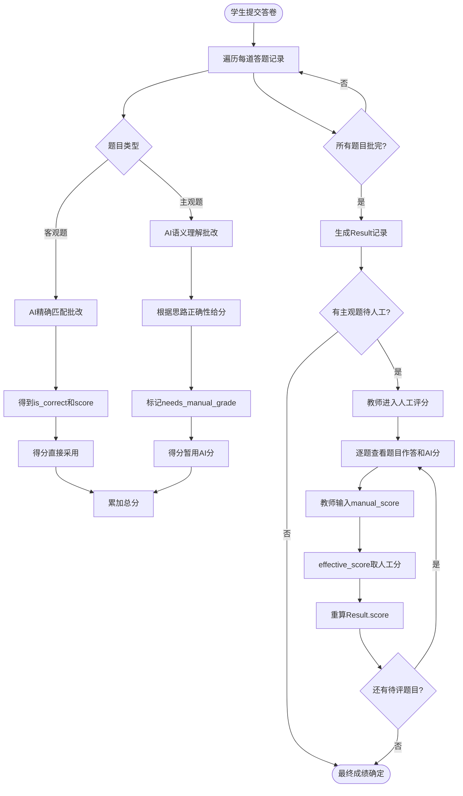
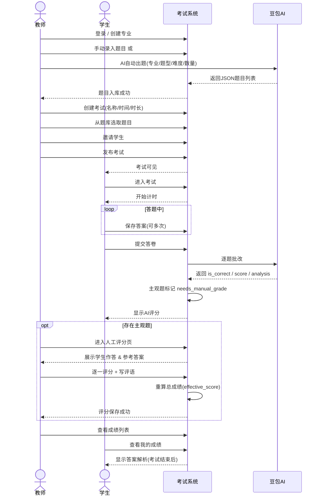
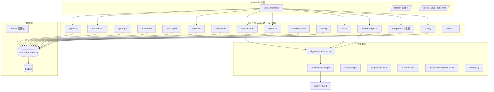

# 智汇学场 — 一体化智能学习平台 开发文档

> 版本: v5.11 | 最后更新: 2026-10-22

## 项目概述

基于 **Flask + Vue 3 + Socket.IO** 的前后端分离一体化智能学习平台，整合 **在线考试、答题竞赛、征集悬赏、自主学习、作业练习** 五大模块，集成火山引擎豆包大模型 API，提供 AI 智能出题、AI 自动批改、AI 智能答疑等核心 AI 能力。支持教师/学生双角色， subjective 题 AI 语义评分 + 教师人工复核。

v1.x–v3.x 演进历史（考试 → 竞赛 → 悬赏 → 安全加固 → 漏洞审计）见 `更新日志.md`。**v4.0** 是架构里程碑版本，完成以下变革：

- **架构切换至 Vue3 SPA**：剔除 Jinja2 模板、static/ 资源目录、Flask-Login（UserMixin 保留仅兼容 models）、9 个传统蓝图（auth/question_bank/exam/exam_execution/result/ai_service 等）。Flask 新增 SPA 托管层（`template_folder=None`, `static_folder=None`, `/assets/*` 长缓存 + 浏览器路由 catch-all 回退 `frontend/dist/index.html`），单端口部署前后端。
- **四个功能模块**：
  - **在线考试**（原核心）：题库管理（含公共题库跨教师共享）、AI 智能组卷、邀请码加入、防作弊切屏检测、自动/人工批改、成绩分析。
  - **答题竞赛**：1v1 实时 PK、限时积分赛、段位/赛季/勋章/战队竞技化体系。
  - **征集悬赏**：师生均可发布/投稿，采纳自动入库/回填解析；v4.2 升级社区化与治理：编辑/关闭/删除/撤回/改投、搜索分页、多档采纳、讨论区/投票、阶梯勋章、站内通知、过期自动治理、赏金钱包托管、定向悬赏、举报、相似题查重。
  - **自主学习**（v4.0 新增）：智能错题本（考试/练习自动收录）、自由刷题会话、学习计划追踪、每日学习报告、AI 智能答疑。
- **公共题库**：Question 新增 `creator_id`（FK→User）+ `is_public` 布尔字段；教师可切公开、跨教师查看/复用，仅创建者可编辑删除。
- **SPA 品牌重塑**：系统名「智汇学场」，首页 Home.vue（玻璃拟态 + Canvas 演示动画，每章带阴影/径向渐变/高光）、Portal.vue（4 模块入口卡）、登录/注册页全部同步。

v4.0 安全/API 增量：题库写接口创建者校验、考试级联删除（Exam→题目/学生/会话/成绩、Session→Answer）、考试移除学生/智能组卷 API 对齐、通知单条删除前端接入、ExamTake.vue 切屏检测前端接入、CompetitionManage.vue 题目级删除前端接入。

**v4.1** 在 v4.0 基线上完成「答题竞赛」竞技内核升级与「自主学习」闭环升级两大方向：

- **竞赛竞技内核升级（三批）**：对战等级分 Elo（跨赛季持久）、多轮系列赛（best_n/sum 结算总冠军）、对战回放时间轴、快速 PK 匹配、赛季分等级证书（金/银/铜/纪念）、邀请码门禁赛（班级化竞赛）、开赛提醒（后台调度幂等推送）；段位页新增积分/Elo 历史曲线与公开主页。
- **自主学习闭环升级**：知识点主数据 + 专业学习路径（节点/选课/进度）+ 学习资源 + 知识图谱；知识点掌握度（遗忘曲线衰减）+ 间隔复习队列（简化 SM-2）+ 学习打卡连击 + 个人知识笔记 + 节点小测/路径终测 + 路径结业证书 + 讨论答疑；新增「今日学习」聚合页与「我的知识」资产页。
- **首页「观看演示」重做**：VideoModal.vue Canvas 动画由 5 切片扩展为 7 切片（品牌开场 + 系统亮点 + 四大模块 + 闭环总结），DPR 高清、变量时长章节跳转、图标改本地 import Element Plus。
- **数据库迁移**：新增 0004 学习路径图谱 → 0010 竞赛运营共 7 版迁移（0004–0010），竞赛/学习新增 22 张表与若干扩展列。

**v4.2（本次更新）** 征集悬赏模块对标主流悬赏/众包平台完成社区化与治理升级（P0–P3 全量落地）：

- **P0 治理闭环**：悬赏编辑/主动关闭/删除、投稿修改（改投）/撤回；新投稿、采纳/拒绝、关闭/过期全链路站内通知（复用 notification 体系）。
- **P1 发现与激励**：广场搜索（标题/描述/标签）+ 分页 + 多维排序（最新/赏金/截止/热门）+ 专业/标签过滤；悬赏贡献榜（答疑之星/悬赏达人）；勋章由 1 枚扩至 5 枚阶梯（悬赏新星🪙/金牌答主🏅/悬赏翘楚🌟/悬赏达人📯/乐于分享🤝）。
- **P2 评审增强**：多档采纳（max_accepts 名额 + 每条中标实发 reward_share）；悬赏讨论区（评论增删）；投稿社区投票（幂等 toggle）；答案择优回填（可覆盖）；落选可选感谢积分。
- **P3 经济与安全治理**：赏金钱包托管账本（发布冻结→采纳释放→过期/取消退回，`BOUNTY_ESCROW` 开关默认关闭保持兼容）；定向悬赏（visibility=targeted 按用户白名单）；举报通道；题库相似题 Jaccard 查重软提示；序列化脱敏升级（匿名投稿隐身份、未采纳投稿答案仅发布者/本人可见）；过期悬赏由后台调度持久化 EXPIRED。
- **数据与接口**：新增 5 张表（bounty_comment/bounty_vote/bounty_report/bounty_wallet/bounty_txn）+ 两表加 10 列（迁移 0011 幂等）；API 由 9 端点扩至 23 端点；前端新增 BountyWallet/BountyLeaderboard 两页，4 个悬赏页全面对齐新能力；端到端冒烟 18/18 通过。

**v4.3** 考试模块完成考务升级（P0–P3），无新表、迁移 0012 对 5 张已有表幂等加列：

- **考务强化**：成绩统一发布门控（`results_published` 默认 1 保持兼容）、`max_attempts` 多轮次限考 + `score_strategy`（last/best）+ `grant_attempt` 补考授权、A/B 卷（`paper_mode=random` + `random_count` 抽题 + `option_map` 选项乱序）、多选判分策略 `multi_score_rule`（all_or_nothing/partial）、匿名阅卷 `anonymous_grading`、材料题（`question.material` + `material_group` 同组共材料）。
- **监考与成绩治理**：实时监考 `GET /exams/<id>/monitor`、成绩 Excel 导出 `GET /exams/<id>/results/export`、改分申诉闭环（学生 `POST /results/<id>/review` 发起 → 教师 `review_handle` 处理）、批改提效（聚类批注 + 同题批量给分）。
- **分析增强**：AI 试卷质检 `POST /exams/<id>/ai_inspect`、试题分析（得分率/区分度/干扰项有效性 `GET /exams/<id>/item_analysis`）。

**v4.4** 学习体验层升级（迁移 0013 新增 5 表 + 2 表加列）：

- **AI 学习助手**：会话/消息持久化（`ai_chat_conversation`/`ai_chat_message`）+ SSE 流式输出 `/learning/ai-chat/stream` + Ollama 降级自动提示。
- **个性化学习**：错题逐题 AI 归因（`wrong_answer_record.ai_analysis`）、专注计时（`focus_session` 番茄钟/正计时）、打卡心情与日志（`study_checkin` 加 `mood`/`content`）、自由学习笔记（`study_note` 分类/标签/置顶）、知识点即问即讲讲解卡（`explain_card`，可一键转笔记）、图片上传。

**v4.5** 学习社区升级（迁移 0014 新增 10 表 + 2 表加列），对标社区型学习平台采纳八项能力（保持积分制、不引入现金与 admin 角色）：

- **审核门禁**：竞赛/悬赏发布默认进入 `reviewing` 待教师互审（通过/驳回 + 原因，驳回自动退托管积分）；平台仅一名教师时自动通过。
- **赛事社区化**：赛事公告 + 资料包附件（上传/下载）；**作品型竞赛**（`competition_type=project`：上传作品包 → 教师评分 → 冠军积分结算发放）。
- **学习资产社区化**：个人资料库（`study_folder` 树形目录 + `study_material` 可公开）、5 类 AI 生成资料（思维导图/闪卡/总结/讲义/Quiz，mermaid 渲染）、探索广场（公开资料/收藏/举报治理）、关注体系（`user_follow` 互关即好友）与公开主页。
- **AI 成本治理**：调用日志 `ai_usage_log` + 每日配额 `ai_quota` + 教师治理面板 `AiGovernance.vue`；悬赏/竞赛历史一键归档 `archive`。

**v4.6** 统一文件上传：三模块共用一份扩展白名单与落盘工具 `utils/uploads.py`（迁移 0015 仅给 bounty_submission / study_note 两表加 `attachment_json` 列，无新表）：

- **全类型白名单**：文档 pdf/doc/docx/txt/md/ppt/pptx · 表格 xls/xlsx/**csv** · 压缩包 zip/rar/7z · 图片 png/jpg/jpeg/gif/webp · 视频 mp4/webm · 代码 py/java/c/cpp/js/ts/html/css/sql，≤50MB，不收可执行文件。
- **竞赛**：资料包/作品上传改用统一工具（新增可传 csv 表格）。
- **自主学习**：学习笔记新增附件端点 `/learning/attachments`（上传/下载/删除，单条笔记≤9 个）；笔记配图内嵌上传仍限图片 ≤5MB 不变。
- **征集悬赏**：投稿新增附件能力（待审状态可传/删，投稿人本人/发布者/教师可下载；序列化仅披露 ext/size 防匿名泄露）。

**v4.7** RBAC 门禁收敛 + 编程题 OJ 自动评测：

- **统一权限门禁（RBAC 第一步）**：新增 `utils/permissions.py`（`require_teacher`/`require_login`，返回 `(user, err)` 元组），全系统 38 处散点内联角色判断收敛到单一实现（文案/状态码/响应键逐处参数化，迁移前后响应完全等价）；资源级复合判断（creator/owner/visible_to）暂留视图内，待第二步权限矩阵化（触发条件：出现第 4 种角色或注册开放）。
- **编程题 OJ 自动评测**：新建 `oj/` 包（子进程执行器：静态危险模式拒绝 + 隔离解释器 `-I` + 临时目录 jail + 超时进程树强杀 + 输出截断），stdin/stdout 用例逐条判 AC/WA/TLE/RE/SE，按通过率折算得分；交卷链路与 AI 评分并列自动判分（有用例不送人工，无用例回落）；题库用例编辑 + 教师试跑 `POST /questions/<id>/oj_run`（限流 10/min）；迁移 0017（`question.test_cases` + `answer.oj_verdict`）。定位为**校内测验级防呆**，非竞技级防逃逸。

**v4.8** 统一账本 ledger：新建 `ledger/` 内核（`LedgerAccount`/`LedgerTxn` + `core.post` 唯一写入口），把赏金钱包（`bounty` 币种）与赛季竞技积分（`points` 币种）两套账收敛为同一记账引擎——逐笔流水 + 幂等键 + 守恒对账 `assert_conservation()`（Σdelta==balance），双币种语义分账防「充值刷段位」；旧 `bounty_wallet`/`bounty_txn` 读端物化由 ledger 派生，榜单/段位/钱包读端零改动；迁移 0018 搬存量 + 积分期初建账 + 旧表转 `*_legacy`。

**v4.9** HTTP 层 E2E 主动脉：`tests/test_http_e2e.py` 用真实 app（conftest 隔离至临时库）跑通认证链（含 v4.6.1 令牌吊销水位 `user.token_valid_at`）、CSRF 前置门、角色门禁，钱链（充值→托管→审核→采纳全链 + 账本守恒收尾）、分链（建卷→交卷→成绩往返）；为后续重构铺安全网。

**v4.10** 竞赛/PK 全链 E2E + 自由练习接入 OJ：赛事托管冻结/释放/驳回退回、PK 建房/应战/交卷/积分镜像、练习 OJ AC/WA/CE 全链覆盖；自由练习答题链路接入 OJ 自动评测（与考试判分一致，响应新增可选 `oj` 字段）。测试安全网扩至 7 条主动脉。

**v4.11** 数据科学竞赛（Kaggle 式作品赛，新 DS 赛道）：竞赛系统升级为「数据集 + 在线运行 + 自动指标评分 + 公私榜」的数据科学竞赛。新建 `dsci/` 包（`dataset`/`dataset_file`/`ds_submission`/`ds_notebook_run` 4 表 + `competition` 7 个 DS 列，迁移 0019）；仅用已装 numpy+pandas 手写 sklearn-free 指标（accuracy/f1_macro/rmse/mae/auc）+ 教师自定义 scorer 沙箱；沿用子进程 jail 但**刻意放开 `open()` 文件读写**（cwd 锁一次性临时目录、gold 隐藏答案永不进目录/不可下载）；提交 prediction.csv 按隐藏答案自动评分，公/私榜分离（`ds_public_ratio`），结算冠军按私榜分；复用 Competition 宿主（建赛/发布/审核/邀请门禁/赛季积分/ledger 冻结释放）与资金不变量零改动；前端引入 Monaco 编辑器（`CodeEditor.vue`）+ 学生工作台 `DsCompetition.vue` / 教师控制台 `DsManage.vue`。

**v5.0** 第五大业务模块「作业练习」：新建 `homework/` 包（models/services/routes，5 表迁移 0020，16 端点）。教师端发布/编辑/查看提交/批改/时效性管理，学生端经站内通知获题、作答、提交、查成绩。**题集式+开放式双形态**；**自动判分（客观题 `exam_engine.check_objective` + 编程题 OJ）+ 人工批改结合**（pending==0 驱动 graded 状态机）；时效由 `homework_expiry_tick` 调度（过期自动关闭 + 截止前未交提醒，reminded_at CAS 幂等）。设计原则**复用不侵入**：通知/上传/调度/建包均复用现有基础设施，作业不进 ledger（防刷分），零改动既有表。前端 4 视图 + `meta.module='homework'` 路由 + Layout 新分组/品牌名/通知跳转 + Portal 第 5 张模块卡。蓝图 20→21、ORM 表 77→82、调度任务 7→8。

**v5.1** 作业练习模块增强：截止时间由必填改为**可选**（`Homework.deadline` 改可空，NULL=不限期永不过期，迁移 0021 用 `batch_alter_table(recreate='always')` 重建表完成 SQLite NOT NULL→NULL），并新增 7 项能力（作业端点 16→24）：**及格线档位**（`pass_score`，统计及格率/优秀率、学生端及格标签）、**成绩统计**（`GET /homeworks/<id>/stats`）、**导出成绩 CSV**（`GET /homeworks/<id>/export`，UTF-8 BOM）、**催交**（`POST /homeworks/<id>/urge`，仅提醒未交学生走实时推送）、**复制作业**（`POST /homeworks/<id>/copy` 一键转草稿）、**随机抽题组卷**（`GET /homeworks/random_questions` 按专业/难度/类型抽题预填）、**教师参考资料附件**（`/homeworks/<id>/reference` 上传/删除/鉴权下载，`reference_json` 列）。无新表（仅加 2 列）、无新蓝图、无新调度任务；到期锁定/提前提醒对 NULL deadline 天然跳过；通知全部走 `create_notification` 自动继承全局实时推送。前端 `HomeworkManage.vue` 加截止开关/及格线/参考上传/随机抽题/「更多」下拉+统计弹窗，`HomeworkTake/Student.vue` 加不限期显示/参考下载/及格标签。

**v5.2** 作业 ↔ 学习闭环联动：作业正式接入自主学习体系，零新表/零迁移/零新端点。**错题自动收录**：`homework/services.py` 新增 `sync_learning_effects(hw, sub, scope)`，两段式挂载——提交/重交后处理自动判分题（scope='auto'）、首次转 GRADED 后处理人工判分题（scope='final'，两 scope 按 `needs_manual_grade` 划分互不重叠防双计）；判错标准为**得分率 <60% 才收录**（`WRONG_SYNC_RATIO=0.6`，未满分但 ≥60% 视为基本掌握不打扰），复用统一入口 `sync_wrong_from_answers`（`source_type='homework'` 幂等合并 wrong_count + ReviewItem 自动排队）。**知识点掌握度联动**：与考试同口径（客观 1/0、主观得分率）调 `update_mastery` EWMA 更新。**错题本答案门控**：`_source_still_reanswerable()` 判定来源仍可重答时（作业未批改完成/考试仍有剩余次数且未截止），错题列表隐藏 `correct_answer`/`ai_analysis`（响应带 `answer_hidden=true`）、AI 归因接口返回 403，防「看答案再重交」；作业+考试双来源统一在序列化层门控，异常时保守不门控。前端：错题本来源筛选/标签加「作业」、门控提示文案与归因按钮禁用、作业结果页加错题本入口链接。测试 165 全绿（+8 函数层用例 +1 HTTP E2E 链）。

**v5.3** 作业 AI 讲评与班级共性分析：新表 `homework_ai_review`（迁移 0022，`(homework_id, scope_key)` 唯一约束实现幂等覆盖，`scope_key` 取 `class` 或 `sub:<id>` 规避 SQLite NULL 唯一约束失效）+ 6 端点（班级讲评 GET/POST/发布、单份讲评 GET/POST）。**两层设计**：本地统计 `_class_stats()` 常驻可用（提交率/平均分/平均得分率/及格率 + 逐题得分率与客观题选项分布 + 薄弱题 top8 + 知识点聚合），AI 只负责文字解读，失败时 `_degraded_class_content()` 规则讲评兜底，不阻断教师。**发布门控**：班级讲评「生成 ≠ 发布」，教师手动发布后学生 `result` 才返回（撤回即时生效）；单份讲评仅本人且 `GRADED` 后可见，未批改生成返回 400。前端新增 `AiReviewContent.vue`（班级紫色/单份青色双版式 + 降级提示），教师批改页「班级 AI 讲评」弹窗（统计条/薄弱题清单/生成·发布·撤回）与批改抽屉「AI 个性化讲评」，学生作答页展示班级讲评与我的讲评两张卡片。测试 173 全绿（+7 函数层用例 +1 HTTP E2E 全链）。

**v5.4** 作业讨论区：新表 `homework_comment`（迁移 0023），支持作业级（`question_id=NULL`）与按题讨论、一层回复（二层以上扁平化到主楼）、`is_teacher` 发帖身份快照、`deleted_at` 软删除（保留楼层，内容替换「该评论已删除」）。参与者严格限定为创建教师 + 发布名单学生，非参与者 404。3 端点：列表（分页 + 按题过滤 + 楼层回复）、发帖/回复（1–2000 字，父楼归属与题目归属校验）、软删（作者或创建教师）。通知：学生发主楼通知教师、回复通知被回复人，与评论同事务提交。前端新增 `HomeworkDiscussion.vue`，学生作答页内嵌、教师批改页抽屉管理。

**v5.5** 生生互评：新表 `homework_peer_review`（迁移 0024，`UniqueConstraint(submission_id, reviewer_id)`），`score` 统一 0–100 百分制、`status=pending/submitted`。中成本方案闭环：教师 `distribute_peer_reviews()` 按份随机派单（默认 2 份、钳制 1–5、排除自评、重新分配清空 pending 保留 submitted、避开已评组合）；学生匿名详情（不含作者身份、正确答案、解析、OJ 用例）→ 打分评语提交；教师 `peer_review_summary()` 查看完成率/每份均分/评审人进度；被评学生仅在本人提交 `graded` 后经 `result.peer_review` 看到匿名均分与评语，未批改恒为 null。互评**不写入官方总分、不进 ledger、不发勋章**，仅作形成性参考。评审人可下载被评提交附件（attachment 鉴权扩展）。5 个新端点：分配、教师汇总、我的任务、详情、提交。前端新增 `PeerReviewCenter.vue`（待互评/已提交双 Tab），学生作业列表「互评任务」角标入口，教师批改页「互评管理」弹窗与匿名互评展示，学生成绩页匿名互评卡片。测试 179 全绿（+5 函数层用例 +1 HTTP E2E 全链）。

**v5.9** 深度生生互评 + 模板/系列前端交互补全（迁移 0027，无新表）：

- **多维度评分**：`PEER_REVIEW_DIMENSIONS` 四维（准确性 0.4 / 完整性 0.3 / 规范性 0.2 / 创造性 0.1），`compute_peer_final_score()` 按已填维度权重归一到 0–100；原始维度分落 `homework_peer_review.scores_json`，`score` 存加权结果（兼容旧单分提交）。
- **教师审核**：新增 `audit_status`（pending/accepted/rejected）+ `teacher_comment`/`audited_by`/`audited_at`，`audit_peer_review()` 仅 `submitted` 可审，采纳/驳回均通知评审人并记录意见。
- **加权分视图**：`peer_review_received()` 返回 `accepted_avg_score`/`weight`/`weighted_contribution`/`final_view_score = total_score + accepted_avg * weight`；**互评分本身不改官方 `total_score`、不直接入 ledger**（作业提交/质量积分按 v5.10 规则独立入账），学生端明确标注「总分视图（不改写官方总分）」。
- **截止与催办**：`Homework.peer_review_deadline` 截止后提交 400；`peer_review_deadline_tick` 在截止前 24h 仅催办 pending 评审人，`peer_review_reminded_at` CAS 幂等；教师可 `PUT .../peer_reviews/settings` 调整截止时间与权重（0–1）。
- **DailyTask 打通**：`distribute_peer_reviews` 为每位评审人建 `source='peer_review'` 的当日互评任务，提交互评时 `complete_peer_review_daily_task` 标记完成；迁移重建 `daily_task` 表放开 source 枚举。
- **模板抽题前端增强**：模板弹窗专业→课程→章节级联、难度分布开关（可视化占比条 + 至少 1 题校验）、`POST /homeworks/templates/preview` 抽题预览（题库可用量/抽中分布/题目清单）；列表加载骨架屏、空态、关键词筛选与分页。
- **系列时间轴**：`GET /homeworks/series/<id>` 驱动 `el-timeline` 展示每份计划时间与生成状态（已生成/已到时未生成/计划中）；列表进度改用 `el-progress`，生成/删除/停止均带行级 loading 与二次确认。
- **测试**：`tests/test_homework_social.py` 新增维度加权、审核采纳与加权视图、DailyTask 三组用例；pytest 196 全绿，`npm run build` 通过。

**v5.10** 作业 ↔ 错题本联动收口 + 作业积分入账（无迁移、无新表）：

- **小组作业联动修复**：新增 `learning_recipients(hw, sub)`，小组作业的错题收录与知识点掌握度按**全组成员**落地（原实现仅同步 `student_id`，即最后提交人）；个人作业行为不变。
- **来源回链**：`GET /learning/wrong-records` 增加 `source_title`（批量取作业标题，无 N+1），前端错题本对作业来源渲染「《作业标题》」并可跳回 `/homeworks/<id>/take`。
- **提交入账（最终提交触发）**：`award_homework_submit_points()` 在 `POST /homeworks/<id>/submit` 成功后发放 **10 积分**；草稿自动保存不触发，重交/反复提交不重复（幂等键 `homework-submit:{hw_id}:{student_id}`），小组作业全组成员各一份。
- **批改质量补发**：`award_homework_grade_bonus()` 在首次转 `graded`（人工 pending==0 或开放式整体给分）后，按得分率补发 `round(20 × 得分率)` 分，幂等键 `homework-grade:{hw_id}:{student_id}`，重批不重复。
- **账本口径**：统一走 `ledger.post(currency='points', kind='award', scope=当前赛季, ref_type='homework', ref_id=hw_id)`，并镜像 `UserPointsProfile.points` + `upsert_points_history`，与竞技积分同口径；互评加权分仍仅是展示视图，不参与入账。
- **测试**：新增小组全员错题/积分同步、提交积分幂等与档案镜像、质量补发按比例三组用例；E2E 作业全链断言改为「两次提交仅 1 笔 10 分 + 批改后 1 笔质量分」；pytest 199 全绿。

**v5.11** 作业批改提效与防抄（单一迁移 0028，全部加列、无新表/无新蓝图）：

- **迟交扣分**：`Homework.late_penalty_pct`（0–100）+ `HomeworkSubmission.score_before_penalty`；`apply_late_penalty()` 在题集式 pending==0 与开放式整体给分两处终态收口统一按百分比扣分（floor 0）；质量补发仍按**扣分前**得分率折算，避免迟交双重惩罚；`to_dict` 暴露原始分/扣分百分比/最终分。
- **匿名批改**：`Homework.blind_grading`；`blind_active()`/`blind_label()` 在未批完前将列表/批改详情的 `username` 脱敏为「匿名#N」且不下发真实 `student_id`（批改仍用 `sub_id`），全部批完或 `closed` 后自动还原。
- **同题批量给分**：新端点 `POST /homeworks/<id>/grade/batch`（30/minute）将某题统一分数/评语套用到多份待批提交，逐份 `recompute_total`、pending==0 转 GRADED（学习闭环与质量分首次触发幂等）；一键采纳 AI 建议为纯前端（`HomeworkGrade.vue` 已将 AI 逐题建议填入后走既有单份批改）。
- **分级多次提醒**：`remind_levels_json`（`[{minutes,label}]`）+ `reminded_json` 水位；`homework_expiry_tick` 逐档催交未交学生（各档只发一次）；为空时回落旧单档 `remind_before`。
- **乱序防抄**：`shuffle_questions`/`shuffle_options` + `assigned_order_json`/`option_map_json`；`ensure_submission_paper()` 首次 take 生成稳定题序/选项乱序（复用考试 `build_session_paper` 算法），采用「存规范化字母、仅显示层映射」，`_canonical_choice_answer()` 判分前反归一，与不乱基准分完全一致。
- **测试**：新增 `tests/test_homework_v5_11.py`（15 服务层用例）+ 3 个 HTTP E2E；pytest 199→217 全绿，`npm run build` 通过，真实库迁移至 0028。

### 核心特性

- 🎯 **前后端分离 + SPA 托管**: Vue 3 SPA + RESTful API；Flask 直接托管 `frontend/dist`（`template_folder=None` / `static_folder=None`，`/assets/*` 长缓存 + 浏览器路由 catch-all 回退 `index.html`），单端口部署
- 🤖 **AI 集成**: 火山方舟 API (出题/批改/解析/答疑),支持 8 种题型
- 🏛 **公共题库** (v4.0): Question 新增 `creator_id` + `is_public`；跨教师共享、仅创建者可编辑删除；支持 `scope=all/mine/public` 筛选
- 📝 **智能组卷**: `POST /api/exams/<id>/smart_composition` 按 major/type/difficulty/source_filter 抽题，调用后自动 invalidate_exam_cache；**v4.3 考务升级**：A/B 卷（`paper_mode=random` 随机抽题 + 选项乱序 `option_map`）、多选判分策略（全对给分/漏选按比例）、材料题（`material` + `material_group`）、匿名阅卷、成绩统一发布门控（`results_published`）
- 🔁 **多轮次考试** (v4.3): `max_attempts` 限考次数 + `score_strategy`（last/best 计分策略）+ `extra_attempts` 补考授权（`POST /exams/<id>/grant_attempt`）；**实时监考** `GET /exams/<id>/monitor`、**成绩 Excel 导出**、**改分申诉闭环**（学生发起 `/results/<id>/review` → 教师 `/results/<id>/review_handle`）、批改提效（聚类批注/同题批量给分）、AI 试卷质检、试题分析（得分率/区分度/干扰项）
- 🔒 **防作弊**: 切屏检测上报（3次服务端强制交卷 + 前端 `visibilitychange`/`blur` 监听）、超时自动交卷、考试自动结束
- 📊 **完整考试生命周期**: 草稿 → 发布 → 进行中 → 已结束；邀请码 `.upper().strip()` 幂等加入
- 📝 **人工评分**: 主观题 AI 初评 + 教师复核,自动重算总成绩
- 📦 **批量导入导出**: 支持 Excel/CSV 格式题库导入导出
- **双重认证**: JWT Token (API 端，统一 `verify_token()` 工具函数)；已移除 Flask-Login（UserMixin 保留仅兼容 models）
- ⚡ **实时通信**: Socket.IO 推送竞赛榜单、PK 对战、个人段位/积分/勋章变化、学习通知
- 🏆 **竞技体系** (v4.1 强化): 6 档段位 (青铜→王者)、自然月赛季惰性归档、8+ 种勋章、固定战队；**对战等级分 Elo**（跨赛季持久）、**多轮系列赛**（sum/best_n 结算）、**对战回放**、**赛季分等级证书**（金/银/铜/纪念）、**邀请码门禁赛**、**开赛提醒**；**v4.5** 作品型竞赛（`competition_type=project` 上传作品→教师评审→冠军积分结算）、赛事公告/资料包、发布审核门禁；**v4.11** 数据科学赛赛道（`competition_type=ds`）
- 📊 **数据科学竞赛** (v4.11): Kaggle 式作品赛——教师上传数据集（train/test/sample 可下载 + gold 隐藏答案不可下载），学生在线 Monaco 单脚本书写→沙箱运行→产出 submission.csv 提交；平台按隐藏 gold 自动评分，预置 sklearn-free 指标（accuracy/f1_macro/rmse/mae/auc）+ 教师自定义 scorer；**公/私榜分离**（`ds_public_ratio` 默认 0.3，私榜分结束前仅教师可见），结算冠军按私榜分；每日提交限额 `ds_daily_limit`；复用 Competition 宿主与 ledger 资金不变量
- 🧠 **学情画像**: 考试+竞赛+自学数据聚合,五维雷达图 (准确率/速度/竞技力/稳定度/活跃度)
- 🪙 **征集悬赏** (v4.2 社区化升级): 师生同权发布题目/答案征集，投稿-审核-采纳闭环；题目采纳自动入题库、答案采纳回填解析；**多档采纳**（名额+每条实发积分）、**讨论区/社区投票**、**编辑/关闭/删除/撤回/改投**治理闭环；**搜索分页排序**与**贡献榜**；5 枚阶梯勋章+落选感谢积分+站内通知；**赏金钱包托管**（发布冻结/采纳释放/过期退回，开关默认关）、**定向悬赏**、**举报**、**相似题查重提示**、匿名/答案序列化脱敏；**v4.5** 发布审核门禁（教师互审/唯一教师自动通过/驳回退托管）与历史归档
- 📝 **作业练习** (v5.0 引入 / v5.1 增强 / v5.2 学习闭环 / v5.3 AI 讲评 / v5.4 讨论区 / v5.5 生生互评): 第五大业务模块 `homework/`（8 表，无侵入既有账本）。**题集式+开放式双形态**；自动判分（客观题 `check_objective` + 编程题 OJ）+ 人工批改结合（pending==0 驱动 graded 状态机）；时效由 `homework_expiry_tick` 调度。**v5.1**：截止时间可选（NULL=不限期永不过期）、及格线档位与成绩统计、导出 CSV、催交未交学生、复制作业转草稿、随机抽题组卷、教师参考资料附件（上传/删除/鉴权下载）；学生经实时通知获题/催交（共 30 端点）。**v5.2**：作业→错题本/知识点掌握度联动（`sync_learning_effects` 两段式挂载，得分率 <60% 收录，见 4.17 错题本答案门控）。**v5.3**：班级 AI 讲评（本地统计 + AI 解读 + 降级兜底，教师发布后学生可见）与单份 AI 个性化讲评（批改后本人可见）；**v5.4** 作业讨论区（作业级/按题、一层回复、软删除、站内通知，参与者=创建教师+名单学生）；**v5.5** 生生互评（教师按份分配、匿名打分评语、完成率与均分汇总，批改后学生可见匿名互评，仅作形成性参考）；**v5.9** 深度互评（四维加权评分、教师审核采纳/驳回、互评截止与催办、加权分独立视图、互评接入每日任务）；**v5.8** 作业模板与系列化（模板抽题规则+默认设置+默认名单，系列按间隔自动生成发布，学生「本周作业」视图）
- 📖 **自主学习** (v4.0 引入 / v4.1 闭环升级): 智能错题本（考试/练习自动收录 WrongAnswerRecord，幂等累加 wrong_count）、自由刷题 PracticeSession（预存 PracticeAnswer 供刷新恢复）、学习计划 StudyPlan + 任务清单 StudyPlanTask（暂停/恢复/进度追踪）、每日学习报告 StudyLog、AI 智能答疑；**v4.1 新增** 知识点主数据 KnowledgePoint + 专业学习路径 LearningPath/LearningPathNode（选课 UserPathEnrollment + 进度 UserNodeProgress）+ 学习资源 LearningResource + 知识图谱、知识点掌握度 KnowledgeMastery（遗忘曲线衰减）、间隔复习 ReviewItem（简化 SM-2）、学习打卡 StudyCheckin（连击天数）、个人笔记 UserKpNote、节点小测/路径终测 QuizAttempt、路径结业证书 PathCertificate、讨论答疑；新增「今日学习」「我的知识」聚合页
- 🔐 **错题本答案门控** (v5.2): 来源仍可重答时（作业未批改完成/考试仍有剩余次数且未截止），错题列表隐藏 `correct_answer`/`ai_analysis`（响应带 `answer_hidden=true`）、AI 归因接口 403，防「看答案再重交」；`_source_still_reanswerable()` 作业+考试双来源统一判定，异常时保守不门控
- 🧾 **作业 AI 讲评** (v5.3): 班级共性分析 = 本地统计聚合（提交率/平均得分率/及格率/逐题得分率与选项分布/薄弱题 top8/知识点）+ AI 教学解读，AI 失败自动降级规则讲评；教师手动发布后学生才可见、撤回即时生效；单份个性化讲评（亮点/改进/下一步）仅本人批改后可见；`homework_ai_review` 幂等覆盖存储
- 💬 **作业讨论区** (v5.4): 作业级/按题讨论 + 一层回复 + 软删除 + 站内通知；参与者=创建教师+名单学生；教师可管理任意楼层，`is_teacher` 身份快照
- 🤝 **生生互评** (v5.5 / v5.9 深度互评): 教师按份随机派单（默认 2 份、排除自评、重新分配保留已提交）；学生匿名打分评语；教师查看完成率/每份均分/评审人进度；批改后学生匿名可见互评结果；互评不改官方总分、不进 ledger，仅形成性参考。**v5.9**：准确性/完整性/规范性/创造性四维加权评分（权重 0.4/0.3/0.2/0.1，已填维度归一）、教师采纳/驳回审核（意见对评审人可见）、互评截止时间 + 截止前 24h 催办（CAS 幂等）、`accepted_avg × peer_review_weight` 生成独立 `weighted_contribution` 与 `final_view_score`（官方 `total_score` 不变）、互评任务接入 `DailyTask`（source=peer_review，提交即完成打卡）
- 🔍 **作业反抄袭** (v5.6): 复用 `oj/plagiarism.py` Jaccard shingle 查重；开放式文字走 `compare_text_submissions`（中文按字符 k-gram，默认 k=4、阈值 0.7、<20 字跳过），题集式编程题走 `compare_submissions`（token 化 shingle）；教师批改页「查重」弹窗按阈值列出相似对（含进度条）；`GET /homeworks/<id>/plagiarism?threshold=0.7`（教师权限，限流 20/min）
- 👥 **小组作业** (v5.7): `Homework.is_group` 布尔，发布时教师可选「小组作业」；新建 `HomeworkGroup`/`HomeworkGroupMember`（组+组员，跨组学生不可重复）；草稿态可编辑小组名单，发布时校验至少一组；组内共享一份提交（`HomeworkSubmission.group_id`，唯一约束保留 `(homework_id, student_id)`，`student_id` 记录最后提交人），任一组员提交全组得分；批改通知推送全组成员
- 📋 **作业模板与系列化** (v5.8): 新建 `HomeworkTemplate`（config_json 含 filters/count/distribution/default_score、settings_json 含 allow_late/allow_resubmit/remind_before/pass_score/deadline_hours、roster_json 名单）；新建 `HomeworkSeries`（template_id/start_at/interval_hours/count/generated_count/status，planned_at(n) 计算第 n 份发布时间）；`Homework.series_id` 关联系列；服务层 `_pick_questions_by_template` 按 filters（专业/课程/章节/难度/题型）抽题，`generate_homework_from_template` 一键生成草稿（系列时标题带序号）；调度器 `homework_series_tick` 扫描 ACTIVE 系列，到期逐份生成并发布、建 DailyTask（`_create_daily_tasks_for_homework`，幂等按 title 查重）、通知，全完成置 COMPLETED；学生提交时 `complete_homework_daily_task` 按标题匹配当日 DailyTask 标记 done（与每日任务/学习打卡打通）；教师端模板 CRUD + 从模板生成、系列 CRUD + 启动/立即生成/停止；学生端 GET `/homeworks/weekly` 聚合本周一至下周一已发布作业清单
- 🤖 **AI 学习助手** (v4.4): 会话/消息持久化（`ai_chat_conversation`/`ai_chat_message`）+ **SSE 流式输出**（`/learning/ai-chat/stream`）+ Ollama 降级自动提示；错题逐题 **AI 归因**；**专注计时**（`focus_session` 番茄钟/正计时 + 统计）；打卡心情与当日总结；**自由学习笔记**（`study_note` 分类/标签/置顶）；知识点**即问即讲**讲解卡（`explain_card` 一键转笔记）
- 🗂 **统一文件上传** (v4.6): 竞赛/学习/悬赏三模块共用白名单（文档/表格含 csv/压缩包/图片/视频/代码，≤50MB，`utils/uploads.py`）；题库媒体上传另限图片/视频；表格导入 `/questions/import` 支持 csv/xlsx/xls/doc/docx
- 💻 **OJ 自动评测** (v4.7): 编程题 stdin/stdout 用例逐条判 AC/WA/TLE/RE/SE（`oj/` 包子进程沙箱：静态危险模式拒绝 + 隔离解释器 `-I` + 临时目录 jail + 超时强杀 + 输出截断），交卷/自由练习按通过率自动判分，与 AI/人工评分并列（无用例回落）；题库用例编辑 + 教师试跑
- ⚖️ **统一账本** (v4.8): `ledger/` 内核统一赏金（bounty）与赛季竞技积分（points）两套账，`post` 唯一写入口 + 逐笔流水 + 幂等键 + 守恒对账 `assert_conservation()`（Σdelta==balance），双币种语义分账防「充值刷段位」
- 🚪 **统一权限门禁** (v4.7): `utils/permissions.py` `require_teacher`/`require_login` 单源实现，38 处散点角色判断收敛；**令牌吊销水位**（v4.6.1 `user.token_valid_at`，登出后旧 JWT 失效）
- 🌐 **学习社区** (v4.5): **个人资料库**（`study_folder` 树形目录 + `study_material` 可公开资料）；**5 类 AI 生成资料**（思维导图/闪卡/总结/讲义/Quiz，mermaid 图渲染）；**探索广场**（公开资料浏览/收藏 `material_favorite`/举报 `material_report` 教师核实下架）；**关注体系**（`user_follow` 互关即好友 + 公开主页 `/learning/users/<id>/profile`）；**AI 成本治理**（`ai_usage_log` 调用日志 + `ai_quota` 每日配额 + 教师治理面板）
- 🌐 **时区统一**: 全系统 UTC 存储 + Asia/Shanghai 展示，UTCDateTime 自定义列类型
- ⏰ **后台调度线程**: 过期考试结束/竞赛结算/赛季归档/开赛提醒/学习日巡查/悬赏过期治理由后台 daemon 线程周期执行，不阻塞请求
- 🛡 **安全加固**: API/页面错误响应分离、CSRF 智能豁免（Bearer 请求自动跳过）、AI 评分 clamp；v3.4 专项：全接口 JWT 鉴权（题库/专业/课程写接口教师专属、通知改 JWT 身份防 IDOR）、学生题库答案/解析脱敏、日志上报鉴权+内容净化、人工评分/答题/交卷归属与状态校验、邀请码按角色隔离、异常详情不下发、上传 50MB 限制 + `nosniff` 安全头；v3.5 专项：全项目 162 端点 IDOR/鉴权复审——考试题目接口（含答案）仅创建教师可访问且鉴权先于缓存、悬赏详情题库题 answer/analysis 仅教师可见+自带快照 answer 仅发布者可见、成绩详情答案/解析考试结束后才对学生公布（`answers_released` 标志）
- 🚀 **生产部署就绪 (v3.3)**: 调试模式/监听地址/CORS 全部环境变量化；生产默认 waitress WSGI 服务器（不开 Werkzeug 调试器）；SECRET_KEY 缺失或为开发默认值时**启动即拒绝**（fail-fast）；CORS 生产默认不开放跨域源
- ⚙️ **性能与健壮性 (v3.3)**: 过期考试收卷按考试独立事务（单考失败不影响整批、缩短 SQLite 写锁持有）+ 批量预载消除 N+1；AI 请求代理改为请求级参数（无全局环境变量副作用）；启动数据修正改 SQL 端过滤（稳态 0 行扫描）
- 📝 **日志健壮性**: SafeRotatingFileHandler 轮转失败安全降级（Windows 占用不崩）、高频请求访问日志静默、Alembic fileConfig 不摧毁应用日志配置

---

## 技术架构

### 后端技术栈

| 分类 | 技术 | 说明 |
|---|---|---|
| Web 框架 | Flask 3.1.x | 轻量级 Python Web 框架 |
| 数据库 | SQLite 3 | 开发环境,`instance/exam_system.db` (instance 目录) |
| ORM | Flask-SQLAlchemy 3.1.x | SQLAlchemy 2.0 语法 (`db.session.get()`) |
| 数据库迁移 | Flask-Migrate 4.1.x | Alembic 迁移链 (0001 基线 → 0022 作业 AI 讲评，共 22 版；0004 学习路径图谱 / 0005 计划任务 / 0006 路径计划字段 / 0007 学习闭环 / 0008 任务截止 / 0009 竞赛竞技场 / 0010 竞赛运营列 / 0011 悬赏社区化列 / 0012 考试考务升级列 / 0013 学习体验新表 / 0014 学习社区新表 / 0015 统一上传附件列 / 0016 令牌吊销水位 user.token_valid_at / 0017 OJ 用例 question.test_cases + answer.oj_verdict / 0018 统一账本 ledger_account+ledger_txn 搬存量旧表转 *_legacy / 0019 数据科学竞赛 4 表 + competition DS 列 / 0020 作业练习 5 表 / 0021 作业 deadline 改可空 + pass_score/reference_json 列 / 0022 作业 AI 讲评 homework_ai_review 表) |
| 时区处理 | UTCDateTime (自定义 TypeDecorator) | 全系统 UTC 存储 + Asia/Shanghai 展示 |
| 实时通信 | Flask-SocketIO 5.6.x | 竞赛榜单/PK 对战/个人段位推送 (async_mode=threading,无需 Redis) |
| Socket 协议 | python-socketio 5.16.x + simple-websocket | 客户端传输层 |
| 生产 WSGI 服务器 | waitress 3.0.x (v3.3) | 生产模式（`FLASK_DEBUG=false`）托管，纯 Python 跨平台；开发模式仍用 Werkzeug |
| 模板引擎 | — | 已全面接入 Vue3 SPA，不再使用服务端模板渲染 |
| 用户认证 | Flask-Bcrypt + PyJWT | 密码哈希 + JWT Token 认证 (统一 `verify_token()` 工具函数)。Flask-Login 已移除（UserMixin 保留仅兼容 models） |
| AI 服务 | 火山引擎方舟 API | 豆包大模型 (出题/批改/解析/答疑) |
| CORS | Flask-CORS | 跨域支持 (Vue 前端) |
| 配置管理 | python-dotenv | `.env` 环境变量 |
| Excel/Word 处理 | openpyxl + python-docx | 题库 Excel/Word 导入导出 |
| 二维码 | qrcode + pillow | 考试/竞赛邀请码 QR 码生成 |
| 缓存层 | Redis (可选) | 高性能缓存,提升 API 响应速度 |
| 安全层 | Flask-Limiter + Flask-WTF | Rate Limiting + CSRF 智能防护 |
| 科学计算 | numpy 2.x + pandas 3.x | 数据科学竞赛指标计算（accuracy/f1_macro/rmse/mae/auc，sklearn-free 手写，v4.11；`dsci/` 包硬依赖，已写入 requirements.txt）|
| 代码沙箱 | subprocess (`sys.executable -I`) | OJ 编程题评测与 DS 在线运行（v4.7/v4.11）：静态危险模式拒绝 + 隔离解释器 + 临时目录 jail + 超时进程树强杀 + 输出截断（校内防呆级，非防逃逸）|
| 后台调度 | threading daemon | 过期考试结束/竞赛结算/赛季归档/开赛提醒/学习闭环日tick (60s 周期) |
| 静态资源 | Vue3 SPA 构建产物 | `template_folder=None`, `static_folder=None`；Flask 托管 `frontend/dist`（`/assets/*` 长缓存 + 浏览器路由 catch-all 回退 index.html） |

### 前端技术栈

| 分类 | 技术 | 说明 |
|---|---|---|
| 框架 | Vue 3 + Vite | 组合式 API,现代构建工具 |
| UI 组件 | Element Plus | 响应式组件库 |
| 状态管理 | Pinia | 轻量级状态管理 |
| 路由 | Vue Router | 前端路由 |
| HTTP 客户端 | Axios | RESTful API 调用 |
| 实时通信 | socket.io-client | Socket.IO 客户端 (榜单/PK/段位推送) |
| 图表 | vue-chartjs + chart.js | 学情画像五维雷达图 |
| 数学公式 | KaTeX (+ MathJax) | LaTeX 公式渲染 (npm 集成) |
| 图表渲染 | mermaid + cytoscape + gsap | AI 思维导图/流程图渲染 (v4.5)、知识图谱、动画 |
| 代码编辑器 | monaco-editor ^0.45 | VS Code 同源编辑器，DS 数据科学赛在线编写运行（v4.11）；`?worker` 打入独立懒加载 chunk，不进主包 |
| CSS | Tailwind CSS | 原子化 CSS 框架 |

### 安全层设计

#### 架构示意图

```
┌─────────────────────────────────────────────────────────────────────────┐
│                           前端请求层                                    │
│   Vue 3 SPA ──► HTTP 请求                                        │
│                      │                                                 │
│                      ▼                                                 │
│              ┌──────────────┐                                          │
│              │ CSRF Token   │  请求头: X-CSRF-TOKEN                     │
│              │ 获取与携带    │                                          │
│              └──────┬───────┘                                          │
└─────────────────────┼───────────────────────────────────────────────────┘
                      ▼
┌─────────────────────────────────────────────────────────────────────────┐
│                           Rate Limiting 层                             │
│  ┌─────────────────────────────────────────────────────────────────┐   │
│  │  请求来源识别 (IP/User ID)                                       │   │
│  │         │                                                       │   │
│  │         ▼                                                       │   │
│  │  ┌─────────────┐    ┌─────────────┐    ┌─────────────┐        │   │
│  │  │ 登录/注册    │    │ AI出题      │    │ 考试提交    │        │   │
│  │  │ 5次/分钟     │    │ 3次/分钟     │    │ 1次/30秒    │        │   │
│  │  └──────┬──────┘    └──────┬──────┘    └──────┬──────┘        │   │
│  │         │                 │                 │                 │   │
│  │         ▼                 ▼                 ▼                 │   │
│  │  ┌─────────────┐    ┌─────────────┐    ┌─────────────┐        │   │
│  │  │ 题目查询    │    │ 成绩查询    │    │ 数据写入    │        │   │
│  │  │ 60次/分钟   │    │ 30次/分钟   │    │ 20次/分钟   │        │   │
│  │  └─────────────┘    └─────────────┘    └─────────────┘        │   │
│  │                          │                                     │   │
│  │                          ▼                                     │   │
│  │              ┌─────────────────────┐                           │   │
│  │              │  超限处理           │  返回 429 Too Many Requests│   │
│  │              │  Retry-After 头     │  X-RateLimit-* 头         │   │
│  │              └─────────────────────┘                           │   │
│  └─────────────────────────────┬─────────────────────────────────┘   │
│                                │                                     │
│                                ▼                                     │
└────────────────────────────────┼──────────────────────────────────────┘
                                 ▼
┌─────────────────────────────────────────────────────────────────────────┐
│                           CSRF 防护层                                  │
│  ┌─────────────────────────────────────────────────────────────────┐   │
│  │  1. Cookie 设置 CSRF Token（HttpOnly, SameSite=Strict）         │   │
│  │  2. 请求头携带 X-CSRF-TOKEN                                     │   │
│  │  3. 服务器验证 Token 一致性                                      │   │
│  │         │                                                       │   │
│  │    ┌────┴────┐                                                  │   │
│  │    ▼         ▼                                                  │   │
│  │  一致     不一致                                                 │   │
│  │    │         │                                                  │   │
│  │    ▼         ▼                                                  │   │
│  │  放行    返回 403                                                │   │
│  └─────────────────────────────────────────────────────────────────┘   │
└─────────────────────────────────────┬───────────────────────────────────┘
                                     │
                                     ▼
                           API 路由处理
                           (正常业务逻辑)
```

#### 安全层技术详解

##### 1. 速率限制模块 (`utils/security.py`)

| 组件 | 说明 | 关键配置 |
|---|---|---|
| **Limiter 实例** | Flask-Limiter 核心对象，管理所有限流规则 | `storage_uri`, `default_limits`, `headers_enabled` |
| **限流策略** | 按接口类型分组的限流规则 | `RateLimitConfig` 类 |
| **来源识别** | 默认使用客户端 IP，支持自定义 key 函数 | `get_remote_address` |
| **响应头** | 返回限流状态信息 | `X-RateLimit-Limit`, `X-RateLimit-Remaining`, `Retry-After` |

##### 2. 限流策略配置

| 策略名称 | 规则 | 适用接口 | 说明 |
|---|---|---|---|
| `AUTH` | 5次/分钟 | 登录、注册 | 防暴力破解 |
| `AI_GENERATE` | 3次/分钟 | AI出题 | 控制 API 费用 |
| `QUESTION_QUERY` | 60次/分钟 | 题目列表查询 | 常规查询 |
| `EXAM_SUBMIT` | 1次/30秒 | 考试提交 | 防止重复提交 |
| `RESULT_QUERY` | 30次/分钟 | 成绩分析查询 | 计算密集型 |
| `DATA_WRITE` | 20次/分钟 | 创建考试等写入操作 | 防滥用 |
| `DEFAULT` | 60次/分钟 | 其他未配置接口 | 兜底策略 |

##### 3. CSRF 防护机制

**Vue3 前端工作流程**：
```
1. 应用启动时调用 /api/csrf-token 获取 Token
2. 服务器生成 Token 并存入 Cookie（HttpOnly, SameSite=Strict）
3. 返回 Token 给前端，前端存入内存
4. 每次 axios 请求自动携带 X-CSRF-TOKEN 请求头
5. 服务器验证请求头 Token 与 Cookie 中 Token 是否一致
6. 一致则放行，不一致返回 403
```

**防护原理**：
- 恶意网站无法读取用户浏览器中的 CSRF Token Cookie（HttpOnly）
- 恶意网站无法在跨域请求中携带自定义请求头（浏览器同源策略）
- 恶意网站无法构造包含有效 Token 的表单提交
- 因此恶意网站无法构造有效的 CSRF 请求

**豁免规则**（`utils/security.py::_smart_csrf_check`）：
- **Bearer token (JWT) 请求自动豁免**：Vue 前端 API 请求携带 `Authorization: Bearer` 头，不依赖 Cookie 会话，天然不受 CSRF 威胁
- **认证前公开接口豁免**：`/api/login`、`/api/register`、`/api/csrf-token`（无会话可保护）
- **日志上报接口豁免**：`/api/logs`、`/api/logs/vue`——两接口视图内自行 `verify_token()` 校验（v3.4 起未登录 401），豁免 CSRF 是为了让 401 能正确返回而非被 CSRF 拦截
- 其余 Cookie 请求一律强制校验

**前端覆盖范围**：
| 前端类型 | 文件数量 | CSRF 防护方式 |
|---|---|---|
| Vue3 (axios) | 全部 | X-CSRF-TOKEN 请求头 |

##### 4. 前端集成 (`frontend/src/utils/request.js`)

| 功能 | 实现方式 |
|---|---|
| **Token 获取** | 应用启动时自动调用 `/api/csrf-token` |
| **Token 携带** | 请求拦截器自动添加 `X-CSRF-TOKEN` 头 |
| **Token 刷新** | 403 响应时自动重新获取 Token |
| **限流提示** | 429 响应时显示"请求过于频繁"提示 |
| **认证失效** | 401 响应时清除本地存储并跳转首页 |

##### 5. 安全配置

**环境变量配置**（`.env` 文件，v3.3 起部署相关配置全部环境变量化）：

```bash
# ── 运行模式（v3.3）──
FLASK_DEBUG=true               # 开发 true；生产必须 false 或不设（默认 false）
FLASK_HOST=127.0.0.1           # 监听地址；局域网/外网访问设 0.0.0.0
FLASK_PORT=5000

# ── 密钥 ──
# 生产必填强随机值：python -c "import secrets;print(secrets.token_hex(32))"
# 生产模式下缺失或仍为开发默认值 dev-secret-key-change-in-production 时，应用启动即 RuntimeError 拒绝运行
SECRET_KEY=...
WTF_CSRF_SECRET_KEY=your-csrf-secret-key   # 缺省回落 SECRET_KEY
WTF_CSRF_TIME_LIMIT=3600

# ── 跨域白名单（HTTP API 与 Socket.IO 共用，v3.3）──
# 逗号分隔；显式配置优先。不配置时：开发模式预置 localhost:5173-5176/5000 等本地源，
# 生产模式默认为空（不开放任何跨域源，同源访问不受影响）
CORS_ORIGINS=https://your-frontend.example.com

# ── 速率限制 ──
RATE_LIMIT_STORAGE_URI=memory://
RATE_LIMIT_DEFAULT=60 per minute
RATE_LIMIT_HEADERS_ENABLED=True
```

**生产环境建议**：

| 配置项 | 开发环境 | 生产环境 |
|---|---|---|
| `FLASK_DEBUG` | `true` | **必须 false**（否则启用 Werkzeug 调试器，存在远程代码执行风险） |
| `SECRET_KEY` | 缺省回落开发默认值 | **必填强随机值**（缺失/默认值启动即报错） |
| `CORS_ORIGINS` | 不配置（预置 localhost 源） | **显式设为前端域名**（默认空，不配置则跨域请求被拒） |
| `FLASK_HOST` | `127.0.0.1` | 需外网访问时 `0.0.0.0` |
| WSGI 服务器 | Werkzeug（`socketio.run`，含 WebSocket） | **waitress**（自动启用，16 线程；Socket.IO 自动降级 HTTP 长轮询） |
| `RATE_LIMIT_STORAGE_URI` | `memory://` | `redis://localhost:6379/1` |
| `CSRF_ENABLED` | `True` | `True` |

> **生产启动行为**：`FLASK_DEBUG=false` 时 `app.py` 不再使用 Werkzeug，改由 `waitress.serve(app, threads=16, channel_timeout=120)` 提供服务；未安装 waitress 会给出 `pip install waitress` 明确提示。waitress 不支持 WebSocket 升级，Socket.IO 客户端自动回退 HTTP 长轮询（前端本有轮询兜底）；如需原生 WebSocket，可在 Linux 上用 gunicorn + eventlet/gevent worker。

##### 6. 安全提升效果

| 安全威胁 | 无防护 | 有防护 |
|---|---|---|
| **暴力破解登录** | 可无限次尝试密码 | 5次/分钟限制，触发封禁 |
| **AI API 滥用** | 费用无限消耗 | 3次/分钟限制，控制成本 |
| **考试作弊** | 可重复提交 | 1次/30秒限制 |
| **CSRF 攻击** | 可冒充用户操作 | Token 验证，攻击失败 |
| **API 资源耗尽** | 可恶意刷接口 | 自动限流，保障服务 |
| **越权操作**（非教师改数据） | 各视图内联判断散落易漏 | **RBAC 统一门禁** `utils/permissions.py`（v4.7）：`require_teacher`/`require_login` 单源 38 处收敛，鉴权先于业务 |
| **令牌盗用**（登出后旧 JWT 仍可用） | JWT 无状态至自然过期 | **吊销水位** `user.token_valid_at`（v4.6.1）：登出置为当前 UTC，早于该时刻签发的令牌 `verify_token` 一律失效 |
| **恶意代码执行**（OJ/DS 在线运行） | 直接 eval 用户代码可 RCE | **子进程沙箱**（v4.7/v4.11）：静态危险模式拒绝 + 隔离解释器 `-I` + 临时目录 jail + 超时强杀 + 输出截断 + env 白名单（校内防呆级，非防逃逸，登记风险台账 #9/#12） |

### 缓存层设计

#### 架构示意图

```
┌─────────────────────────────────────────────────────────────────────────┐
│                           前端请求层                                    │
│   Vue 3 SPA ──► HTTP 请求 ──► Flask API                            │
└─────────────────────────────────────────────────────────────────────────┘
                                    │
                                    ▼
┌─────────────────────────────────────────────────────────────────────────┐
│                           API 路由层                                   │
│   api/question_routes.py                                               │
│   api/major_routes.py                                                  │
│   api/course_routes.py                                                 │
│   api/chapter_routes.py                                                │
│   api/exam_routes.py                                                   │
│   api/result_routes.py                                                 │
└─────────────────────────────────────────────────────────────────────────┘
                                    │
                                    ▼
┌─────────────────────────────────────────────────────────────────────────┐
│                           Redis 缓存层                                  │
│  ┌─────────────────────────────────────────────────────────────────┐   │
│  │                    缓存命中判断                                    │   │
│  │  ┌─────────────┐    ┌─────────────┐    ┌─────────────┐        │   │
│  │  │  题库缓存    │    │  专业/课程   │    │  考试缓存    │        │   │
│  │  │ questions:* │    │ majors:*    │    │ exams:*     │        │   │
│  │  │  5min TTL   │    │ 5-10min TTL │    │ 1-2min TTL  │        │   │
│  │  └──────┬──────┘    └──────┬──────┘    └──────┬──────┘        │   │
│  │         │                 │                 │                 │   │
│  │         ▼                 ▼                 ▼                 │   │
│  │  ┌─────────────┐    ┌─────────────┐    ┌─────────────┐        │   │
│  │  │  章节缓存    │    │  成绩分析    │    │  通知缓存    │        │   │
│  │  │ chapters:*  │    │ analysis:*  │    │ notif:*     │        │   │
│  │  │  5min TTL   │    │  10min TTL  │    │  5min TTL   │        │   │
│  │  └─────────────┘    └─────────────┘    └─────────────┘        │   │
│  └─────────────────────────────┬─────────────────────────────────┘   │
│                                │ 缓存未命中                           │
│                                ▼                                     │
│                    ┌─────────────────────┐                           │
│                    │   SQLite 数据库     │                           │
│                    │   exam_system.db    │                           │
│                    └─────────────────────┘                           │
└─────────────────────────────────────────────────────────────────────────┘
                                    │
                                    ▼
                           数据写入/更新
                                    │
                                    ▼
                    ┌─────────────────────┐
                    │   缓存失效机制       │
                    │   invalidate_*()    │
                    │   删除相关缓存键     │
                    └─────────────────────┘
```

#### 缓存层技术详解

##### 1. 缓存工具模块 (`utils/redis_cache.py`)

| 组件 | 说明 | 关键函数 |
|---|---|---|
| **连接管理** | Redis 单例客户端，支持环境变量配置 | `init_redis()`, `is_redis_available()` |
| **基础操作** | 统一的缓存读写接口，JSON 序列化 | `get_cache()`, `set_cache()`, `delete_cache()` |
| **模式匹配删除** | 支持通配符批量删除相关缓存 | `delete_pattern()` |
| **装饰器** | 通用缓存装饰器，自动处理缓存逻辑 | `@cached(expires=300)` |
| **缓存键定义** | 集中式缓存键常量，避免硬编码 | `CacheKey` 类 |
| **失效策略** | 按业务模块分组的失效函数 | `invalidate_question_cache()` 等 |

##### 2. 缓存键设计规范

采用层级命名结构，格式为 `模块:资源:条件`：

| 模块 | 缓存键模式 | 示例 | 过期时间 |
|---|---|---|---|
| 题库 | `questions:major={id}:course={id}:type={type}` | `questions:major=1:type=single_choice` | 5分钟 |
| 专业 | `majors` / `major:{id}` | `major:1` | 10分钟 / 5分钟 |
| 课程 | `courses:major={id}` | `courses:major=1` | 5分钟 |
| 章节 | `chapters:course={id}` | `chapters:course=1` | 5分钟 |
| 考试 | `exams:user={id}` / `exam:{id}` | `exams:user=1` | 2分钟 |
| 考试题目 | `exam:questions:{id}` | `exam:questions:1` | 1分钟 |
| 成绩分析 | `result:analysis:{id}` | `result:analysis:1` | 10分钟 |

##### 3. 缓存策略

**读取策略 - Cache-Aside 模式**：
```
1. 请求到达 API
2. 构建缓存键
3. 尝试从 Redis 获取缓存
4. ✓ 命中 → 直接返回缓存数据
5. ✗ 未命中 → 查询数据库 → 写入缓存 → 返回数据
```

**写入策略 - Write-Through 模式**：
```
1. 数据写入/更新/删除
2. 提交数据库事务
3. 调用对应模块的 invalidate_*() 函数
4. 删除相关缓存键（下次读取将重新缓存）
```

##### 4. 失效策略详解

| 操作 | 失效范围 | 原因 |
|---|---|---|
| 新增题目 | 该专业/课程下所有题目缓存 | 题目列表发生变化 |
| 更新题目 | 旧专业/课程 + 新专业/课程缓存 | 题目所属分类可能变更 |
| 删除题目 | 该专业/课程下所有题目缓存 | 题目列表发生变化 |
| 批量导入题目 | 所有题目缓存 | 大规模数据变更 |
| 新增/更新专业 | 专业列表 + 该专业下课程缓存 | 专业数据及关联课程变化 |
| 删除专业 | 专业缓存 + 关联课程 + 关联题目缓存 | 级联删除影响所有关联数据 |
| 新增/更新课程 | 课程列表 + 关联章节缓存 | 课程数据及关联章节变化 |
| 删除课程 | 课程缓存 + 关联章节 + 关联题目缓存 | 级联删除影响所有关联数据 |
| 新增/更新章节 | 该课程下章节缓存 | 章节列表发生变化 |
| 删除章节 | 该课程下章节缓存 | 章节列表发生变化 |
| 创建/更新/发布/结束/删除考试 | 考试列表 + 考试详情 + 考试题目缓存 | 考试状态或内容变化 |
| 添加/移除考试题目 | 考试详情 + 考试题目缓存 | 考试题目列表变化 |
| 人工评分 | 成绩分析缓存 | 评分影响统计分析结果 |

##### 5. 容错机制

| 场景 | 处理方式 | 影响 |
|---|---|---|
| Redis 服务未启动 | `init_redis()` 返回 False，自动降级 | 系统正常运行，直接查询数据库 |
| Redis 连接超时 | 捕获异常，记录日志，返回 None | 当前请求降级，后续请求继续尝试 |
| Redis 写入失败 | 捕获异常，记录日志，不抛异常 | 缓存未写入，下次请求重新查询 |
| Redis 读取失败 | 捕获异常，记录日志，返回 None | 当前请求降级，查询数据库 |
| Redis 内存不足 | Redis 自动淘汰策略（LRU） | 旧缓存被清除，自动重建 |

##### 6. 性能预期

| 指标 | 优化前 | 优化后（缓存命中） | 提升幅度 |
|---|---|---|---|
| 题目列表查询 | 50-200ms | < 10ms | 5-20x |
| 专业/课程/章节查询 | 30-80ms | < 10ms | 3-8x |
| 考试列表查询 | 50-150ms | < 10ms | 5-15x |
| 成绩分析查询 | 100-500ms | < 10ms | 10-50x |
| 数据库 QPS | 高（每次请求都查询） | 低（仅缓存未命中时查询） | 大幅降低 |

### 时区统一设计 (v3.1)

#### 全系统时间约定

| 层 | 时间类型 | 说明 |
|---|---|---|
| Python 代码层 | aware UTC | `utcnow()` 返回 `datetime.now(timezone.utc)` |
| 数据库存储 | naive UTC | `UTCDateTime` TypeDecorator 写入时 aware→naive UTC |
| 数据库读取 | aware UTC | `UTCDateTime` 读取时 naive→aware UTC |
| 展示/输入 | Asia/Shanghai (UTC+8) | `iso_local()` / `parse_dt()` 自动转换 |

#### 核心工具 (`utils/timeutil.py`)

| 函数 | 说明 |
|---|---|
| `utcnow()` | 当前时间：aware UTC（全系统唯一的「现在」来源） |
| `aware_min()` | 排序兜底用的 aware datetime.min |
| `localtime(dt)` | aware/naive(按 UTC 解释) → Asia/Shanghai 墙上时间 |
| `iso_local(dt)` | 存储值 → 本地时间 ISO 字符串（前端 `new Date()` 按本地解析） |
| `fmt_local(dt, fmt)` | 存储值 → 本地时间格式化字符串（API 序列化 / 前端展示） |
| `parse_dt(value)` | 用户输入 → aware UTC（带时区按其时区转 UTC，不带时区按本地解释） |
| `current_season()` | 当前赛季键（按本地日历月 'YYYY-MM'） |
| `season_of(dt)` | 存储值 → 所属赛季键 |

### 后台调度线程 (v3.1)

#### 架构

将过期考试结束、竞赛结算、赛季归档从 `before_request` 钩子移至独立 daemon 线程，60 秒周期执行。

| 组件 | 说明 |
|---|---|
| `utils/scheduler.py` | 后台 daemon 线程（name=`bg-scheduler`），60s 周期 |
| `start_scheduler(app, interval)` | 启动线程（幂等：重复调用不重复启动） |
| `stop_scheduler()` | 停止线程（优雅退出） |

#### 调度任务

| 任务 | 来源 | 说明 |
|---|---|---|
| `auto_end_expired_exams()` | `app.py` | 过期考试自动结束 + 客观题本地批改 |
| `settle_pending_competitions()` | `competition/gamification.py` | 竞赛惰性结算 |
| `ensure_seasons()` | `competition/season.py` | 赛季惰性归档 (CAS 抢锁) |
| `send_competition_reminders()` | `competition/reminder.py` | 开赛提醒 (v4.1，幂等标记 remind_sent_at) |
| `learning_daily_tick()` | `api/learning_engine.py` | 学习闭环日巡查 (v4.1，复习调度/任务核销) |
| `bounty_expiry_tick()` | `bounty/engine.py` | 悬赏过期治理 (v4.2，持久化 EXPIRED + 托管退回 + 通知发布者，幂等) |
| `homework_expiry_tick()` | `homework/services.py` | 作业时效 (v5.0，过期禁迟交自动关闭 + 截止前未交提醒，reminded_at CAS 幂等；v5.1 deadline=NULL 不限期作业天然跳过) |
| `database_backup_tick()` | `utils/backup.py` | 定时数据库备份 (v4.12) |

> 各任务独立 try/except，单点失败不阻塞其余任务，异常时主动 `db.session.rollback()` 防止会话污染。

> **v3.3 事务粒度优化**：`auto_end_expired_exams()` 由"所有过期考试共用一个大事务"改为**每个考试独立事务**（独立 try/commit/rollback）：
> - 单个考试批改失败只回滚该考试，不影响其余考试，下一轮自动重试；
> - 缩短 SQLite 库级写锁持有时间，避免批量批改期间阻塞学生交卷写入；
> - 开考时一次性批量预载本场考试的题目分值（`ExamQuestion`）与题目实体（`Question`）为字典，消除逐答案的 N+1 查询；
> - `IntegrityError`（并发交卷导致成绩唯一约束冲突）时整场回滚并记 warning，下轮重试。

### 错误处理与 CSRF 智能豁免 (v3.1)

#### 错误响应区分 API/页面

| 请求类型 | 响应格式 | 判断条件 |
|---|---|---|
| API 请求 | JSON `{"message": "..."}` | `request.path` 以 `/api/` 开头，或 Accept 头含 JSON |
| 浏览器页面 | SPA 静态 HTML 错误页 (占位符替换) | 其余请求；v4.0 移除 render_template_string，改用 `_static_error_page()` 从模板 HTML 读入后替换 `__CODE__`/`__MESSAGE__` |

#### CSRF 智能豁免

`security._smart_csrf_check` 对 Bearer token (JWT) 请求自动跳过 CSRF 校验；v4.0 移除 Session 认证（Flask-Login），仅 JWT 单轨。

### 项目结构详解

```
exam_system_Beta/
├── .env                          # 环境变量 (密钥/API/配置)
├── .gitignore                    # Git 忽略文件配置
├── config.py                     # Flask 配置类 (数据库/AI/引擎选项/CSRF/限流)
├── app.py                        # 应用入口 + 蓝图注册 + 错误处理器 + init_database
├── start-all.bat                 # Windows 一键启动脚本
├── 更新日志.md                    # 项目更新记录
├── 后续方向.md                    # 项目后续发展方向
├── 说明文档.md                    # 项目技术文档 (本文件)
│
├── database/                     # 数据层
│   ├── __init__.py               # SQLAlchemy + Bcrypt 实例 (延迟初始化，避免循环 import)
│   ├── models.py                 # ORM 模型 + 枚举定义 + 关联关系
│   ├── types.py                  # 自定义列类型 (UTCDateTime / JSONType)
│   └── init_data.py              # 初始数据
│
├── migrations/                   # Flask-Migrate / Alembic 迁移链
│   ├── alembic.ini               # Alembic 配置
│   ├── env.py                    # 迁移环境
│   └── versions/                 # 迁移版本 (0001→0024 共 24 版)
│       ├── 0001_baseline.py      # 基线迁移 (全表)
│       ├── 0002_tz_normalize.py  # 时区归一 (历史数据本地→UTC)
│       ├── 0003_schema_refactor.py # 结构补全 (唯一约束 + 新字段)
│       ├── 0004_learning_path_graph.py     # 知识点/关系边/学习路径/节点/选课/进度/资源
│       ├── 0005_study_plan_tasks.py        # 学习计划任务条目 study_plan_task
│       ├── 0006_learning_path_plan_fields.py # 路径/计划补充字段
│       ├── 0007_learning_closed_loop.py    # 掌握度/笔记/小测/复习/打卡/结业证书
│       ├── 0008_task_due_date.py           # 任务截止日/自动核销字段
│       ├── 0009_competition_arena.py       # 竞技场：Elo/积分历史/系列赛/快速PK/讨论区 + competition/pk_battle 加列
│       ├── 0010_competition_ops.py         # 运营：赛季证书 competition_certificate + competition 提醒/邀请码列
│       ├── 0011_bounty_upgrade.py          # v4.2 悬赏升级：bounty/bounty_submission 幂等加 10 列（新表由 create_all 自动建）
│       ├── 0012_exam_upgrade.py            # v4.3 考试考务升级：exam/exam_session/exam_student/result/question 幂等加列（无新表）
│       ├── 0013_learning_experience.py     # v4.4 学习体验：ai_chat_conversation/ai_chat_message/focus_session/study_note/explain_card 5 新表 + study_checkin/wrong_answer_record 加列
│       ├── 0014_learning_community.py      # v4.5 学习社区：资料库/收藏/举报/关注/AI配额日志/赛事公告资料作品 10 新表 + competition/bounty 审核列
│       ├── 0015_upload_attachments.py      # v4.6 统一文件上传：bounty_submission/study_note 幂等加 attachment_json 附件列
│       ├── 0016_token_revocation.py        # v4.6.1 令牌吊销水位：user 加 token_valid_at 列（幂等）
│       ├── 0017_oj_test_cases.py           # v4.7 OJ 评测铺垫：question 加 test_cases（JSON）+ answer 加 oj_verdict
│       ├── 0018_ledger_unify.py            # v4.8 统一账本：建 ledger_account/ledger_txn，搬赏金/积分存量，旧钱包表改名 *_legacy，守恒门对账
│       ├── 0019_data_science.py            # v4.11 数据科学竞赛：competition 加 7 DS 列 + 建 dataset/dataset_file/ds_submission/ds_notebook_run 4 表（无数据回填）
│       ├── 0020_homework.py                # v5.0 作业练习：CREATE TABLE IF NOT EXISTS 建 homework/homework_question/homework_student/homework_submission/homework_answer 5 表
│       ├── 0021_hw_enhance.py              # v5.1 作业增强：batch_alter_table(recreate='always') 改 homework.deadline 可空 + 幂等加 pass_score/reference_json 列
│       ├── 0022_hw_ai_review.py            # v5.3 作业 AI 讲评：homework_ai_review 表（(homework_id, scope_key) 唯一约束 + homework_id 索引，inspect 判存在幂等跳过）
│       ├── 0023_hw_comment.py              # v5.4 作业讨论区：homework_comment 表（作业级/按题、一层回复、软删除，inspect 判存在幂等）
│       ├── 0024_hw_peer_review.py          # v5.5 生生互评：homework_peer_review 表（submission_id+reviewer_id 唯一约束，inspect 判存在幂等）
│       ├── 0025_hw_plagiarism_group.py    # v5.6/v5.7 作业反抄袭+小组作业：homework.is_group + homework_group/homework_group_member 两表 + homework_submission.group_id（inspect 幂等，SQLite 省略 FK）
│       ├── 0026_hw_template_series.py     # v5.8 作业模板与系列化：homework.series_id + homework_template/homework_series 两表（inspect 幂等，SQLite 省略 FK）
│       └── 0027_hw_deep_peer_review.py    # v5.9 深度互评：homework 加 peer_review_deadline/weight/reminded_at + homework_peer_review 加 scores_json/audit_status/teacher_comment/audited_by/audited_at + daily_task 重建放开 source=peer_review（PRAGMA 判列幂等）
│       └── 0028_hw_grading_anti_cheat.py    # v5.11 作业批改提效与防抄（均加列、无新表）：homework 加 late_penalty_pct/blind_grading/remind_levels_json/reminded_json/shuffle_questions/shuffle_options + homework_submission 加 score_before_penalty/assigned_order_json/option_map_json（_col_exists+PRAGMA 幂等）
│
├── ai_service/                   # AI 服务模块 (v4.0 简化，v4.5 增配额门禁)
│   ├── client.py                 # 火山方舟 HTTP 客户端 (重试/清洗/日志/答疑)
│   ├── services.py               # AI 业务逻辑 (出题/批改/解析/答疑/讲解卡/资料生成，评分 clamp [0,100])
│   └── gate.py                   # AI 用量门禁 (v4.5：学生每日限额默认 30 次/教师恒放行 + ai_usage_log 调用落账，不自动 commit)
│
├── api/                          # RESTful API 模块 (供 Vue 前端调用，统一 `/api` 前缀)
│   ├── __init__.py               # 包初始化
│   ├── auth_routes.py            # 认证 API (登录/注册/获取当前用户)
│   ├── question_routes.py        # 题目 API (CRUD + scope=all/mine/public 筛选 + toggle_public + creator_id 校验 + _normalize_options)
│   ├── course_routes.py          # 课程 API (CRUD)
│   ├── major_routes.py           # 专业 API (CRUD)
│   ├── chapter_routes.py         # 章节 API (CRUD)
│   ├── exam_routes.py            # 考试 API (CRUD/发布/题目/邀请码/QR码/智能组卷 + v4.3：publish_results 成绩发布/grant_attempt 补考授权/monitor 实时监考/results_export Excel 导出/ai_inspect 试卷质检/item_analysis 试题分析)
│   ├── student_routes.py         # 学生管理 API (邀请/列表/移除 remove_student)
│   ├── execution_routes.py       # 考试执行 API (开始/答题/提交/切屏 report_switch + sync_wrong_from_exam 错题收录钩子)
│   ├── result_routes.py          # 成绩 API (查询/人工评分/分析 + v4.3：review 改分申诉/review_handle 教师处理/cluster 聚类批注/question_batch 同题批量给分)
│   ├── notification_routes.py    # 通知 API (列表/已读/单条删除 DELETE /api/notifications/:id)
│   ├── log_routes.py             # 前端日志接收 API
│   ├── ai_routes.py              # AI 服务 API (出题/题型枚举，count 参数容错)
│   ├── learning_routes.py        # 自主学习 API (93+ 端点：错题本/刷题/学习计划/学习报告/知识图谱/路径/节点/资源/掌握度/笔记/小测/复习/打卡/证书 + v4.4 AI 会话/流式答疑/专注计时/心情打卡/自由笔记/讲解卡 + v4.5 资料库/文件夹/AI 生成资料/探索广场/收藏举报/关注主页/AI 配额治理 + v4.6 笔记附件上传/下载/删除)
│   └── learning_engine.py        # 自学引擎 (掌握度遗忘曲线/间隔复习 SM-2/连击与待办/路径结业证书/学习徽章)
│
├── competition/                  # 竞赛 & 竞技化模块 (v2.9+)
│   ├── __init__.py
│   ├── models.py                 # 竞赛/PK/段位/赛季/勋章/战队/竞技内核(Elo/历史/系列赛/讨论/证书) + v4.5 公告/资料包/作品 共 20 张表
│   ├── routes.py                 # 竞赛管理 API (CRUD/发布/题目/报名 + 多轮系列赛 + 邀请码重置 + v4.5：pending 待审/review 审核门禁/公告资料包 CRUD+下载/works 评审打分/score/settle 冠军结算/archive 归档)
│   ├── play_routes.py            # 限时赛参赛 (加入/开始/答题/交卷 + 邀请码加入 + 对战回放 + lobby N+1 优化 + v4.5 作品赛 work 查看/上传)
│   ├── pk_routes.py              # 1v1 PK (发起/接受/大厅/答题/结算 + 快速PK/机器人 + WAITING 过期清理)
│   ├── gamification.py           # 段位/积分/勋章/Elo 结算服务层
│   ├── season.py                 # 赛季惰性归档 (CAS 抢锁) + 赛季证书颁发
│   ├── gamification_routes.py    # 段位/赛季/勋章/积分历史/赛季证书/学情画像/公开主页 API
│   ├── team_routes.py            # 战队 API (创建/加入/退出/转让/解散)
│   ├── scoring.py                # 竞赛计分 (base+speed，time_spent 服务端计算)
│   ├── leaderboard.py            # 榜单聚合 (joinedload user + get_my_rank 复用行)
│   ├── realtime.py               # Socket.IO 推送封装 (竞赛房/PK房/个人房)
│   ├── reminder.py              # 开赛提醒服务 (remind_before 扫描 + 幂等标记 remind_sent_at)
│   └── socket_events.py          # Socket.IO 房间事件注册 (JWT 鉴权)
│
├── bounty/                       # 征集悬赏模块 (v3.2 引入 / v4.2 社区化与治理升级，独立包，与考试/竞赛并列)
│   ├── __init__.py
│   ├── models.py                 # Bounty/BountySubmission + 5 张社区化表(评论/投票/举报/钱包/流水) + 3 个枚举 (v4.5 状态加 reviewing/rejected)
│   ├── routes.py                 # 悬赏 API (29 端点：发布/编辑/关闭/删除/投稿/改投/撤回/多档采纳/拒绝/评论/投票/举报/榜单/钱包 + v4.5：pending 待审/review 审核/archive 归档 + v4.6：投稿附件上传/删除/下载)
│   ├── engine.py                 # 运营引擎 (站内通知/过期调度 bounty_expiry_tick/贡献榜/相似题 Jaccard 查重)
│   ├── wallet.py                 # 赏金钱包托管账本 (冻结/释放/退回/充值，BOUNTY_ESCROW 开关默认关；v4.5 竞赛 prize_points 托管复用 freeze/refund/release_to)
│   └── rewards.py                # 奖励结算 (竞技积分 + 5 枚阶梯勋章 BOUNTY_BADGES + 落选感谢积分 + Socket 推送)
│
├── ledger/                       # 统一账本内核 (v4.8 新增，与考试/竞赛/悬赏并列的底层记账引擎)
│   ├── __init__.py
│   ├── models.py                 # LedgerAccount(user_id+currency+scope 余额) / LedgerTxn(逐笔流水 delta/balance_after/kind/idempotency_key)
│   └── core.py                   # post 唯一写入口 + 守恒对账 assert_conservation() + 幂等；currency=bounty/points 双语义分账；赏金/竞技积分各建门面全量委托
│
├── oj/                           # OJ 编程题自动评测包 (v4.7 新增，子进程防呆沙箱)
│   ├── __init__.py
│   ├── runner.py                 # run_python 子进程执行器：静态危险模式拒绝 + `sys.executable -I` 隔离 + 临时目录 jail + 超时进程树强杀 _kill_tree + 输出截断
│   └── services.py               # grade(code,language,test_cases) 逐用例判 AC/WA/TLE/RE/SE，按通过率折算；仅 Python 可评测，其余 supported=False 回落 AI/人工
│
├── dsci/                         # 数据科学竞赛包 (v4.11 新增，Kaggle 式作品赛)
│   ├── __init__.py
│   ├── models.py                 # Dataset / DatasetFile(gold is_downloadable=0) / DsSubmission(公私榜分) / DsNotebookRun(在线运行留痕) + DatasetRole
│   ├── metrics.py                # sklearn-free 指标 accuracy/f1_macro/rmse/mae/auc（纯 numpy 手写）+ higher_is_better + score_from_frames 契约
│   ├── runner.py                 # DS 沙箱：沿用 oj.runner 但刻意放开 open() 文件读写，cwd 锁一次性临时目录、gold 不进目录、env 白名单、超时钳制
│   └── routes.py                 # dsci_bp（11 端点：config/datasets/文件上传删除下载/notebook/run/submit/my-submissions/leaderboard/rescore）
│
├── homework/                     # 作业练习包 (v5.0 新增第五大业务模块，v5.1–v5.5 增强)
│   ├── __init__.py
│   ├── models.py                 # Homework(is_group 布尔 v5.7, series_id 可空 v5.8, peer_review_deadline/peer_review_weight/peer_review_reminded_at v5.9, late_penalty_pct/blind_grading/remind_levels_json/reminded_json/shuffle_questions/shuffle_options v5.11) / HomeworkQuestion(复合主键) / HomeworkStudent(名单) / HomeworkSubmission(group_id 可空 v5.7, score_before_penalty/assigned_order_json/option_map_json v5.11) / HomeworkAnswer / HomeworkAiReview(v5.3) / HomeworkComment(v5.4 讨论) / HomeworkPeerReview(v5.5，v5.9 加 scores_json/audit_status/teacher_comment/audited_by/audited_at) / HomeworkGroup+HomeworkGroupMember(v5.7 小组名单) / HomeworkTemplate+HomeworkSeries(v5.8 模板与系列，HomeworkSeriesStatusEnum 4 态) / HomeworkRubric(v5.15 多维度评分标准库，dimensions_json；Homework.rubric_id 可空 FK、HomeworkSubmission.rubric_scores_json 快照) + 6 枚举（含 PeerReviewAuditEnum）
│   ├── services.py               # grade_submission（客观 check_objective + 编程 OJ + 主观 pending）、recompute_total（pending==0 驱动 graded）、finalize_submission、notify_homework_students、homework_expiry_tick、ai_suggest_grading、sync_learning_effects（v5.2）、ai 讲评系列、distribute_peer_reviews/peer_review_summary/peer_review_received（v5.5）、homework_plagiarism_check（v5.6）、get_student_group/get_group_submission/sync_roster_from_groups（v5.7）、_pick_questions_by_template/generate_homework_from_template/homework_series_tick/_create_daily_tasks_for_homework/complete_homework_daily_task（v5.8）、PEER_REVIEW_DIMENSIONS/compute_peer_final_score/audit_peer_review/peer_review_deadline_tick/preview_template_questions/_ensure_peer_daily_task/complete_peer_review_daily_task（v5.9）、apply_late_penalty/blind_active/blind_label/ensure_submission_paper（v5.11）
│   └── routes.py                 # homework_bp（v5.15 共 60 端点：v5.11 52 + 批改工作台/作业中心/评分制派生/量规 CRUD）；v5.10 提交/批改成功即调用积分入账（非关键路径）；v5.11 批改终态收口调 apply_late_penalty、盲审/乱序反归一、batch 端点 30/minute；v5.15 rubrics CRUD 5 端点
│
├── frontend/                     # Vue 3 前端项目 (v4.0 全面 SPA 化，单端口部署)
│   ├── src/
│   │   ├── views/                # 页面组件 (70 个视图，v4.1 新增 12 个竞赛/学习视图，v4.2 新增 2 个悬赏视图，v4.3 新增 3 个考务视图，v4.4/v4.5 新增 6 个学习社区视图，v4.11 新增 2 个数据科学赛视图，v5.0 新增 4 个作业视图 HomeworkManage/HomeworkGrade/HomeworkStudent/HomeworkTake，v5.5 新增 PeerReviewCenter)
│   │   │   ├── Home.vue              # 首页 (玻璃拟态 + Canvas 演示动画 7 章节，品牌「智汇学场」)
│   │   │   ├── Login.vue             # 登录页
│   │   │   ├── Register.vue          # 注册页
│   │   │   ├── Portal.vue            # 模块选择入口 (考试/竞赛/悬赏/自学/作业，5 模块卡)
│   │   │   ├── Layout.vue            # 布局组件 (侧边栏 5 模块入口/顶栏/Socket.IO 个人房间监听)
│   │   │   ├── QuestionList.vue      # 题库管理 (scope 切换 all/mine/public + 公开徽章 + 创建者仅可编辑)
│   │   │   ├── MajorList.vue         # 专业列表
│   │   │   ├── MajorDetail.vue       # 专业详情
│   │   │   ├── ChapterList.vue       # 章节列表
│   │   │   ├── AiGenerate.vue        # AI 出题
│   │   │   ├── ExamDashboard.vue     # 考试仪表盘
│   │   │   ├── EditExam.vue          # 编辑考试
│   │   │   ├── StudentDashboard.vue  # 学生仪表盘 (含邀请码加入入口 ?join=CODE 自动填充)
│   │   │   ├── ExamTake.vue          # 在线答题 (切屏检测 visibilitychange/blur 监听 + 3次服务端强制交卷)
│   │   │   ├── ResultList.vue        # 成绩列表
│   │   │   ├── ExamResults.vue       # 考试成绩
│   │   │   ├── ResultDetail.vue      # 成绩详情
│   │   │   ├── ResultAnalysis.vue    # 成绩分析
│   │   │   ├── GradingPage.vue       # 人工评分
│   │   │   ├── UserProfile.vue       # 用户资料
│   │   │   ├── SystemSettings.vue    # 系统设置
│   │   │   ├── CompetitionHome.vue   # 竞赛首页 (教师管理入口)
│   │   │   ├── CompetitionPlaza.vue  # 竞赛广场 (学生浏览)
│   │   │   ├── CompetitionManage.vue  # 竞赛管理 (教师 CRUD + 题目级删除 DELETE /api/competitions/:id/questions/:cq_id)
│   │   │   ├── CompetitionTake.vue   # 限时赛答题
│   │   │   ├── CompetitionLeaderboard.vue # 竞赛榜单 (Socket.IO 实时)
│   │   │   ├── PkLobby.vue           # PK 大厅
│   │   │   ├── PkTake.vue            # PK 答题
│   │   │   ├── RankCenter.vue        # 段位中心 (段位/赛季榜/勋章墙)
│   │   │   ├── TeamCenter.vue        # 战队中心
│   │   │   ├── StudyProfile.vue      # 学情画像 (五维雷达图)
│   │   │   ├── BountyPlaza.vue       # 悬赏广场 (搜索/分页/多维排序/标签/定向标识/榜单钱包入口)
│   │   │   ├── BountyPublish.vue     # 发布悬赏 (题目/答案征集 + 名额/标签/定向可见性)
│   │   │   ├── BountyDetail.vue      # 悬赏详情 (多档采纳/编辑关闭删除/改投撤回/匿名投稿/讨论区/投票/举报)
│   │   │   ├── BountyMine.vue        # 我的悬赏 (我发布的/我的投稿)
│   │   │   ├── BountyWallet.vue      # 赏金钱包 (v4.2，余额/充值/收支流水账本)
│   │   │   ├── BountyLeaderboard.vue # 悬赏贡献榜 (v4.2，答疑之星/悬赏达人双榜)
│   │   │   ├── LearningHome.vue      # 自学首页 (v4.0 新增，青色渐变入口卡 #06b6d4)
│   │   │   ├── WrongNotebook.vue     # 错题本 (v4.0 新增，AI 答疑弹窗)
│   │   │   ├── PracticeList.vue      # 刷题列表 (v4.0 新增)
│   │   │   ├── PracticeDetail.vue    # 刷题详情 (v4.0 新增，刷新恢复 PracticeAnswer 预存)
│   │   │   ├── StudyPlan.vue         # 学习计划 (v4.0 新增，暂停/恢复/进度追踪)
│   │   │   ├── StudyReport.vue       # 学习报告 (v4.0 新增，概览 + 每日聚合)
│   │   │   ├── QuickPk.vue           # 快速 PK (v4.1，随机匹配/机器人对手，即时开始)
│   │   │   ├── SeriesView.vue         # 多轮系列赛 (v4.1，按轮次展示 + sum/best_n 积分结算)
│   │   │   ├── BattleReplay.vue       # 对战回放 (v4.1，逐题时间轴回放 PK/竞赛)
│   │   │   ├── CompetitionCertificates.vue # 赛季证书 (v4.1，我的证书墙 gold/silver/bronze/merit)
│   │   │   ├── PublicProfile.vue      # 公开主页 (v4.1，他人段位/Elo/历史曲线/成就)
│   │   │   ├── TodayStudy.vue         # 今日学习 (v4.1，待办任务/到期复习/打卡/连击一站式)
│   │   │   ├── MyKnowledge.vue        # 我的知识库 (v4.1，知识点掌握度/笔记管理)
│   │   │   ├── CertificateView.vue    # 路径结业证书 (v4.1，详情/展示)
│   │   │   ├── MajorPathsView.vue     # 专业学习路径列表 (v4.1，按专业浏览/选课)
│   │   │   ├── PathDetailView.vue     # 路径详情 (v4.1，节点序列/进度/终测/结业)
│   │   │   ├── NodeLearnView.vue      # 节点学习 (v4.1，知识点讲解/资源/小测/笔记)
│   │   │   ├── KnowledgeGraphView.vue # 知识图谱 (v4.1，知识点关系边可视化)
│   │   │   ├── ExamMonitor.vue        # 实时监考 (v4.3，逐人进度/切屏次数/交卷状态)
│   │   │   ├── ExamItemAnalysis.vue   # 试题分析 (v4.3，得分率/区分度/干扰项有效性)
│   │   │   ├── ResultAnalysis.vue     # 成绩分析 (v4.3 增强，多轮次 best 策略/申诉入口)
│   │   │   ├── StudyNotes.vue         # 自由学习笔记 (v4.4，分类/标签/置顶)
│   │   │   ├── MaterialLibrary.vue    # 个人资料库 (v4.5，树形文件夹/AI 生成 5 类资料/公开收藏)
│   │   │   ├── ExploreSquare.vue      # 探索广场 (v4.5，公开资料浏览/收藏/举报治理)
│   │   │   ├── UserHome.vue           # 用户主页 (v4.5，关注/粉丝/公开资料/学习成就)
│   │   │   ├── AiGovernance.vue       # AI 成本治理 (v4.5，教师面板：调用日志/配额管理/降级监控)
│   │   │   ├── CompetitionProject.vue # 作品型竞赛 (v4.5，公告/资料包下载/作品上传/评审榜单/冠军结算)
│   │   │   ├── DsCompetition.vue   # 数据科学赛学生工作台 (v4.11，数据集下载/Monaco 在线运行/提交/我的提交/公榜)
│   │   │   └── DsManage.vue        # 数据科学赛教师控制台 (v4.11，配置/数据集上传/公私榜切换/重跑评分)
│   │   ├── components/           # 可复用组件 (11 个)
│   │   │   ├── KatexRenderer.vue     # KaTeX 数学公式渲染器
│   │   │   ├── AIChatDialog.vue      # AI 智能答疑对话弹窗
│   │   │   ├── KnowledgeGraph.vue    # 知识图谱力导向图渲染组件
│   │   │   ├── QuizDialog.vue        # 轻量小测弹窗 (节点小测/路径终测)
│   │   │   ├── DiscussionPanel.vue   # 赛后讨论区面板 (帖子/回复一层线程)
│   │   │   ├── ReplayTimeline.vue    # 对战回放时间轴组件
│   │   │   ├── MdView.vue            # Markdown 渲染组件 (v4.5，mermaid 图表 + KaTeX 公式，AI 资料展示)
│   │   │   ├── CodeEditor.vue        # Monaco 编辑器封装 (v4.11，DS 在线编写；editor.worker ?worker 独立懒加载)
│   │   │   ├── AiReviewContent.vue   # 作业 AI 讲评渲染 (v5.3，班级 purple/单份 cyan 双版式 + 降级黄条)
│   │   │   ├── HomeworkDiscussion.vue # 作业讨论区 (v5.4，发帖/一层回复/软删除/分页，教师端可管理)
│   │   │   └── VideoModal.vue        # 首页演示弹窗 (Canvas 动画 7 章节 + 7 辅助绘制函数: setShadow/clearShadow/drawGlassCard/drawGradientBar/drawGradientCircle/drawGlowRing/drawGradientText)
│   │   ├── stores/               # Pinia 状态管理
│   │   │   ├── auth.js               # 认证状态 (登录/登出/用户信息)
│   │   │   └── theme.js              # 主题状态 (亮色/暗色模式)
│   │   ├── router/               # Vue Router 配置
│   │   │   └── index.js              # 路由定义 (含守卫, module 分组)
│   │   ├── utils/                # 工具函数
│   │   │   ├── request.js            # Axios 封装 (拦截器/Token注入)
│   │   │   ├── socket.js             # Socket.IO 客户端单例 (个人房间/鉴权)
│   │   │   └── logger.js             # 前端日志
│   │   ├── App.vue               # 根组件
│   │   ├── main.js               # 入口文件
│   │   └── style.css             # 全局样式
│   ├── .env.development          # 开发环境变量
│   ├── index.html                # HTML 入口
│   ├── package.json              # 前端依赖
│   ├── package-lock.json         # 依赖锁定文件
│   ├── vite.config.js            # Vite 构建配置 (含代理)
│   ├── tailwind.config.js        # Tailwind CSS 配置
│   ├── postcss.config.js         # PostCSS 配置
│   ├── tsconfig.json             # TypeScript 配置
│   ├── start.bat                 # 前端启动脚本 (Windows)
│   └── start.ps1                 # 前端启动脚本 (PowerShell)
│
├── uploads/                      # 上传文件目录 (自动创建)
│
│
├── utils/                        # 工具模块
│   ├── logger.py                 # 日志配置 (SafeRotatingFileHandler 轮转降级/访问日志静默高频路径)
│   ├── redis_cache.py            # Redis 缓存工具 (连接/缓存键/失效策略)
│   ├── security.py               # 安全工具 (Rate Limiting/CSRF防护/verify_token（含 v4.6.1 token_valid_at 吊销水位比对）)
│   ├── permissions.py            # 统一权限门禁 (v4.7 RBAC 第一步：require_teacher/require_login 返回 (user,err)，全系统 38 处散点收敛)
│   ├── scheduler.py              # 后台调度线程 (60s 周期：过期考试/竞赛结算/赛季归档)
│   ├── timeutil.py               # 时区统一工具 (utcnow/iso_local/parse_dt/season)
│   ├── uploads.py                # 统一文件上传工具 (v4.6：全类型白名单/save_upload，竞赛/学习/悬赏三模块共用)
│   └── decorators.py             # 日志装饰器 (错误捕获/性能监控)
│
└── logs/                         # 日志目录 (运行时生成)
    ├── app.log                    # 主应用日志
    ├── error.log                  # 错误日志
    └── access.log                 # 访问日志
```

---

## 数据库模型详解

### 2.1 枚举定义 (`database/models.py` + `competition/models.py`)

| 枚举类 | 值 | 说明 |
|---|---|---|
| **RoleEnum** | `teacher`, `student` | 用户角色 |
| **ExamStatusEnum** | `draft`, `published`, `ended` | 考试状态 |
| **QuestionTypeEnum** | `single_choice`, `multiple_choice`, `fill_blank`, `true_false`, `short_answer`, `programming`, `application`, `calculation` | 题型 (8种) |
| **DifficultyEnum** | `easy`, `medium`, `hard` | 难度 |
| **NotificationTypeEnum** | `success`, `warning`, `info`, `error` | 通知类型 |
| **CompetitionStatusEnum** | `draft`, `reviewing`, `rejected`, `published`, `ongoing`, `ended` | 竞赛状态（`published` 到开放窗口自动转 `ongoing`，窗口结束转 `ended`，由 `sync_status()` 惰性同步；v4.5 新增 `reviewing` 发布待审核 / `rejected` 审核驳回回退修改） |
| **CompetitionTypeEnum** | `timed`, `project`, `ds`, `pk`, `quick_answer` | 竞赛类型（`timed` 限时积分赛已实现；`project` 作品型竞赛 v4.5 新增：上传作品+教师评审；`ds` 数据科学赛 v4.11 新增：数据集+在线运行+自动指标+公私榜；`pk`/`quick_answer` 为预留值，PK 实际以限时赛题库为题源发起） |
| **ParticipantStatusEnum** | `joined`, `playing`, `finished` | 参赛状态 |
| **PkBattleStatusEnum** | `waiting`, `playing`, `finished`, `cancelled` | PK 对战状态 (v3.1 新增 `cancelled`)|
| **BountyTypeEnum** | `question`, `answer` | 悬赏类型：题目征集 / 答案征集 (v3.2) |
| **BountyStatusEnum** | `reviewing`, `rejected`, `open`, `closed`, `expired`, `cancelled` | 悬赏状态：待审核 / 审核驳回(托管已退) / 征集中 / 已采纳关闭 / 已过期 / 发布者主动撤销 (v4.2 新增 `cancelled`；v4.5 新增 `reviewing`/`rejected` 审核门禁)；`expired` 读取时由 `effective_status()` 惰性反映，并由后台调度 `bounty_expiry_tick()` 持久化落库 (v4.2) |
| **SubmissionStatusEnum** | `pending`, `accepted`, `rejected`, `withdrawn` | 投稿审核状态 (v4.2 新增 `withdrawn` 投稿人主动撤回) |
| **自学模块状态 (无独立 Enum)** | PracticeSession.status: `in_progress`/`completed`<br>StudyPlan.status: `active`/`paused`/`completed`<br>StudyLog.log_type: `exam`/`competition`/`practice`<br>WrongAnswerRecord.source_type: `exam`/`competition`/`practice` | 自学模块 v4.0 新增，使用硬编码字符串常量而非 Enum 类 (便于 DB 直接读写) |

`QuestionTypeEnum` 扩展方法:
- `SUBJECTIVE_TYPES = {'short_answer', 'programming', 'application', 'calculation'}`: 主观题集合
- `is_subjective(type) -> bool`: 判断是否为主观题
- `label(type) -> str`: 返回中文名称 (如 `programming` → `编程题`)

### 2.2 数据表结构

> 全库共 **87 张表**（`db.metadata` 盘点，v5.7 口径；v5.5 85 张 + v5.7 `homework_group`/`homework_group_member` 2 表；v4.8 旧 `bounty_wallet`/`bounty_txn` 模型转物理 `*_legacy`，新增 `ledger_account`/`ledger_txn`，净持不增；v4.11 DS 新增 4 表；v5.0 作业 5 表 + v5.3 `homework_ai_review` + v5.4 `homework_comment` + v5.5 `homework_peer_review`）；下表为核心主表，v4.1–v4.5 新增表见 2.2.1–2.2.4，v4.7/v4.8/v4.11 新表与加列见 2.2.5，作业表见下方作业练习段。

| 表名 | 主键 | 关键字段 | 外键关联 | 说明 |
|---|---|---|---|---|
| **user** | id | username, email, password_hash, role, created_at | - | 用户表 |
| **department** | id | name, description | - | 院系表 |
| **major** | id | name, description, department_id | department.id | 专业表 |
| **course** | id | name, major_id, description, credit, semester | major.id | 课程表 |
| **chapter** | id | name, course_id, description, order_num | course.id | 章节表 |
| **question** | id | content, options(JSON), answer, analysis, knowledge, major_id, course_id, chapter_id, type, difficulty, source, creator_id(FK→user), is_public(bool), created_at；v4.3 加 `material`(共享材料)/`material_group`(同组标识) | major.id, course.id, chapter.id, user.id (creator, v4.0) | 题库表 (v4.0 新增 creator_id+is_public 公共题库支持；creator_id 允许 NULL 兼容存量历史题目；scope=all/mine/public 筛选；仅创建者可 PUT/DELETE；toggle_public 单端点；v4.3 材料题) |
| **exam** | id | title, description, start_time, end_time, duration, status, creator_id, created_at, invitation_code, invitation_url；v4.3 加 `results_published`/`max_attempts`/`score_strategy`(last/best)/`paper_mode`(unified/random)/`random_count`/`shuffle_options`/`multi_score_rule`/`anonymous_grading` | user.id (creator) | 考试表（v4.3 考务升级列详见 2.2.2） |
| **exam_question** | (exam_id, question_id) | score, order | exam.id, question.id | 考试-题目关联表 |
| **exam_student** | (exam_id, student_id) | invited_at | exam.id, user.id (student) | 考试-学生邀请表 |
| **exam_session** | id | exam_id, student_id, start_time, end_time, status, switch_count；v4.3 加 `attempt_no`/`score`/`assigned_question_ids`(A/B 卷抽题)/`option_map`(选项乱序映射) | exam.id, user.id (student) | 考试会话表（多轮次每人一会话，attempt_no 区分） |
| **answer** | id | session_id, question_id, student_answer, is_correct, score, manual_score, manual_comment, needs_manual_grade | exam_session.id (session), question.id | 答题记录表 |
| **result** | id | exam_id, student_id, score, total_score, submitted_at, ai_analysis；v4.3 加 `session_id`/`review_status`(none/pending/approved/rejected)/`review_reason`/`review_reply`/`reviewed_at` | exam.id, user.id (student) | 成绩表（v4.3 改分申诉闭环列；best 策略下仅存最优轮次成绩） |
| **notification** | id | user_id, title, content, type, read, related_type, related_id, created_at | user.id | 通知表 |
| **competition** | id | title, competition_type, status, start_time, end_time, duration, draw_count, scoring_rule, total_score, allow_pk, series_id, series_round, is_quick, remind_before, remind_sent_at, access_mode, invite_code, creator_id, created_at；v4.5 加 `reviewer_id`/`reviewed_at`/`review_reason`/`prize_points`/`frozen_points`；v4.11 加 7 个 DS 赛道列 | user.id (creator/reviewer) | 竞赛表（v4.1 竞技内核/运营新列见 2.2.1；v4.5 审核与积分托管列见 2.2.4；v4.11 DS 赛道列见 2.2.5；注意 creator/reviewer 双 FK 指向 user，relationship 需显式 `foreign_keys=[creator_id]`） |
| **competition_question** | id | competition_id, question_id, q_type, q_content, options(JSON), answer, score, order | competition.id, question.id | 竞赛题目快照 |
| **competition_participant** | id | competition_id, user_id, status, assigned_cq_ids(JSON), score, used_time, started_at, finished_at | competition.id, user.id | 限时赛参与者 |
| **competition_answer** | id | participant_id, cq_id, answer, is_correct, gained_score, time_spent, answered_at | competition_participant.id, competition_question.id | 限时赛答题记录（唯一约束 participant_id+cq_id） |
| **pk_battle** | id | competition_id, challenger_id, opponent_id, status, winner_id, challenger_score, opponent_score, challenger_answered, opponent_answered, challenger_finished_at, opponent_finished_at, started_at, finished_at, created_at | competition.id, user.id (challenger/opponent/winner) | PK 对战表 |
| **pk_answer** | id | battle_id, player_id, cq_id, answer, is_correct, gained_score, time_spent, answered_at | pk_battle.id, user.id (player), competition_question.id | PK 答题记录（唯一约束 battle_id+player_id+cq_id） |
| **user_points_profile** | id | user_id, season(YYYY-MM), points, pk_win, pk_lose, pk_draw, streak, max_streak, timed_finished, last_played_at | user.id | 赛季积分档案 |
| **season_meta** | id | season(YYYY-MM), archived, archived_at | - | 赛季元信息 |
| **season_archive** | id | season(YYYY-MM), user_id, rank, points, tier, pk_win, pk_total, timed_finished | user.id | 赛季归档快照 |
| **user_badge** | id | user_id, badge_code, season(YYYY-MM), related_id, granted_at | user.id | 勋章发放记录 |
| **team** | id | name, description, captain_id, created_at | user.id (captain) | 战队表 |
| **team_member** | id | team_id, user_id, role(captain/member), joined_at | team.id, user.id | 战队成员表 |
| **bounty** | id | publisher_id, bounty_type(question/answer), title, description, target_question_id, target_question_snapshot(JSON), major_id, q_type, q_difficulty, reward_points, status(reviewing/rejected/open/closed/expired/cancelled), deadline, accepted_submission_id, max_accepts, accept_count, tags, visibility(public/targeted), target_json(JSON), frozen_points, created_at, updated_at, closed_at；v4.5 加 `reviewer_id`/`reviewed_at`/`review_reason` | user.id (publisher/reviewer), question.id, major.id | 悬赏单 (v3.2 师生均可发布；v4.2 多档采纳名额/标签/定向可见性/托管冻结列；v4.5 发布审核门禁列) |
| **bounty_submission** | id | bounty_id, submitter_id, content, q_content, q_options(JSON), q_answer, q_analysis, q_type, q_difficulty, q_knowledge, status(pending/accepted/rejected/withdrawn), review_comment, reviewer_id, accepted_question_id, reward_share, is_anonymous, edited_at, attachment_json(v4.6 投稿附件), created_at, reviewed_at | bounty.id, user.id (submitter/reviewer), question.id | 悬赏投稿 (唯一约束 bounty_id+submitter_id 防重复投稿；accepted_question_id 为题目采纳后入库的 Question；v4.2 每条中标实发 reward_share、匿名投稿、改投时间；v4.6 迁移 0015 加 attachment_json 附件列) |
| **bounty_comment** | id | bounty_id, submission_id(可空), user_id, content, created_at | bounty.id, bounty_submission.id, user.id | 悬赏讨论区 (v4.2)，可针对整个悬赏或某条投稿 |
| **bounty_vote** | id | submission_id, user_id, value(+1), created_at | bounty_submission.id, user.id | 投稿社区投票 (v4.2)，唯一约束 submission_id+user_id，接口幂等 toggle |
| **bounty_report** | id | bounty_id(可空), submission_id(可空), reporter_id, reason(≤300), status(pending/resolved/dismissed), created_at | bounty.id, bounty_submission.id, user.id | 举报 (v4.2)，CheckConstraint 保证二选一指向 |
| **bounty_wallet** | user_id(PK) | balance, updated_at | user.id | 赏金钱包 (v4.2)，与竞技积分分账的独立余额，用于发布托管冻结 |
| **bounty_txn** | id | user_id, delta(正入负出), balance_after, kind(topup/freeze/release/refund/grant), ref_type(bounty/submission), ref_id, memo, created_at | user.id | 钱包流水账本 (v4.2)，每笔收支可审计 |
| **wrong_answer_record** | id | user_id, question_id, source_type(exam/competition/practice，v5.2 增 homework), source_id, wrong_answer, correct_answer, is_mastered(bool), wrong_count, last_wrong_at, mastered_at, created_at；v4.4 加 `ai_analysis`/`ai_analyzed_at`(逐题 AI 归因，幂等不重复调用) | user.id, question.id | 错题本 (v4.0 自学)；唯一约束 user_id+question_id 幂等累加 wrong_count；考试/竞赛/练习/作业(v5.2)后自动收录；v5.2 答案门控（仍可重答时序列化层隐藏 correct_answer/ai_analysis） |
| **practice_session** | id | user_id, title, major_id, course_id, status(in_progress/completed), questions_count, correct_count, total_time_sec, start_time, end_time | user.id, major.id, course.id | 自由刷题会话 (v4.0 自学)；不计分不计时，纯练习；questions_count/correct_count 聚合字段 |
| **practice_answer** | id | session_id, question_id, student_answer, is_correct, time_spent_sec, answered_at | practice_session.id, question.id | 练习会话内单题作答 (v4.0 自学)；start 时预存占位供刷新恢复；cascade='all, delete-orphan' 随会话删除 |
| **study_plan** | id | user_id, title, description, target_count, completed_count, major_id, course_id, chapter_id, start_date, end_date, status(active/paused/completed), created_at | user.id, major.id, course.id, chapter.id | 学习计划 (v4.0 自学)；暂停/恢复/进度追踪；completed_count 随练习/考试更新 |
| **study_log** | id | user_id, log_type(exam/competition/practice), reference_id, total_questions, correct_count, score_ratio, time_spent_sec, studied_at | user.id | 学习日志 (v4.0 自学)；考试/竞赛/练习结束后聚合写入；供学习报告查询 |

### 2.2.1 v4.1 新增数据表（竞赛竞技内核 + 自主学习闭环）

> v4.0 之后（迁移 0004–0010）新增的表。竞赛包 `competition/models.py`，学习包 `database/models.py`。

**竞赛竞技内核（迁移 0009 竞技场 / 0010 运营）**

| 表名 | 主键 | 关键字段 | 说明 |
|---|---|---|---|
| **arena_rating** | user_id | user_id(PK,FK→user), elo, peak_elo, games, updated_at | 对战等级分 Elo，跨赛季持久、月度不清零，仅随 PK 胜负变动；K 值按 games 收敛 |
| **points_history** | id | user_id, season(YYYY-MM), day(YYYY-MM-DD), points, elo, updated_at | 竞技积分/Elo 按天快照（user+season+day upsert），供段位页/公开主页历史曲线 |
| **competition_series** | id | title, description, scoring_mode(best_n/sum), best_n, creator_id, created_at | 多轮系列赛：把若干场竞赛归为一个赛季系列，按 sum 或 best_n 结算总冠军 |
| **discussion_post** | id | competition_id, user_id, parent_id(自引用FK), content, created_at | 赛后讨论区：以竞赛为单元的帖子/回复（一层线程，回复指向顶层帖；迁移 0009） |
| **competition_certificate** | id | user_id, season(YYYY-MM), serial_no(UQ), grade(gold/silver/bronze/merit), tier, rank, points, total_players, summary(JSON), earned_at | 赛季分等级证书；UniqueConstraint(user_id,season) 幂等，赛季归档时按最终积分颁发（迁移 0010） |

`competition` 表加列：`series_id`（所属系列赛，应用层维护无 FK）、`series_round`（轮次 1..N）、`is_quick`（快速 PK 隐藏题源，不在广场展示）——迁移 0009；`remind_before`（开赛前 N 分钟，0=关）、`remind_sent_at`（提醒幂等标记）、`access_mode`（public/restricted）、`invite_code`（受限竞赛邀请码，public 为 NULL）——迁移 0010。`pk_battle` 表加列：`is_bot`（对手为训练机器人）、`quick`（/pk/quick 发起）、`bot_plan`（机器人逐题计划 JSON）、`delta_challenger`/`delta_opponent`（本场 Elo 变化）——迁移 0009。

**自主学习闭环（迁移 0004–0008）**

| 表名 | 主键 | 关键字段 | 说明 |
|---|---|---|---|
| **knowledge_point** | id | chapter_id(FK,NN), name, description, order_num, difficulty, status(active/deprecated) | 知识点主数据（挂章节下），替代逗号分隔字符串；UniqueConstraint(chapter_id,name) |
| **knowledge_edge** | id | source_id, target_id, relation_type(prerequisite/related/derived), weight | 知识点关系边，驱动知识图谱与推荐；UniqueConstraint(source_id,target_id,relation_type) |
| **question_knowledge_point** | (question_id, knowledge_point_id) | — | 题目↔知识点多对多关联表（`Question.knowledge` 旧字符串字段保留只读兜底） |
| **learning_path** | id | major_id(FK,NN), title, description, learning_goal, start_date, target_end_date, target_hours, difficulty, version, status(draft/published/archived), creator_id | 专业学习路径；UniqueConstraint(major_id,title,version) |
| **learning_path_node** | id | path_id(FK), node_type(knowledge_point/chapter), knowledge_point_id/chapter_id, order_num, role(core/elective/review), estimated_minutes | 路径节点；CheckConstraint(KP 或章节至少一个)、UniqueConstraint(path_id,order_num) |
| **user_path_enrollment** | id | user_id, path_id, status(active/completed/abandoned), current_node_id, completed_count, total_count, completed_at | 用户选课；UniqueConstraint(user_id,path_id) |
| **user_node_progress** | id | user_id, path_id, node_id, status(not_started/in_progress/mastered/skipped), time_spent_sec, attempts_count, mastered_at | 节点学习进度；UniqueConstraint(user_id,node_id) |
| **learning_resource** | id | title, type(text/video/exercise/external_link), content, url, knowledge_point_id/chapter_id, creator_id, order_num | 学习资源（挂 KP/章节下） |
| **knowledge_mastery** | id | user_id, knowledge_point_id, level(0-100), last_verified_at, total_attempts, total_correct, updated_at | 知识点掌握度（存原始值，展示按遗忘曲线衰减）；UniqueConstraint(user_id,knowledge_point_id) |
| **user_kp_note** | id | user_id, knowledge_point_id, content, updated_at | 个人知识笔记（user+KP upsert 语义）；UniqueConstraint(user_id,knowledge_point_id) |
| **quiz_attempt** | id | user_id, scope_type(node/path_final), node_id, path_id, question_ids(JSON), questions_count, correct_count, score_ratio, status(in_progress/completed) | 轻量小测（节点小测/路径终测，客观题即时判分，不走正式考试体系） |
| **quiz_attempt_answer** | id | attempt_id, question_id, student_answer, is_correct, answered_at | 小测单题作答 |
| **review_item** | id | user_id, question_id, interval_days, repetitions, ease(1.3~2.8), due_at, status(pending/retired), source_type(wrong/mastery_decay) | 间隔复习卡（简化 SM-2），到期进入今日复习队列；UniqueConstraint(user_id,question_id) |
| **study_checkin** | id | user_id, day(Date), minutes, tasks_done；v4.4 加 `mood`(≤16 字)/`content` | 学习打卡（有效学习行为自动写当日记录），驱动连击天数；UniqueConstraint(user_id,day)；v4.4 心情 emoji 与当日一句话总结 |
| **daily_task** | id | user_id, day(Date), title, source(manual/ai), status(pending/done), done_at | 每日学习任务（自建或采纳 AI 建议），今日学习页按天展示 |
| **study_plan_task** | id | plan_id(FK), title, task_type(knowledge_point/resource/practice/custom), knowledge_point_id, resource_id, question_count, progress_count, estimated_minutes, due_date, status(pending/done), auto_done, order_num | 学习计划任务条目（最小执行单元，可勾选/系统自动核销）；迁移 0005/0008 |
| **path_certificate** | id | user_id, path_id, serial_no(UQ), final_score(0-1), summary(JSON), earned_at | 路径结业证书（完成全部节点 + 终测 ≥80% 颁发，幂等）；UniqueConstraint(user_id,path_id) |

### 2.2.2 v4.3 考试考务升级（仅加列，无新表，迁移 0012 幂等）

v4.3 不新增数据表，对 5 张已有表幂等加列（列清单已并入 2.2 主表对应行）：

| 表 | 新列 | 用途 |
|---|---|---|
| **exam** | results_published(默1) / max_attempts(默1) / score_strategy(last/best) / paper_mode(unified/random) / random_count / shuffle_options / multi_score_rule(all_or_nothing/partial) / anonymous_grading | 成绩统一发布门控；多轮次限考与 best/last 计分策略；A/B 卷随机抽题；选项乱序；多选判分策略；匿名阅卷 |
| **exam_session** | attempt_no / score / assigned_question_ids(JSON) / option_map(JSON) | 每人每轮一个会话；会话级得分（best 策略比较用）；个人抽题结果与选项乱序映射 |
| **exam_student** | extra_attempts | 补考授权额外次数 |
| **result** | session_id / review_status(none/pending/approved/rejected) / review_reason / review_reply / reviewed_at | 成绩归属会话（多轮次区分）；改分申诉闭环字段 |
| **question** | material / material_group | 材料题：同组题共共享材料 |

### 2.2.3 v4.4 新增数据表（学习体验层，迁移 0013）

| 表名 | 主键 | 关键字段 | 说明 |
|---|---|---|---|
| **ai_chat_conversation** | id | user_id, title(默「新的对话」), context(创建时所在模块), created_at, updated_at | AI 学习助手会话持久化，支持历史回看与续聊；索引 (user_id,updated_at) |
| **ai_chat_message** | id | conversation_id(FK), role(user/assistant), content, degraded(AI 不可用降级标记), created_at | 会话消息；随会话 cascade 删除；索引 (conversation_id,id) |
| **focus_session** | id | user_id, topic, mode(pomodoro/stopwatch), planned_min, actual_sec, status(running/dropped/finished), started_at, ended_at | 专注计时会话，结束后并入当日打卡；CheckConstraint mode/status |
| **study_note** | id | user_id, title, content(Markdown 可嵌上传图片), category, tags(JSON 数组), pinned, source(manual/explain), attachment_json(v4.6 笔记附件) | 自由学习笔记（不绑知识点的个人知识资产）；索引 (user_id,updated_at) |
| **explain_card** | id | user_id, topic, content, knowledge_point_id(可空 FK，命中库内 KP 回填), created_at | 知识点即问即讲讲解卡，可一键转存为 study_note |

> 另有加列：`study_checkin` + `mood`/`content`，`wrong_answer_record` + `ai_analysis`/`ai_analyzed_at`（已并入 2.2/2.2.1 对应行）。

### 2.2.4 v4.5 新增数据表（学习社区，迁移 0014）

**个人资料库与社区（`database/models.py`）**

| 表名 | 主键 | 关键字段 | 说明 |
|---|---|---|---|
| **study_folder** | id | user_id, name(≤50), parent_id(自引用 FK，空=根目录) | 个人资料库树形文件夹 |
| **study_material** | id | user_id, folder_id, kind(video_script/mindmap/lecture/summary/quiz/manual), title, content(Markdown，mindmap 含 mermaid), subject, difficulty, knowledge_point_id, source(manual/ai), is_public, views, status(active/removed) | 个人学习资料：5 类 AI 生成或手写沉淀，可公开到探索广场；举报核实置 removed |
| **material_favorite** | id | user_id, material_id(FK) | 资料收藏；UniqueConstraint(user_id,material_id) 幂等 |
| **material_report** | id | material_id, reporter_id, reason(≤200), status(pending/removed/rejected), handler_id, note, handled_at | 资料举报，教师核实下架或驳回 |
| **user_follow** | id | follower_id, followee_id(均 FK→user) | 关注关系，双向互关即好友；UniqueConstraint + CheckConstraint 防自关 |
| **ai_usage_log** | id | user_id, action(chat/question/explain/material/analyze/grade…), status(success/degraded/fail), cost_ms | AI 调用日志，供治理页统计成本 |
| **ai_quota** | user_id(PK) | daily_limit(默 30), used_today, reset_date | AI 每日生成配额，跨天惰性重置；教师不限量（仍记日志） |

**赛事社区化（`competition/models.py`）**

| 表名 | 主键 | 关键字段 | 说明 |
|---|---|---|---|
| **competition_announcement** | id | competition_id, title(≤100), content, created_by | 赛事公告，竞赛详情页置顶 |
| **competition_resource** | id | competition_id, title, filename, stored_name, size, uploaded_by | 赛事资料包附件（uploads/ 存储，统一下载端点） |
| **competition_work** | id | competition_id, user_id, description, filename/stored_name(可空=仅文字), size, version(重交 +1), score(教师评审分 NULL=未评), review_note, scored_by/scored_at, submitted_at | 作品型竞赛（project）提交；唯一约束 competition_id+user_id 一人一份；冠军同分取最早提交 |

> 加列：`competition` + `reviewer_id`/`reviewed_at`/`review_reason`（审核门禁）+ `prize_points`/`frozen_points`（冠军积分托管，复用 `bounty/wallet.py` 账本）；`bounty` + `reviewer_id`/`reviewed_at`/`review_reason`。注意：competition 表 creator_id/reviewer_id 双 FK 指向 user，`Competition.creator` relationship 必须显式 `foreign_keys=[creator_id]`，否则 ORM 实例化报 AmbiguousForeignKeysError。

> 注（v4.8）：`bounty_wallet`/`bounty_txn` 作为 ORM 模型已移除，物理表改名 `bounty_wallet_legacy`/`bounty_txn_legacy` 原位留存；其职能由下文 2.2.5 的 `ledger_account`/`ledger_txn` 统一账本接管（`UserPointsProfile.points`/`BountyWallet` 余额仍作读端物化，由 ledger 派生）。

### 2.2.5 v4.7 / v4.8 / v4.11 新增表与加列（OJ / 统一账本 / 数据科学竞赛）

**令牌吊销与 OJ 评测（迁移 0016 / 0017，仅加列）**

| 表 | 新列 | 用途 |
|---|---|---|
| **user** | `token_valid_at`（DATETIME 可空，v4.6.1） | 吊销水位：登出时置为当前 UTC，早于该时刻签发的 JWT 失效，NULL=从未吊销 |
| **question** | `test_cases`（JSON 可空，v4.7） | OJ stdin/stdout 用例 `[{input, expected}]`；NULL=编程题无自动评测，回落 AI/人工评分 |
| **answer** | `oj_verdict`（String(10) 可空，v4.7） | OJ 自动评测判定留痕：AC/WA/TLE/RE |

**统一账本（迁移 0018，`ledger/models.py`）**

| 表名 | 主键 | 关键字段 | 说明 |
|---|---|---|---|
| **ledger_account** | id | user_id(FK), currency(bounty/points), scope(points=赛季 'YYYY-MM'/bounty=''), balance, updated_at | 账户余额；UniqueConstraint(user_id,currency,scope)；双币种永不互兑 |
| **ledger_txn** | id | user_id(FK), currency, scope, delta(正入负出), balance_after, kind, ref_type, ref_id, memo, idempotency_key(UQ), created_at | 逐笔流水；`core.post` 唯一写入；幂等键非空时唯一（采纳/结算重放去重）；按 (user,currency,scope) 守恒 Σdelta==balance |

> kind 白名单：bounty=topup/grant/freeze/release/refund；points=award/thanks/battle/settle/inherit/init。旧 `bounty_wallet`/`bounty_txn` 物理表改名 `*_legacy` 留存。

**数据科学竞赛 DS 赛道（迁移 0019，`dsci/models.py`）**

`competition` 加 7 列：`ds_metric`（accuracy/f1_macro/rmse/mae/auc/custom）/ `ds_higher_is_better`（custom 时教师显式设定）/ `ds_id_column`（预测对齐主键）/ `ds_target_column`（目标列）/ `ds_public_ratio`（默 0.3，公榜占比）/ `ds_daily_limit`（默 5，每人每日提交上限）/ `ds_scorer_code`（自定义 scorer）。

| 表名 | 主键 | 关键字段 | 说明 |
|---|---|---|---|
| **dataset** | id | competition_id(FK 可空), name, description, owner_id(FK), version, created_at | 数据集：一组带角色文件的容器，绑定某场 DS 竞赛（competition_id 可空以便日后跨赛复用） |
| **dataset_file** | id | dataset_id(FK), role(train/test/gold/sample), filename, stored_name, size, is_downloadable, uploaded_by(FK), created_at | 真实落盘 uploads/；**gold（隐藏答案）is_downloadable=False**，任何下载端点拒绝，仅供评分器读；学生序列化隐 gold 文件名 |
| **ds_submission** | id | competition_id(FK), user_id(FK), kind(file/notebook), filename, stored_name, public_score, private_score, status(pending/scored/error), error_msg, version, created_at, scored_at | 预测提交：公榜分实时可见，私榜分（`with_private`）结束前仅教师可见；结算冠军按 private_score |
| **ds_notebook_run** | id | competition_id(FK), user_id(FK), code, stdout, stderr, exit_code, timed_out, rejected, produced_submission, created_at | 在线编写运行留痕；`rejected` 非空=静态危险模式拦截未执行；`produced_submission` 回写的 submission.csv 文本供“用运行结果提交” |

> DatasetRole：train/test/sample 对参赛者可见可下载（VISIBLE）；gold 为隐藏答案。relationship backref：`Competition.datasets`/`ds_submissions`/`ds_runs`，`User.datasets`/`ds_submissions`/`ds_runs`/`ledger_accounts`/`ledger_txns`。

**作业练习（迁移 0020 建表 + 0021 增强 + 0022 AI 讲评 + 0023 讨论区 + 0024 互评 + 0025 查重/小组 + 0027 深度互评 + 0028 提效防抄（均加列），`homework/models.py`）**

| 表名 | 主键 | 关键字段 | 说明 |
|---|---|---|---|
| **homework** | id | title, description, hw_type(question_set/open), teacher_id(FK), status(draft/published/closed), deadline(可空，NULL=不限期), allow_late, allow_resubmit, remind_before, pass_score(可空), reference_json(可空), **is_group(v5.7 布尔)**, **series_id(v5.8 可空 FK)**, **peer_review_deadline(v5.9 可空)**, **peer_review_weight(v5.9，0–1，默认 0)**, **peer_review_reminded_at(v5.9 CAS 催办水位)**, **late_penalty_pct(v5.11，0–100，0=不扣)**, **blind_grading(v5.11 布尔)**, **remind_levels_json(v5.11 JSON 可空)**, **reminded_json(v5.11 各档已发水位)**, **shuffle_questions(v5.11 布尔)**, **shuffle_options(v5.11 布尔)**, reminded_at, created_at, published_at | 作业主体；`is_group=True` 时走小组名单模式；`series_id` 关联生成它的 HomeworkSeries；`peer_review_deadline` 为互评截止、`peer_review_weight` 决定互评加权分视图（**不改 `total_score`**）；`is_expired`/`accepts_submission` property（deadline=None 恒未过期）；`reference_meta()` 仅披露 filename/size/ext；**v5.11**：`late_penalty_pct` 迟交扣分比例、`blind_grading` 匿名批改、`remind_levels_json`+`reminded_json` 多档阶梯提醒与水位（为空回落 `remind_before`+`reminded_at` 单档）、`shuffle_questions`/`shuffle_options` 乱序防抄 |
| **homework_question** | (homework_id, question_id) | score, "order" | 题集式逐题分值/排序（复合主键；`order` 加引号避 SQL 关键字） |
| **homework_student** | (homework_id, student_id) | assigned_at | 发布名单（复合主键；小组作业由 `sync_roster_from_groups` 同步全部组员） |
| **homework_submission** | id | homework_id(FK), student_id(FK), **group_id(FK 可空, v5.7)**, status(draft/submitted/graded), content, attachment_json, version, is_late, submitted_at, total_score, **score_before_penalty(v5.11 迟交扣分前可空)**, max_score, comment, graded_by(FK), graded_at, **assigned_order_json(v5.11 题序 qid 列表)**, **option_map_json(v5.11 {qid:[perm]}选项乱序)** | UniqueConstraint(homework_id,student_id)；小组作业 `group_id` 关联小组，`student_id` 记录最后提交人，组内共享一份提交；**v5.11** `score_before_penalty` 存迟交扣分前总分、`assigned_order_json`/`option_map_json` 存该生稳定乱序映射（首次 take 生成、再进入复用） |
| **homework_answer** | id | submission_id(FK), question_id(FK), answer, auto_score, manual_score, is_correct, oj_verdict, needs_manual_grade, comment, updated_at | 逐题作答；`effective_score` 人工优先回落自动分 |
| **homework_ai_review** | id | homework_id(FK), scope(class/submission), scope_key(class / sub:<submission_id>), submission_id(FK, 可空), content_json, stats_json, model, degraded, created_by(FK), created_at, updated_at, published_at | v5.3 AI 讲评（迁移 0022）；UniqueConstraint(homework_id, scope_key) 幂等覆盖生成结果；`published_at` 非空才对学生下发班级讲评 |
| **homework_comment** | id | homework_id(FK), question_id(FK, 可空=作业级), parent_id(FK 自引用, 可空), user_id(FK), content(≤2000), is_teacher(发帖快照), created_at, deleted_at | v5.4 讨论区（迁移 0023）；一层回复；软删除保留楼层；参与者=创建教师+发布名单学生 |
| **homework_peer_review** | id | homework_id(FK), submission_id(FK), reviewer_id(FK), status(pending/submitted), score(0-100 加权结果), **scores_json(v5.9 各维度原始分)**, **audit_status(v5.9 pending/accepted/rejected)**, **teacher_comment(v5.9)**, **audited_by(FK 可空)**, **audited_at(v5.9)**, comment, created_at, submitted_at | v5.5 生生互评（迁移 0024，v5.9 迁移 0027 扩展）；UniqueConstraint(submission_id, reviewer_id)；匿名；不改官方总分，仅审核通过的互评分进入加权视图 |
| **homework_group** | id | homework_id(FK), name, created_at | v5.7 小组（迁移 0025）；`Homework.groups` 关系 cascade |
| **homework_group_member** | id | group_id(FK), student_id(FK), joined_at | v5.7 小组成员（迁移 0025）；UniqueConstraint(group_id, student_id)；跨组学生不可重复 |
| **homework_template** | id | teacher_id(FK), title, description, config_json(filters/count/distribution/default_score), settings_json(allow_late/allow_resubmit/remind_before/pass_score/deadline_hours), roster_json([student_id]), created_at, updated_at | v5.8 作业模板（迁移 0026）；抽题规则+默认设置+默认名单，可复用生成作业或驱动系列 |
| **homework_series** | id | teacher_id(FK), template_id(FK), title, description, start_at, interval_hours(默认24), count(默认5), generated_count(默认0), status(draft/active/completed/paused), created_at | v5.8 作业系列（迁移 0026）；`planned_at(n)=start_at+n*interval_hours`；调度器 tick 到期生成，全完成置 completed |

> 枚举：`HomeworkStatusEnum`(DRAFT/PUBLISHED/CLOSED)、`HomeworkTypeEnum`(QUESTION_SET='question_set'/OPEN='open')、`SubmissionStatusEnum`(DRAFT/SUBMITTED/GRADED)、`PeerReviewStatusEnum`(PENDING/SUBMITTED)、`PeerReviewAuditEnum`(PENDING/ACCEPTED/REJECTED，v5.9)。**v5.10 起作业按「最终提交 10 分 + 批改质量补发 0–20 分」进入统一 ledger（points/award，赛季 scope），草稿保存不入账、重交/重批幂等；v5.0–v5.9 的「不进 ledger」口径已被取代**。学生序列化红线：不下发 answer/analysis/test_cases；互评详情同样剥离正确答案/解析。`daily_task.source` 于 v5.9 扩展 `peer_review`（迁移重建表以更新 CHECK 约束）。

### 2.3 模型关联关系

```python
# User 模型
User.exams → List[Exam]                    # 教师创建的考试
User.exam_sessions → List[ExamSession]     # 学生参与的考试会话
User.results → List[Result]                # 学生的成绩记录
User.notifications → List[Notification]    # 用户的通知记录
User.wrong_records → List[WrongAnswerRecord]  # 错题本 (v4.0)
User.practice_sessions → List[PracticeSession] # 刷题会话 (v4.0)
User.study_plans → List[StudyPlan]         # 学习计划 (v4.0)
User.study_logs → List[StudyLog]           # 学习日志 (v4.0)

# Question 模型 (v4.0 扩展)
Question.creator → User                    # 创建者 (公共题库创建者校验)
Question.wrong_records → List[WrongAnswerRecord]  # 错题引用
Question.practice_answers → List[PracticeAnswer]  # 刷题引用

# Major 模型
Major.questions → List[Question]           # 专业下的题目
Major.courses → List[Course]               # 专业下的课程 (cascade delete)
Major.department → Department              # 所属院系

# Course 模型
Course.questions → List[Question]          # 课程下的题目
Course.major → Major                       # 所属专业
Course.chapters → List[Chapter]            # 课程下的章节 (cascade delete)

# Chapter 模型
Chapter.course → Course                    # 所属课程
Chapter.questions → List[Question]         # 章节下的题目 (cascade delete)

# Exam 模型 (v4.0 级联删除修复)
Exam.creator → User                        # 创建者 (教师)
Exam.exam_questions → List[ExamQuestion]   # 包含的题目 (cascade)
Exam.exam_students → List[ExamStudent]     # 邀请的学生 (cascade)
Exam.sessions → List[ExamSession]          # 考试会话 (cascade)
Exam.results → List[Result]                # 成绩记录 (cascade)

# ExamSession 模型 (v4.0 级联删除修复)
ExamSession.student → User                 # 参加考试的学生
ExamSession.exam → Exam                    # 所属考试
ExamSession.answers → List[Answer]         # 答题记录 (cascade='all, delete-orphan')

# Answer 模型
Answer.session → ExamSession               # 所属会话
Answer.question → Question                 # 对应的题目

# PracticeSession 模型 (v4.0 自学)
PracticeSession.user → User
PracticeSession.major → Major
PracticeSession.course → Course
PracticeSession.answers → List[PracticeAnswer]  # cascade='all, delete-orphan'

# 计算属性 (Answer)
Answer.effective_score → float             # 有效得分 (人工评分优先)
Answer.is_manual_graded → bool             # 是否已人工评分
```

### 2.4 考试状态生命周期

```
draft (草稿) ──publish──▶ published (已发布) ──end──▶ ended (已结束)
```

| 状态 | 说明 | 教师操作 | 学生可见性 |
|---|---|---|---|
| `draft` | 草稿状态 | 编辑/添加题目/邀请学生/发布 | 不可见 |
| `published` | 已发布 | 查看进度/手动结束 | 可见,可进入考试 |
| `ended` | 已结束 | 查看成绩/人工评分/查看解析 | 可查成绩和解析 |

**自动结束机制**: `utils/scheduler.py` 后台 daemon 线程（60s 周期）调用 `app.py` 的 `auto_end_expired_exams()`，自动检测 `end_time < now` 的考试,将其状态改为 `ended`,并为已作答的学生创建成绩记录 (客观题本地批改)。

> 竞赛状态另有独立生命周期：`draft → published → ongoing → ended`，由 `Competition.sync_status()` 在访问时按时间窗惰性同步（到开始时间转 ongoing、过结束时间转 ended 并归档答题中参与者）。

### 2.5 权限控制模型

系统采用 **JWT 单轨认证**（v4.0 移除 Flask-Login，所有请求统一走 Bearer Token + `verify_token()`）：

| 认证方式 | 适用场景 | 实现 |
|---|---|---|
| **JWT Token** | 全部 RESTful API | `Authorization: Bearer <token>` 请求头；CSRF 智能豁免（Bearer 请求自动跳过） |

**角色权限矩阵**:

| 模块 | 教师 | 学生 |
|---|---|---|
| 题库查询 (GET) | ✅ 完整字段（含答案/解析）；`scope=public` 可跨教师看公共题 | ✅ 可查询但**答案/解析脱敏为空**（v3.4）；`scope=public` 可看公共题 |
| 题库管理 (写操作) | ✅ 增删改 **自己创建的** 题目、切公开/私有、批量导入导出、管理专业/课程 | ❌ 写接口 403（v3.4 起教师专属） |
| 公共题库切换 | ✅ `toggle_public` 仅创建者可切 | ❌ |
| 考试管理 | ✅ 创建/编辑/发布/结束 **自己的** 考试；智能组卷；移除受邀学生；组卷题目接口（含正确答案）仅**创建者本人**（v3.5） | ❌ 不可访问（题目接口 403，v3.5） |
| 考试执行 | ❌ 不可访问 | ✅ 参加被邀请的考试（取题走 take 接口，不含答案）；邀请码加入 `POST /api/exam/join/<code>` |
| AI 出题 | ✅ 调用 AI 生成题目 | ❌ 不可访问 |
| 成绩查看 | ✅ 查看自己创建的考试成绩（含答案/解析） | ✅ 仅查看自己的成绩；**正确答案/解析考试结束后才公布**（`answers_released`，v3.5），进行中只见得分与本人作答 |
| 人工评分 | ✅ 对自己创建的考试评分 | ❌ 不可访问 |
| 竞赛管理 | ✅ 创建/发布/管理 **自己的** 竞赛；题目级删除 | ❌ 不可访问 |
| 限时赛参赛 | ❌ 不可访问 | ✅ 报名/答题/实时看榜 |
| 1v1 PK | ❌ 不可访问 | ✅ 发起/接受/答题 |
| 段位/勋章 | ❌ 不可访问 | ✅ 查看自己的段位/勋章/排行榜 |
| 战队 | ❌ 不可访问 | ✅ 创建/加入/退出/转让/解散 |
| 学情画像 | ✅ 查询所教学生的画像 | ✅ 查看自己的画像 |
| 征集悬赏 | ✅ 发布悬赏/投稿/审核自己悬赏下的投稿；悬赏内题库题可见 answer/analysis、自己发布的快照可见 answer | ✅ 同左（师生同权，仅不能投给自己发布的悬赏）；但**题库题 answer/analysis 仅教师可见、自带快照 answer 仅发布者可见**（v3.5 脱敏） |
| 自主学习 (v4.0) | ✅ 查看学习报告/错题本/刷题计划（auth 校验即可，无角色限制） | ✅ 同左；考试提交后自动收录错题、自由刷题、学习计划追踪、AI 智能答疑 |

**权限校验规则**:
- 教师访问非自己创建的考试/成绩 → 返回 "无权访问" 并重定向/403
- 学生访问他人成绩/通知 → 返回 "无权查看/操作" 403（v3.4：通知接口身份只认 JWT，不再信任 `user_id` 参数，IDOR 防护）
- 题库/专业/课程/学生管理写接口统一 `_require_teacher()`：未登录 401、非教师 403（v3.4）
- 答题/交卷/人工评分接口校验"考试-会话-题目/答卷"归属链：会话必须属于路径考试、题目必须属于该考试、评分的 answer 必须属于该生本场会话；交卷后会话锁定，禁止改答案与重复交卷（v3.4）
- 考试邀请码/邀请链接仅在考试详情接口对**创建教师**返回，学生得到 `null`；列表/详情缓存按 `:t`/`:s` 角色隔离（v3.4）
- 考试题目接口 `GET /api/exams/<id>/questions`（响应含正确答案，供教师组卷）**仅考试创建者教师可访问**：非教师 403、非创建者 403，且鉴权前置到缓存读取之前；学生答题统一走 `GET /api/exam/<id>/take`（不含答案）（v3.5）
- 悬赏答案脱敏：`GET /api/bounties/<id>` 关联题库题的 `answer`/`analysis` 仅教师返回；`Bounty.to_dict()` 自带题目快照 `target_question_snapshot.answer` 仅**发布者本人**可见，其余查看者（含悬赏广场列表）剔除 answer（v3.5）
- 成绩答案公布时机：学生 `GET /api/results/<result_id>` 仅在考试已结束（`status=ended` 或已过 `end_time`）后才返回 `correct_answer`/`analysis`；考试进行中两字段为空串并下发 `answers_released:false`，得分/本人作答/对错始终可见；教师（创建者）不受限（v3.5，Vue 端双重判断）
- 所有删除操作使用 **POST** 方法 (防 CSRF)

> **开发阶段特例**：注册接口 `/api/register` 允许自选教师/学生角色（便于测试）；`api/auth_routes.py` 留有注释，上线前需收紧为仅学生注册或后台建号。

### 2.6 数据完整性与安全

- **删除安全**: 题目和专业的删除操作均使用 **POST** 方法 (防 CSRF)
- **级联检查**: 删除专业前检查是否有关联题目,有则拒绝并提示数量
- **级联删除**: `Major → Course` 和 `Course → Question` 配置了 `cascade='all, delete-orphan'`
- **密码加密**: 使用 Flask-Bcrypt 对密码进行 bcrypt 哈希存储
- **数据库迁移**: 启动时自动执行 `ALTER TABLE` (幂等),兼容已有数据库
- **SQLite 锁优化**: `SQLALCHEMY_ENGINE_OPTIONS = {"connect_args": {"timeout": 30}}` 设置 30 秒锁超时
- **唯一约束**: `Major(department_id, name)` 和 `Course(major_id, name)` 设置联合唯一约束
- **空值处理**: SQLite 唯一约束下空值必须存为 `NULL` 而非空字符串
- **上传体积限制 (v3.4)**: `app.config['MAX_CONTENT_LENGTH'] = 50MB`，超限请求直接 413；上传接口以流式探测真实字节数，防超大文件耗尽磁盘/内存
- **上传文件安全 (v3.4)**: 文件名 UUID 重命名（不可枚举）、仅允许图片/视频类型白名单；`/uploads/<filename>` 响应带 `X-Content-Type-Options: nosniff`，防浏览器把文件嗅探为 HTML/可执行内容
- **日志上报净化 (v3.4)**: `/api/logs` 与 `/api/logs/vue` 需登录（401）；级别白名单（DEBUG/INFO/WARNING/ERROR，非法值降级 INFO）；消息/字段剥离 `\r`、`\n`（防日志伪造换行注入）并截断长度（消息 2000、字段 500 字符）
- **异常信息收敛 (v3.4)**: AI 出题、题库上传/导入、成绩详情/分析、交卷批改等接口的异常详情只写服务端日志（`logger.exception`），客户端仅收到通用提示，不泄露堆栈/SQL/内部路径
- **越权写防护 (v3.4)**: 人工评分的 `answer_id` 必须属于"该考试+该学生"的会话（跨考试 answer_id 跳过不更新）；`manual_score` 非数字 400、负值归零、评语截断 1000 字
- **考试答案接口收口 (v3.5)**: 组卷用题目接口（响应含 `answer`）仅考试创建者教师可访问，鉴权先于缓存读取，杜绝学生（含未受邀）拉取考试答案；学生取题走不含答案的 take 接口
- **悬赏答案脱敏 (v3.5)**: 悬赏详情/广场中，关联题库题的答案与解析仅教师角色返回；发布者自带题目快照的答案仅发布者本人可见——学生可浏览题干/选项投稿，但无法通过悬赏通道获取题库答案；v4.2 升级：`BountySubmission.to_dict(viewer_id, is_publisher)` 序列化脱敏——匿名投稿对非发布者/非本人隐去身份，未采纳投稿的题目答案仅发布者/本人可见
- **成绩答案公布门槛 (v3.5)**: 成绩详情的正确答案/解析对学生**考试结束后才公布**（`status=ended` 或过 `end_time`），防止提前交卷后考试进行中答案外传；Vue 端双重判断对齐，教师不受限

### 2.7 征集悬赏模块表结构详解 (v3.2 引入 / v4.2 社区化与治理升级)

> 来源：`bounty/models.py`。共 7 张表：核心两表 `bounty` / `bounty_submission`（v4.2 经迁移 0011 幂等加 10 列）+ 社区化五表 `bounty_comment` / `bounty_vote` / `bounty_report` / `bounty_wallet` / `bounty_txn`（v4.2 新表，由 `db.create_all()` 自动建）；时间列统一使用 `UTCDateTime`（UTC 存储），JSON 列使用 `JSONType`（TEXT 兼容）。

#### 2.7.1 `bounty` — 悬赏单表

师生均可发布；一条悬赏单对应多条投稿；v4.2 支持多档采纳（`max_accepts` 个名额，采纳满才关闭）。

| 字段 | 类型 | 约束 | 外键/关联 | 业务含义 |
|---|---|---|---|---|
| `id` | Integer | PK, 自增 | - | 悬赏单 ID |
| `publisher_id` | Integer | NOT NULL | FK → `user.id` | 发布者（教师/学生均可）；relationship `publisher`，反向 `User.bounties` |
| `bounty_type` | String(20) | NOT NULL, 默认 `question` | - | 悬赏类型：`question` 题目征集 / `answer` 答案征集 |
| `title` | String(100) | NOT NULL | - | 悬赏标题（入库时截断至 100 字符） |
| `description` | Text | 可空 | - | 悬赏描述/具体要求 |
| `target_question_id` | Integer | 可空 | FK → `question.id` | 答案征集：关联的题库已有题（relationship `target_question`）；与 `target_question_snapshot` 二选一 |
| `target_question_snapshot` | JSONType | 可空 | - | 答案征集：自带题目快照 `{content, options, answer}`，不依赖题库 |
| `major_id` | Integer | 可空 | FK → `major.id` | 题目征集：期望题目所属专业（题目投稿采纳入库时使用；relationship `major`），发布题目悬赏时必填 |
| `q_type` | String(20) | 可空 | - | 题目征集：期望题型（如 `single_choice`），投稿缺省取此值 |
| `q_difficulty` | String(20) | 可空 | - | 题目征集：期望难度（`easy/medium/hard`），投稿缺省取此值 |
| `reward_points` | Integer | NOT NULL, 默认 10 | - | 赏金（竞技积分数），发布时校验为正整数 |
| `status` | String(20) | NOT NULL, 默认 `open` | - | 状态：`open` 征集中 / `closed` 已采纳关闭 / `expired` 已过期（读取时 `effective_status()` 惰性反映，v4.2 起由后台调度 `bounty_expiry_tick()` 持久化落库）/ `cancelled` 发布者主动撤销 (v4.2) |
| `deadline` | UTCDateTime | 可空 | - | 投稿截止时间；为空表示长期有效；超期未采纳则读取时视为 `expired`，不可再投稿 |
| `accepted_submission_id` | Integer | 可空 | **无 FK**（普通 Integer，避免与 `bounty_submission` 循环外键） | 首个被采纳的投稿 ID（兼容字段）；多档中标列表见 `to_dict` 的 `accepted_submissions` |
| `max_accepts` | Integer | NOT NULL, 默认 1 | - | (v4.2 迁移 0011) 最多可采纳名额 1–20；`accepts_remaining()>0` 才可继续采纳，名额用完才 CAS 关闭 |
| `accept_count` | Integer | NOT NULL, 默认 0 | - | (v4.2) 已采纳数 |
| `tags` | String(200) | 可空 | - | (v4.2) 逗号分隔标签，供广场搜索/过滤 |
| `visibility` | String(10) | NOT NULL, 默认 `public` | - | (v4.2) `public` 全体可见 / `targeted` 定向悬赏仅 `target_json` 指定人群可见 |
| `target_json` | JSONType | 可空 | - | (v4.2) 定向人群 `{user_ids:[], major_ids:[]}`；`visible_to(user)` 判定（发布者恒可见） |
| `frozen_points` | Integer | NOT NULL, 默认 0 | - | (v4.2) 托管冻结池（`BOUNTY_ESCROW` 开启时发布冻结 `reward × max_accepts`，0=未启用托管） |
| `created_at` | UTCDateTime | NOT NULL, 默认 `utcnow` | - | 发布时间 |
| `updated_at` | UTCDateTime | NOT NULL, 默认 `utcnow` + onupdate | - | (v4.2) 编辑时间 |
| `closed_at` | UTCDateTime | 可空 | - | 采纳/撤销关闭时间（与 status 同事务写入） |

**关系与级联**：
- `bounty.submissions` → `BountySubmission` 列表，`cascade='all, delete-orphan'`（删除悬赏单级联删除其全部投稿）
- `bounty.comments` / `bounty.reports` → (v4.2) 讨论与举报，随悬赏级联删除
- `is_expired`（property）：`status=open` 且 `deadline` 已过；`effective_status()` 据此返回 `expired`
- `accepts_remaining()` / `visible_to(user)`（v4.2）：剩余采纳名额；定向悬赏可见性判定
- `to_dict(current_user_id)` 附带 `publisher_name`、`major_name`、`tags`、`max_accepts`、`accept_count`、`visibility`、`frozen_points`、`submission_count`、`pending_count`（待审核数）、`comment_count`、`is_publisher`、`my_submission`（当前用户的投稿）、`accepted_submissions`（全部中标投稿 v4.2）；自带题目快照中的 `answer` 仅发布者本人可见（v3.5 脱敏）

#### 2.7.2 `bounty_submission` — 悬赏投稿表

投稿人提交题目或答案；每人每悬赏限一条；题目投稿采纳后入库为正式 Question；v4.2 支持匿名投稿、投稿修改（改投）与主动撤回。

| 字段 | 类型 | 约束 | 外键/关联 | 业务含义 |
|---|---|---|---|---|
| `id` | Integer | PK, 自增 | - | 投稿 ID |
| `bounty_id` | Integer | NOT NULL | FK → `bounty.id` | 所属悬赏单（联合唯一约束的一部分） |
| `submitter_id` | Integer | NOT NULL | FK → `user.id` | 投稿人（relationship `submitter`）；不能等于悬赏发布者；联合唯一约束的一部分 |
| `content` | Text | 可空 | - | **答案投稿**正文（答案/解析），答案投稿必填 |
| `q_content` | Text | 可空 | - | **题目投稿**题干，题目投稿必填 |
| `q_options` | JSONType | 可空 | - | 题目投稿：选项 JSON 数组（如 `["A. ...", "B. ..."]`） |
| `q_answer` | Text | 可空 | - | 题目投稿：标准答案，题目投稿必填 |
| `q_analysis` | Text | 可空 | - | 题目投稿：答案解析 |
| `q_type` | String(20) | 可空 | - | 题目投稿：题型；缺省取悬赏 `q_type`，再缺省 `single_choice` |
| `q_difficulty` | String(20) | 可空 | - | 题目投稿：难度；缺省取悬赏 `q_difficulty`，再缺省 `medium` |
| `q_knowledge` | String(200) | 可空 | - | 题目投稿：知识点（逗号分隔） |
| `status` | String(20) | NOT NULL, 默认 `pending` | - | 审核状态：`pending` 待审核 / `accepted` 已采纳 / `rejected` 已拒绝 / `withdrawn` 投稿人主动撤回 (v4.2)；仅 `pending` 可改投/撤回/被采纳 |
| `review_comment` | Text | 可空 | - | 审核评语（拒绝时可附；采纳其余投稿时自动写"悬赏已采纳其他投稿"） |
| `reviewer_id` | Integer | 可空 | FK → `user.id` | 审核人（即悬赏发布者，relationship `reviewer`） |
| `accepted_question_id` | Integer | 可空 | FK → `question.id` | 题目投稿被采纳后入库的正式题目 ID（`Question.source='bounty'`，relationship `accepted_question`） |
| `reward_share` | Integer | NOT NULL, 默认 0 | - | (v4.2 迁移 0011) 本条中标实发赏金（多档采纳时由发布者按名额分配） |
| `is_anonymous` | Boolean | NOT NULL, 默认 False | - | (v4.2) 匿名投稿：对非发布者/非本人隐去身份显示"匿名用户" |
| `edited_at` | UTCDateTime | 可空 | - | (v4.2) 最近改投时间（仅本人 pending 且悬赏 open 可改投） |
| `created_at` | UTCDateTime | NOT NULL, 默认 `utcnow` | - | 投稿时间 |
| `reviewed_at` | UTCDateTime | 可空 | - | 审核时间（采纳/拒绝时写入） |

**约束与索引**：
- **联合唯一约束** `_bounty_submitter_uc (bounty_id, submitter_id)`：每人每悬赏限投一条；重复投稿时服务端先校验、数据库 `IntegrityError` 兜底返回 400
- 外键列 `bounty_id` / `submitter_id` / `reviewer_id` / `accepted_question_id` 为高频查询/关联条件
- `to_dict(viewer_id, is_publisher)` 双参脱敏契约 (v4.2)：匿名投稿对非发布者/非本人隐去 `submitter_id/submitter_name`；未采纳投稿的 `q_answer` 仅发布者/本人/已采纳时可见（防答案外泄）

#### 2.7.3 社区化扩展表 (v4.2)

| 表 | 关键字段 | 约束/说明 |
|---|---|---|
| `bounty_comment` | bounty_id, submission_id(可空), user_id, content | 讨论区；`submission_id` 非空时挂到某条投稿（须校验归属本悬赏）；删除权限：作者或悬赏发布者；随悬赏级联删除 |
| `bounty_vote` | submission_id, user_id, value(+1) | 社区投票；联合唯一 `_bounty_vote_uc (submission_id, user_id)`；接口幂等 toggle（再投取消）；禁自投 |
| `bounty_report` | bounty_id/submission_id(二选一), reporter_id, reason(≤300), status | 举报；CheckConstraint `_report_target_ck` 保证至少指向其一；status `pending/resolved/dismissed` 待管理员处理 |
| `bounty_wallet` | user_id(PK→user), balance | 赏金钱包，user_id 即主键（一人一账本）；与竞技积分分账 |
| `bounty_txn` | user_id, delta, balance_after, kind, ref_type/ref_id, memo | 流水账本；kind：`topup` 充值 / `freeze` 发布冻结 / `release` 采纳释放 / `refund` 过期取消退回 / `grant` 系统发放；正入负出，每笔记录余额快照 |

> 钱包托管由 `bounty/wallet.py` 提供 `freeze / release_to / refund / topup` 原语，`BOUNTY_ESCROW` 环境变量开关默认关闭（关闭时行为与 v3.2 完全兼容，不冻结不扣减）。

#### 2.7.4 表关系与状态流转

```
user (publisher) ──1:N──► bounty ──1:N──► bounty_submission ──N:1──► user (submitter/reviewer)
        │                  │  │                 │
        │  major/question(target_question_id)   ├─1:N─► bounty_comment (可挂 submission_id)
        │                  │  │                 ├─1:N─► bounty_vote
        │                  │  └─N:1─► question (accepted_question_id，采纳后入库)
        │                  └─1:N─► bounty_report
        └─1:1─► bounty_wallet ──1:N──► bounty_txn (ref→bounty/submission)
```

**悬赏单状态流转**：
```
open(征集中) ──采纳满名额(accept×max_accepts)──► closed(已关闭)
      │──发布者主动关闭/撤销──► cancelled (v4.2，退回托管冻结)
      └──过 deadline 未采纳──► expired(读取时惰性反映；v4.2 起由 bounty_expiry_tick() 调度持久化落库并退回托管，不可再投稿)
```

**投稿状态流转**：
```
pending ──发布者采纳──► accepted（题目→入题库 / 答案→回填解析；名额用完时同悬赏其余 pending 自动转 rejected）
pending ──发布者拒绝──► rejected（可附 review_comment + 可选感谢积分 thank_you v4.2）
pending ──投稿人撤回──► withdrawn (v4.2，仅悬赏 open 时)
pending ──投稿人改投──► pending（更新内容/置 edited_at，v4.2）
```

> 采纳操作以 CAS 保证并发安全：多档采纳时仅 `accepts_remaining()==0`（名额用完）才执行 `UPDATE bounty SET status='closed' WHERE id=? AND status='open'`；单一中标（max_accepts=1）时 rowcount≠1 即回滚拒绝，防止并发重复采纳/重复发奖。每条中标独立记 `reward_share` 实发。

---

## 架构设计

### 3.1 Flask 蓝图注册

> **v4.0 架构切换**：已移除全部 9 个传统模板蓝图（auth/question_bank/exam/execution/result/ai_bp 等），Flask 配置 `template_folder=None`、`static_folder=None`，所有路由统一走 RESTful API。

系统在 `app.py` 中注册 **21 个 Blueprint**，全部统一 `url_prefix='/api'`：

> CSRF 由 `security._smart_csrf_check` 智能处理（Bearer token 请求自动豁免）。所有 Blueprint 通过列表 `api_bps` 循环注册，新增蓝图只需追加到列表。

| Blueprint | 变量名 | 来源模块 | 功能 |
|---|---|---|---|
| `api_auth_bp` | `api_auth` | `api/auth_routes.py` | 认证 API (登录/注册/获取当前用户) |
| `api_question_bp` | `api_question` | `api/question_routes.py` | 题目 API (CRUD + scope=all/mine/public 筛选 + toggle_public + creator_id 校验) |
| `api_course_bp` | `api_course` | `api/course_routes.py` | 课程 API (CRUD) |
| `api_major_bp` | `api_major` | `api/major_routes.py` | 专业 API (CRUD) |
| `api_chapter_bp` | `api_chapter` | `api/chapter_routes.py` | 章节 API (CRUD) |
| `api_exam_bp` | `api_exam` | `api/exam_routes.py` | 考试 API (CRUD/发布/结束/题目管理/邀请码/智能组卷) |
| `api_student_bp` | `api_student` | `api/student_routes.py` | 学生管理 API (邀请/列表/移除) |
| `api_execution_bp` | `api_execution` | `api/execution_routes.py` | 考试执行 API (开始/答题/提交/切屏上报 + 错题收录钩子) |
| `api_result_bp` | `api_result` | `api/result_routes.py` | 成绩 API (查询/人工评分/分析) |
| `api_notification_bp` | `api_notification` | `api/notification_routes.py` | 通知 API (列表/已读/单条删除) |
| `api_log_bp` | `api_log` | `api/log_routes.py` | 前端日志接收 API |
| `api_ai_bp` | `api_ai` | `api/ai_routes.py` | AI 服务 API (出题/枚举，count 容错) |
| `api_learning_bp` | `api_learning` | `api/learning_routes.py` | 自主学习 API (90+ 端点：错题本/刷题/学习计划/学习报告/AI 答疑 + v4.1 知识图谱/路径/节点/资源/掌握度/笔记/小测/复习/打卡/证书 + v4.4 AI 会话/专注计时/自由笔记/讲解卡 + v4.5 资料库/广场/关注/AI 治理) |
| `competition_bp` | `competition_bp` | `competition/routes.py` | 竞赛管理 (CRUD/发布/题目管理 + 多轮系列赛/邀请码重置 + 讨论区) |
| `competition_play_bp` | `competition_play_bp` | `competition/play_routes.py` | 限时赛参赛 (加入/开始/答题/交卷 + 邀请码加入 + 对战回放) |
| `pk_bp` | `pk_bp` | `competition/pk_routes.py` | 1v1 PK (发起/接受/答题/结算 + 快速PK/机器人 + WAITING 过期清理) |
| `gamification_bp` | `gamification_bp` | `competition/gamification_routes.py` | 段位/赛季/勋章/积分历史/赛季证书/公开主页/学情画像 |
| `team_bp` | `team_bp` | `competition/team_routes.py` | 战队 (创建/加入/退出/转让/解散) |
| `bounty_bp` | `bounty` | `bounty/routes.py` | 征集悬赏 (v4.2：发布/编辑/关闭/删除/投稿/改投/撤回/多档采纳/评论/投票/举报/榜单/钱包，23 端点) |
| `dsci_bp` | `dsci` | `dsci/routes.py` | 数据科学竞赛（v4.11：DS 赛道 config/datasets/文件上传删除下载/notebook-run/submit/my-submissions/leaderboard/rescore，11 端点）|
| `homework_bp` | `homework` | `homework/routes.py` | 作业练习（v5.0 第五大业务模块，题集式/开放式双形态，教师发布/编辑/查看提交/批改/时效，学生作答/提交/查成绩；v5.1 截止时间可选 + 及格线/统计/导出/催交/复制/随机抽题/参考资料；v5.3 班级 AI 讲评 GET/POST/发布 + 单份讲评 GET/POST；v5.4 讨论区 GET/POST/DELETE；v5.5 互评分配 GET/POST + 我的任务三端点；v5.6 查重 GET；v5.7 小组作业；v5.8 模板 CRUD+生成 + 系列 CRUD+启动/立即生成 + 学生周清单，共 48 端点）|

### 3.2 应用入口 (`app.py`)

**启动流程**:

1. **配置加载**: `app.config.from_object(Config)` 加载 `.env` 环境变量
2. **数据库初始化**: `db.init_app(app)` + `bcrypt.init_app(app)` (bcrypt 放 database/__init__.py 避免循环 import)
3. **Flask-Migrate**: `Migrate(app, db)` 绑定 Alembic 迁移引擎
4. **Socket.IO 初始化**: `socketio = SocketIO(app, async_mode='threading', cors_allowed_origins=Config.CORS_ORIGINS)`（v3.3：不再用 `'*'`，与 HTTP CORS 共用白名单），注入 `init_realtime(socketio)`，注册 `register_socket_events(socketio)` 处理房间加入/离开 (JWT 鉴权)
5. **CORS 配置** (v3.3 环境变量化): HTTP API 与 Socket.IO 共用 `Config.CORS_ORIGINS`——`CORS_ORIGINS` 环境变量显式配置优先；未配置时开发模式（`FLASK_DEBUG=true`）预置 `localhost:5173-5176`、`127.0.0.1:5173-5176`、`localhost:5000`、`172.16.10.172:5000`，生产模式默认为空列表
6. **数据库初始化** (`init_database()`):
   - `db.create_all()` 创建不存在的表（含竞赛/竞技化、悬赏、自学、v4.8 `ledger_account`/`ledger_txn`、v4.11 `dataset`/`dataset_file`/`ds_submission`/`ds_notebook_run`、v5.0 `homework`/`homework_question`/`homework_student`/`homework_submission`/`homework_answer`、v5.3 `homework_ai_review`、v5.4 `homework_comment`、v5.5 `homework_peer_review` 等共 87 张 ORM 表（`db.metadata` 盘点），新表自动建无需迁移）
   - `upgrade()` 执行 Alembic 迁移链至最新版本 (0001 基线 / 0002 时区归一 / 0003 结构补全)
   - 幂等数据修正（v3.3 改 **SQL 端过滤**，只加载待修正行，稳态 0 行扫描）: 题型/难度值转小写（`WHERE type != LOWER(type) OR difficulty != LOWER(difficulty)`）、课程学分补全（`WHERE credit IS NULL OR credit = 0`）
7. **蓝图注册**: 注册 21 个 Blueprint（通过列表 `api_bps` 循环统一 `url_prefix='/api'`；**已移除** Flask-Login、9 个传统模板蓝图；v4.11 新增 `dsci_bp`、v5.0 新增 `homework_bp`）
8. **SPA 托管层** (v4.0):
   - `template_folder=None` / `static_folder=None` 禁用 Flask 模板与静态目录
   - `/assets/<path:filename>` 长缓存（`max-age=31536000, immutable`）托管带哈希的 js/css
   - `/` 和 `/<path:path>` catch-all 路由，`api/`、`socket.io`、`uploads/` 前缀及带文件后缀的路径不回退，其余回退 `_spa_index_response()` 读取 `frontend/dist/index.html`
   - dist 未构建时返回友好提示静态 HTML
9. **后台调度线程**: `start_scheduler(app, interval=60)` 启动 daemon 线程，60 秒周期执行:
   - `auto_end_expired_exams()`: 过期考试自动结束 + 客观题本地批改（v3.3：每考试独立事务 + 批量预载）
   - `settle_pending_competitions()`: 竞赛惰性结算
   - `ensure_seasons()`: 赛季惰性归档
   - `homework_expiry_tick()` (v5.0): 过期作业自动关闭 + 截止前未交提醒（reminded_at CAS 幂等）
10. **错误处理器**: `_wants_json()` 区分 API/页面请求 → API 返回 JSON，浏览器返回 SPA 静态 HTML 错误页
11. **CSRF 智能豁免**: `_smart_csrf_check` 对 Bearer token (JWT) 请求自动跳过 CSRF 校验
12. **启动模式分流** (v3.3，按 `Config.DEBUG`):
    - **开发模式** (`FLASK_DEBUG=true`): `socketio.run(..., debug=True, allow_unsafe_werkzeug=True)`，Werkzeug 开发服务器，Socket.IO 经 simple-websocket 支持原生 WebSocket
    - **生产模式** (默认): `waitress.serve(app, host, port, threads=16, channel_timeout=120)`，生产级 WSGI 服务器，不开调试器；Socket.IO 自动降级 HTTP 长轮询

**Socket.IO 房间设计**:

| 房间名 | 触发事件 | 推送内容 |
|---|---|---|
| `competition_{id}` | `join_competition` (需 JWT 鉴权) / `leave_competition` | 竞赛榜单 Top10 (`leaderboard_update`) |
| `battle_{id}` | `join_battle` (需 JWT + 仅限对战双方) / `leave_battle` | PK 对战进度/得分/结果 (`battle_update` / `battle_end` / `battle_accepted`) |
| `user_{id}` | `join_user` (需 JWT 鉴权) / `leave_user` | 个人段位/积分/勋章变化 (`profile_update` / `badge_granted`) |

**根路由与 SPA 托管 (v4.0)**:
```python
# Flask 配置
app = Flask(__name__, static_folder=None, template_folder=None)

# SPA 静态资源（带哈希，长缓存）
@app.route('/assets/<path:filename>')
def spa_assets(filename):
    resp = send_from_directory(os.path.join(FRONTEND_DIST, 'assets'), filename)
    resp.headers['Cache-Control'] = 'public, max-age=31536000, immutable'
    return resp

# Catch-all：浏览器路由回退 index.html，后端保留前缀不回退
@app.route('/', defaults={'path': ''})
@app.route('/<path:path>')
def spa_entry(path):
    if path.startswith(('api/', 'socket.io', 'uploads/')):
        abort(404)       # 后端前缀不回退
    if '.' in path.rsplit('/', 1)[-1]:
        abort(404)       # 带文件后缀的路径不属于前端路由
    return _spa_index_response()  # 读取 frontend/dist/index.html

def _spa_index_response():
    index_path = os.path.join(FRONTEND_DIST, 'index.html')
    if os.path.isfile(index_path):
        resp = send_from_directory(FRONTEND_DIST, 'index.html')
        resp.headers['Cache-Control'] = 'no-cache'  # 入口文档禁止长缓存
        return resp
    return _SPA_MISSING_HTML, 200, {'Content-Type': 'text/html; charset=utf-8'}
```

### 3.3 AI 服务架构 (`ai_service/`)

**两层封装设计 (v4.0)**:

> 已移除原 `routes.py` 路由层（Jinja2 AI 出题页面），AI 功能全部通过 API Blueprint `api_ai_bp` 和 `api_learning_bp`（答疑）对外暴露。

| 层级 | 文件 | 职责 | 核心方法 |
|---|---|---|---|
| **HTTP 客户端** | `client.py` | 封装火山方舟请求、JSON 清洗、异常处理、日志记录、超时重试 | `_send_ark_request()`, `generate_question()`, `grade_answer()`, `generate_analysis()`, `ask_question()` (v4.0 答疑) |
| **业务服务** | `services.py` | 出题/批改/解析/答疑的业务逻辑,调用 client 并操作数据库 | `ai_generate_questions()`, `ai_grade_exam()`, `ai_generate_analysis()`, `ai_ask()` (v4.0 答疑入口) |

**AIClient 核心配置**:

| 配置项 | 值 | 说明 |
|---|---|---|
| 请求超时 | 60 秒 | AI 生成多道题时可能较慢 |
| 最大重试 | 2 次 | 超时自动重试 1 次 |
| 代理绕过 (v3.3) | `requests.post(..., proxies={"http": None, "https": None})` 请求级禁用系统代理 | 避免开发机代理软件拦截方舟请求；不再模块级修改 `os.environ`，无全局副作用 |
| 认证方式 | `Bearer Token` | Header 中传递 API Key |
| 模型标识 | `DOUBAN_ENDPOINT_ID` | 火山方舟接入点 ID |

**出题 Prompt 差异化设计**:

| 题型 | 字段要求 |
|---|---|
| **选择题** | `options`: 4 个选项的字符串数组 (如 `["A. class", "B. def"]`) |
| **填空题** | `content`: 空格用 `____` 表示,`options`: 空数组 `[]` |
| **判断题** | `answer`: 填"正确"或"错误" |
| **编程题** | `answer`: 参考代码,`analysis`: 解题思路+算法原理 |
| **应用题** | `answer`: 完整解答过程,`analysis`: 知识点应用+解题步骤 |
| **计算题** | `answer`: 完整计算步骤和结果,`analysis`: 公式原理+计算过程 |

**AI 批改逻辑** (`ai_grade_exam`):

```python
for answer in answers:
    if QuestionTypeEnum.is_subjective(question.type):
        # 主观题:标记需人工评分 + 调用 AI 语义批改
        answer.needs_manual_grade = True
        result = ai_client.grade_answer(...)  # 返回 is_correct/score/analysis
        # AI 返回 0-100 百分比，clamp 到 [0, 100] 防止异常值，再换算题目满分
        ratio = max(0.0, min(float(result.score or 0), 100.0))
        answer.score = (ratio / 100) * exam_question.score
    else:
        # 客观题:本地精确比对
        if question.type == 'multiple_choice':
            is_correct = sorted(student_ans) == sorted(correct_ans)
        elif question.type == 'fill_blank':
            is_correct = student_ans.lower() == correct_ans.lower()
        else:
            is_correct = student_ans.upper() == correct_ans.upper()
        answer.score = exam_question.score if is_correct else 0
```

> v3.1 变更：AI 评分增加 clamp [0,100] 防止异常值导致成绩溢出。

---

## RESTful API 接口文档

> 所有 API 接口统一前缀: `/api`
> 认证方式: 请求头 `Authorization: Bearer <token>`
> 数据格式: JSON
> 响应格式: `{"message": "...", ...}` 或数据数组

### 4.1 认证 API (`/api/auth`)

| 路由 | 方法 | 认证 | 说明 |
|---|---|---|---|
| `/register` | POST | ❌ | 用户注册（开发阶段可自选 role=teacher/student，**上线前需收紧**） |
| `/login` | POST | ❌ | 用户登录 |
| `/user/me` | GET | ✅ | 获取当前登录用户信息 |
| `/logout` | POST | ✅ | 登出（v4.6.1）：将 `user.token_valid_at` 置为当前 UTC，此前签发的 JWT 在 `verify_token` 一律失效（吊销水位）|

#### POST `/api/register` - 用户注册

**请求体**:
```json
{
  "username": "string",
  "password": "string",
  "role": "student"
}
```

**成功响应** (200): 同登录接口，返回 `token` 与 `user`。`role` 仅接受 `teacher`/`student`，缺省 `student`。

#### POST `/api/login` - 用户登录

**请求体**:
```json
{
  "username": "string",
  "password": "string"
}
```

**成功响应** (200):
```json
{
  "token": "eyJhbGciOiJIUzI1NiIsInR5cCI6IkpXVCJ9...",
  "user": {
    "id": 1,
    "username": "nfpz",
    "role": "teacher"
  }
}
```

**失败响应** (401):
```json
{
  "message": "用户名或密码错误"
}
```

#### GET `/api/user/me` - 获取当前用户

**请求头**: `Authorization: Bearer <token>`

**成功响应** (200):
```json
{
  "id": 1,
  "username": "nfpz",
  "role": "teacher"
}
```

**失败响应** (401):
```json
{
  "message": "未登录"
}
```

---

### 4.2 题库管理 API (`/api/questions`)

| 路由 | 方法 | 认证 | 说明 |
|---|---|---|---|
| `/questions` | GET | ✅ 登录 | 获取题目列表；**学生角色 `answer`/`analysis` 返回空串**（v3.4 脱敏）；**v4.0 新增 `scope` 参数**：`all`(默认)/`mine`(仅自己创建)/`public`(公共题库跨教师) |
| `/questions` | POST | ✅ (教师) | 添加题目 |
| `/questions/<id>` | PUT | ✅ (教师) | 更新题目；**v4.0 校验** `creator_id == current_user.id`（仅创建者可编辑） |
| `/questions/<id>` | DELETE | ✅ (教师) | 删除题目；**v4.0 校验** `creator_id == current_user.id`；被考试引用的题目禁止删除 |
| `/questions/<id>/toggle_public` | POST | ✅ (教师) | **v4.0 新增** 切换题目公开状态（仅创建者可操作） |
| `/upload` | POST | ✅ (教师) | 上传题目附件/图片（图片/视频白名单，单请求 ≤50MB，v3.4） |
| `/questions/import` | POST | ✅ (教师) | Excel/CSV 批量导入 |
| `/questions/template/<format>` | GET | ✅ (教师) | 下载导入模板 |

> v3.4 鉴权变更：以上写接口未登录返回 401、学生角色返回 403「无权操作，仅教师可管理题库」；GET 接口未登录 401。题库列表缓存 key 按角色加 `:t`/`:s` 后缀，教师/学生响应不会串缓存。
>
> v4.0 公共题库扩展：Question 模型新增 `creator_id`（FK→User，允许 NULL 兼容存量）+ `is_public` 字段；`scope` 参数 `public` 可跨教师查看公开题目；PUT/DELETE 写接口新增 creator_id 归属校验（非创建者 403）。

#### GET `/api/questions` - 题目列表

**查询参数**:
- `major_id` (可选): 专业 ID
- `course_id` (可选): 课程 ID
- `type` (可选): 题型 (如 `single_choice`)

**响应** (200，教师视角):
```json
[
  {
    "id": 1,
    "content": "Python中哪个关键字用于定义函数?",
    "type": "single_choice",
    "difficulty": "easy",
    "major_id": 1,
    "major_name": "Python编程",
    "course_id": null,
    "course_name": "",
    "options": "[\"A. class\", \"B. def\", \"C. function\", \"D. define\"]",
    "answer": "B",
    "analysis": "def 是 Python 中定义函数的关键字",
    "knowledge": "函数定义,关键字",
    "created_at": "2026-06-25T10:00:00"
  }
]
```

#### POST `/api/questions` - 添加题目

**请求体**:
```json
{
  "content": "题目内容",
  "type": "single_choice",
  "difficulty": "easy",
  "major_id": 1,
  "course_id": null,
  "options": "[\"A. 选项1\", \"B. 选项2\"]",
  "answer": "A",
  "analysis": "解析内容",
  "knowledge": "知识点1,知识点2"
}
```

**响应** (200):
```json
{
  "message": "添加成功",
  "id": 2
}
```

---

### 4.3 专业管理 API (`/api/majors`)

| 路由 | 方法 | 认证 | 说明 |
|---|---|---|---|
| `/majors` | GET | ❌ | 获取专业列表 |
| `/majors/<id>` | GET | ❌ | 获取专业详情 |
| `/majors` | POST | ❌ | 添加专业 |
| `/majors/<id>` | PUT | ❌ | 更新专业 |
| `/majors/<id>` | DELETE | ❌ | 删除专业 |

#### DELETE `/api/majors/<id>` - 删除专业

**失败响应** (400) - 存在关联题目:
```json
{
  "message": "该专业下还有5道题目,无法删除"
}
```

**成功响应** (200):
```json
{
  "message": "删除成功"
}
```

---

### 4.4 课程管理 API (`/api/courses`)

| 路由 | 方法 | 认证 | 说明 |
|---|---|---|---|
| `/courses` | GET | ✅ 登录 | 获取课程列表 (支持 `major_id` 筛选) |
| `/courses` | POST | ✅ (教师) | 添加课程 |
| `/courses/<id>` | PUT | ✅ (教师) | 更新课程 |
| `/courses/<id>` | DELETE | ✅ (教师) | 删除课程 |

> v3.4：未登录 401；写接口非教师 403。

#### POST `/api/courses` - 添加课程

**请求体**:
```json
{
  "name": "数据结构",
  "major_id": 1,
  "description": "计算机核心课程",
  "credit": 4.0,
  "semester": "大二上"
}
```

---

### 4.4.1 章节管理 API (`/api/chapters`)

| 路由 | 方法 | 认证 | 说明 |
|---|---|---|---|
| `/chapters` | GET | ✅ (教师) | 获取章节列表 (需 `course_id` 参数) |
| `/chapters` | POST | ✅ (教师) | 添加章节 |
| `/chapters/<chapter_id>` | GET | ✅ (教师) | 获取章节详情 |
| `/chapters/<chapter_id>` | PUT | ✅ (教师) | 更新章节 |
| `/chapters/<chapter_id>` | DELETE | ✅ (教师) | 删除章节 |

#### GET `/api/chapters` - 获取章节列表

**查询参数**:
- `course_id` (必填): 课程 ID

**响应** (200):
```json
[
  {
    "id": 1,
    "name": "第一章 函数基础",
    "description": "介绍 Python 函数定义与调用",
    "course_id": 1,
    "order_num": 1
  }
]
```

#### POST `/api/chapters` - 添加章节

**请求体**:
```json
{
  "name": "第一章 函数基础",
  "course_id": 1,
  "description": "介绍 Python 函数定义与调用",
  "order_num": 1
}
```

**失败响应** (400):
```json
{
  "error": "章节名称已存在"
}
```

---

### 4.5 考试管理 API (`/api/exams`)

| 路由 | 方法 | 认证 | 说明 |
|---|---|---|---|
| `/exams` | GET | ✅ | 获取考试列表 (教师返回自己创建的,学生返回被邀请的) |
| `/exams` | POST | ✅ (教师) | 创建考试 |
| `/exams/<id>` | GET | ✅ | 获取考试详情；**`invitation_code`/`invitation_url` 仅创建教师返回，学生为 `null`**（v3.4） |
| `/exams/<id>` | PUT | ✅ (教师) | 更新考试 |
| `/exams/<id>/publish` | POST | ✅ (教师) | 发布考试 |
| `/exams/<id>/end` | POST | ✅ (教师) | 结束考试 |
| `/exams/<id>/questions` | GET | ✅ (创建教师) | 获取考试题目列表（含正确答案，**仅考试创建者教师可访问**，非教师/非创建者 403，v3.5） |
| `/exams/<id>/add_questions` | POST | ✅ (教师) | 添加题目到考试 |
| `/exams/<id>/remove_question/<q_id>` | POST | ✅ (教师) | 从考试移除题目 |
| `/exams/<id>/generate_invitation` | POST | ✅ (教师) | 生成邀请码/链接/QR码 |
| `/exams/<id>/smart_composition` | POST | ✅ (教师) | **v4.0 新增** AI 智能组卷：按 major_id/type/difficulty/source_filter 抽题，自动 invalidate_exam_cache |

> v3.4：考试详情缓存 key 按角色区分（`exam:{id}:t` / `exam:{id}:s`），非创建教师访问详情返回 403；学生无法通过任何接口获得邀请码。
>
> v3.5：`GET /exams/<id>/questions` 响应含正确答案（供教师组卷弹窗使用），收紧为**仅考试创建者教师**可访问——非教师 403、非创建者 403，鉴权在缓存读取之前执行（防止学生命中含答案的缓存）。学生考试取题走 `GET /api/exam/<id>/take`，该接口不返回 answer。
>
> v4.0 新增端点：`POST /api/exams/<id>/smart_composition` AI 智能组卷，按专业/题型/难度/来源（mine/public/all）抽题；`POST /api/exam/join/<code>` 学生邀请码加入（`.upper().strip()` 幂等）。

#### POST `/api/exams` - 创建考试

**请求体**:
```json
{
  "title": "Python 期末考",
  "description": "考试说明",
  "start_time": "2026-07-01T09:00:00",
  "end_time": "2026-07-01T11:00:00",
  "duration": 120
}
```

**响应** (200):
```json
{
  "message": "创建成功",
  "id": 1
}
```

**失败响应** (400):
```json
{
  "message": "开始时间必须早于结束时间"
}
```

#### POST `/api/exams/<id>/publish` - 发布考试

**前置条件**:
- 考试状态为 `draft`
- 考试至少包含一道题目

**失败响应** (400):
```json
{
  "message": "考试必须至少包含一道题目"
}
```

#### GET `/api/exams/<id>/questions` - 获取考试题目

> **鉴权 (v3.5)**：仅供考试创建者教师组卷使用。未登录 401；学生角色 403；非创建者教师 403。鉴权先于缓存读取。学生答题请使用 `GET /api/exam/<id>/take`（不返回 `answer`）。

**响应** (200, 创建教师):
```json
[
  {
    "id": 1,
    "content": "题目内容",
    "type": "single_choice",
    "difficulty": "easy",
    "options": "[...options...]",
    "answer": "A",
    "score": 5.0,
    "order": 1
  }
]
```

**失败响应** (403, 学生或非创建者):
```json
{ "message": "无权查看该考试题目" }
```

#### POST `/api/exams/<id>/generate_invitation` - 生成邀请码/链接/QR码

**请求体**:
```json
{
  "generate_code": true,
  "generate_url": true,
  "generate_qr": true
}
```

**响应** (200):
```json
{
  "success": true,
  "invitation_code": "2720Q884",
  "invitation_url": "http://localhost:5000/exam/join/2720Q884",
  "qr_code_data": "data:image/png;base64,iVBORw0KGgo..."
}
```

---

### 4.6 学生管理 API (`/api/exams/<id>/students`)

| 路由 | 方法 | 认证 | 说明 |
|---|---|---|---|
| `/students` | GET | ✅ (教师) | 获取所有学生列表 |
| `/exams/<id>/students` | GET | ✅ (教师) | 获取考试邀请的学生列表 |
| `/exams/<id>/invite` | POST | ✅ (教师) | 邀请学生参加考试 |
| `/exams/<id>/remove_student/<sid>` | POST | ✅ (教师) | **v4.0 新增** 取消邀请某学生（级联删除 exam_student 关联） |

#### GET `/api/exams/<id>/students` - 考试学生列表

**响应** (200):
```json
[
  {
    "id": 2,
    "username": "123",
    "email": "student@example.com",
    "invited_at": "2026-06-25T10:00:00",
    "has_submitted": true,
    "score": 85.0
  }
]
```

#### POST `/api/exams/<id>/invite` - 邀请学生

**请求体**:
```json
{
  "student_ids": [2, 3, 4]
}
```

---

### 4.7 考试执行 API (`/api/exam/<exam_id>`)

| 路由 | 方法 | 认证 | 说明 |
|---|---|---|---|
| `/exam/<id>/start` | POST | ✅ (学生) | 开始考试 |
| `/exam/<id>/take` | GET | ✅ (学生) | 获取答题界面数据 |
| `/exam/<id>/save_answer` | POST | ✅ (学生) | 保存单题答案 |
| `/exam/<id>/submit` | POST | ✅ (学生) | 提交考试 |
| `/exam/<id>/report_switch` | POST | ✅ (学生) | 切屏上报 (防作弊) |
| `/exam/<id>/report` | GET | ✅ (学生) | 查看考试报告 |

#### POST `/api/exam/<id>/start` - 开始考试

**前置校验**:
- 考试状态为 `published`
- 当前时间在 `start_time` 和 `end_time` 之间
- 学生已被邀请

**成功响应** (200):
```json
{
  "message": "开始成功",
  "session_id": 1
}
```

**失败响应** (400):
```json
{
  "message": "不在考试时间内"
}
```

#### GET `/api/exam/<id>/take` - 获取答题数据

**响应** (200):
```json
{
  "exam": {
    "title": "Python 期末考",
    "description": "考试说明",
    "duration": 120,
    "start_time": "2026-07-01T09:00:00",
    "end_time": "2026-07-01T11:00:00"
  },
  "session_id": 1,
  "questions": [
    {
      "id": 1,
      "content": "题目内容",
      "type": "single_choice",
      "options": "[...options...]",
      "student_answer": ""  // 已保存的答案
    }
  ]
}
```

#### POST `/api/exam/<id>/save_answer` - 保存答案

**请求体**:
```json
{
  "session_id": 1,
  "question_id": 1,
  "answer": "A"
}
```

**v3.4 服务端校验**（任一不通过返回 400）:
1. 会话必须存在且 `session.exam_id` 与路径 `exam_id` 一致（防跨考试写答案）
2. 会话状态必须为 `in_progress`——**交卷后禁止修改答案**
3. `question_id` 必须属于该考试（`ExamQuestion` 归属校验，防给题外题写答案）

#### POST `/api/exam/<id>/submit` - 提交考试

**请求体**:
```json
{
  "session_id": 1
}
```

**处理流程**:
1. v3.4 校验：会话存在、属于路径考试、状态为 `in_progress`；**重复提交返回 400「试卷已提交，请勿重复操作」**
2. 设置会话 `end_time` 和 `status='submitted'`
3. 调用 `ai_grade_exam()` 进行 AI 批改
4. 客观题本地比对,主观题 AI 语义评分
5. 创建 `Result` 记录

> 批改过程异常时：异常详情仅写入服务端日志（`logger.exception`），接口返回 200 通用提示，不向前端泄露内部错误信息（v3.4）。

**响应** (200):
```json
{
  "message": "提交成功,正在批改..."
}
```

#### POST `/api/exam/<id>/report_switch` - 切屏上报

**防作弊机制**:
- 前端检测到 `visibilitychange` 事件时调用
- 每次调用 `switch_count + 1`
- 当 `switch_count >= 3` 时,系统可自动交卷 (前端逻辑)

**响应** (200):
```json
{
  "message": "已记录",
  "switch_count": 2
}
```

---

### 4.8 成绩管理 API (`/api/results`)

| 路由 | 方法 | 认证 | 说明 |
|---|---|---|---|
| `/results/me` | GET | ✅ | 获取我的成绩列表 |
| `/results/exam/<exam_id>` | GET | ✅ (教师) | 获取某考试的成绩列表 |
| `/results/<result_id>` | GET | ✅ | 获取成绩详情 (含答题记录)；**学生在考试结束后才返回正确答案/解析**（`answers_released` 标志，v3.5），教师不受限 |
| `/results/grading/<exam_id>` | GET | ✅ (教师) | 获取人工评分学生列表 |
| `/results/grading/<exam_id>/<student_id>` | GET | ✅ (教师) | 获取某学生的主观题列表 |
| `/results/grading/<exam_id>/<student_id>` | POST | ✅ (教师) | 保存人工评分 |

#### GET `/api/results/me` - 我的成绩

**响应** (200):
```json
[
  {
    "id": 1,
    "exam_id": 1,
    "exam_title": "Python 期末考",
    "score": 85.0,
    "total_score": 100.0,
    "submitted_at": "2026-07-01T10:30:00",
    "ai_analysis": "整体表现良好..."
  }
]
```

#### GET `/api/results/<result_id>` - 成绩详情

> **答案公布时机 (v3.5)**：学生仅在**考试结束后**（考试 `status=ended`，或当前时间已过 `end_time` 截止时间）才能看到 `correct_answer` 与 `analysis`；考试进行中（如提前交卷）这两个字段返回空串，响应携带 `answers_released: false`，但得分 `score`、本人作答 `student_answer`、对错 `is_correct` 始终可见。教师（考试创建者）不受此限制，`answers_released` 恒为 true。前端 `ResultDetail.vue` 在未公布时显示"考试尚未结束，正确答案与解析暂未公布"提示横幅并隐藏答案/解析行。

**响应** (200):
```json
{
  "id": 1,
  "exam_title": "Python 期末考",
  "score": 85.0,
  "total_score": 100.0,
  "submitted_at": "2026-07-01T10:30:00",
  "ai_analysis": "...",
  "answers_released": true,
  "answers": [
    {
      "question_id": 1,
      "content": "题目内容",
      "type": "single_choice",
      "options": "...",
      "correct_answer": "A",
      "student_answer": "A",
      "is_correct": true,
      "ai_score": 5.0,
      "manual_score": null,
      "manual_comment": null,
      "needs_manual_grade": false,
      "analysis": "解析内容"
    }
  ]
}
```

> 考试进行中学生访问时：`answers_released` 为 `false`，每题的 `correct_answer` 与 `analysis` 为 `""`（其余字段不变）。

#### POST `/api/results/grading/<exam_id>/<student_id>` - 保存人工评分

**请求体**:
```json
{
  "answers": [
    {
      "answer_id": 1,
      "manual_score": 8.0,
      "manual_comment": "思路正确,但缺少边界处理"
    }
  ]
}
```

**处理流程**:
1. v3.4 归属校验：先定位该考试+该学生的 `ExamSession`（不存在 404）；每条 `answer_id` 必须属于该会话（`Answer.query.filter_by(id=answer_id, session_id=session.id)`），**不属于本场会话的 answer_id 一律跳过不更新**，杜绝跨考试/跨学生篡改分数
2. `manual_score` 必须为数字（否则 400），负值归零；`manual_comment` 截断 1000 字符
3. 更新 `Answer.manual_score` 和 `manual_comment`
4. 设置 `needs_manual_grade = False`
5. 重新计算总成绩: `result.score = sum(answer.effective_score)`
6. `effective_score` 逻辑: `manual_score if manual_score is not None else (score or 0)`

**响应** (200): `{"message": "评分保存成功", "updated": <实际更新条数>}`；非创建教师调用返回 403。

#### GET `/api/results/analysis/<exam_id>` - 成绩分析

**响应** (200):
```json
{
  "total_students": 30,
  "avg_score": 75,
  "highest_score": 98,
  "pass_rate": 85,
  "score_distribution": {
    "0-9": 0,
    "10-19": 0,
    "20-29": 0,
    "30-39": 0,
    "40-49": 1,
    "50-59": 3,
    "60-69": 8,
    "70-79": 10,
    "80-89": 6,
    "90-99": 2
  },
  "score_segments": {
    "90-100分": 2,
    "80-89分": 6,
    "70-79分": 10,
    "60-69分": 8,
    "60分以下": 4
  },
  "question_type_analysis": [
    {"type": "单选题", "avg_score_percentage": 85},
    {"type": "多选题", "avg_score_percentage": 72},
    {"type": "判断题", "avg_score_percentage": 88}
  ],
  "rankings": [
    {"rank": 1, "student_name": "张三", "score": 98, "total_score": 100, "percentage": "98%", "rank_percentage": "超越 97% 的学生"}
  ]
}
```

---

### 4.8.1 通知管理 API (`/api/notifications`)

| 路由 | 方法 | 认证 | 说明 |
|---|---|---|---|
| `/notifications` | GET | ✅ | 获取**自己**的通知列表（身份取自 JWT） |
| `/notifications/unread` | GET | ✅ | 获取自己的未读通知数量 |
| `/notifications/<id>/read` | PUT | ✅ | 标记单个通知为已读（仅属主，他人 ID 返回 403） |
| `/notifications/read_all` | PUT | ✅ | 标记自己的所有通知为已读 |
| `/notifications/<id>` | DELETE | ✅ | 删除单个通知（仅属主，403） |
| `/notifications/clear_all` | DELETE | ✅ | 清空自己的所有通知 |

> v3.4 安全变更（IDOR 修复）：全部通知接口统一 `_current_user()` 鉴权——未登录 401；用户身份**只从 JWT 解析，不再接受/信任 `user_id` 查询参数**；标记已读/删除时校验通知归属，操作他人通知返回 403。

#### GET `/api/notifications` - 获取通知列表

**查询参数**:
- `page` (可选): 页码，默认 1
- `per_page` (可选): 每页数量，默认 20

**响应** (200):
```json
{
  "notifications": [
    {
      "id": 1,
      "title": "考试成绩已公布：Python 期末考",
      "content": "您在「Python 期末考」中的成绩为 85/100。",
      "type": "success",
      "read": false,
      "related_type": "result",
      "related_id": 1,
      "created_at": "2026-07-01T10:30:00",
      "time_ago": "刚刚"
    }
  ],
  "total": 10,
  "page": 1,
  "per_page": 20
}
```

**通知类型**:
- `success`: 成功通知（如成绩公布）
- `warning`: 警告通知（如待人工评分）
- `info`: 信息通知（如考试发布）
- `error`: 错误通知

#### GET `/api/notifications/unread` - 获取未读数量

**查询参数**: 无（用户身份取自 JWT）

**响应** (200):
```json
{
  "unread_count": 3
}
```

---

### 4.9 AI 服务 API (`/api/ai`)

| 路由 | 方法 | 认证 | 说明 |
|---|---|---|---|
| `/ai/generate` | POST | ✅ (教师) | AI 生成题目 |
| `/question-types` | GET | ❌ | 获取题型枚举列表 |
| `/difficulties` | GET | ❌ | 获取难度枚举列表 |

#### POST `/api/ai/generate` - AI 出题

**请求体**:
```json
{
  "major_name": "Python编程",
  "course_name": "函数基础",  // 可选
  "type": "single_choice",
  "difficulty": "easy",
  "count": 5
}
```

**处理流程**:
1. 检查专业是否存在,不存在则自动创建
2. 如果提供 `course_name`,检查/创建课程
3. 调用 `ai_generate_questions()` 生成题目
4. 题目入库并返回数量

**响应** (200):
```json
{
  "message": "成功生成5道题目",
  "count": 5
}
```

**失败响应** (500):
```json
{
  "message": "生成失败: AI返回内容不是有效JSON..."
}
```

#### GET `/api/question-types` - 题型枚举

**响应** (200):
```json
[
  {"value": "single_choice", "label": "单选题"},
  {"value": "multiple_choice", "label": "多选题"},
  {"value": "fill_blank", "label": "填空题"},
  {"value": "true_false", "label": "判断题"},
  {"value": "short_answer", "label": "问答题"},
  {"value": "programming", "label": "编程题"},
  {"value": "application", "label": "应用题"},
  {"value": "calculation", "label": "计算题"}
]
```

---

### 4.10 竞赛管理 API (`/api/competitions`，教师)

> 来源：`competition/routes.py`，全部需 JWT 且 `require_teacher()`（v4.7 起委托 `utils/permissions.py`）校验教师角色；教师只能操作自己创建的竞赛（`_get_own_competition`）。创建时 `competition_type` 可选 `timed`/`project`/`ds`（v4.11），DS 赛道专项接口见 4.23。

| 路由 | 方法 | 说明 |
|---|---|---|
| `/competitions` | GET | 竞赛列表（教师返回自己创建的） |
| `/competitions` | POST | 创建竞赛（草稿） |
| `/competitions/<id>` | GET | 竞赛详情（含题目快照） |
| `/competitions/<id>` | PUT | 更新竞赛（仅草稿态可改核心字段） |
| `/competitions/<id>` | DELETE | 删除竞赛（级联题目/参与者/PK） |
| `/competitions/<id>/questions` | POST | 从题库添加题目（仅客观题，发布时生成快照） |
| `/competitions/<id>/questions/<cq_id>` | DELETE | 移除竞赛题目 |
| `/competitions/<id>/publish` | POST | 发布竞赛（校验时间窗/题目数，计算 total_score） |
| `/competitions/<id>/end` | POST | 手动结束竞赛 |
| `/competitions/<id>/participants` | GET | 参与者列表与成绩 |

#### POST `/api/competitions` - 创建竞赛

**请求体**:
```json
{
  "title": "Python 基础限时赛",
  "description": "面向全体学生",
  "start_time": "2026-09-10T14:00:00",
  "end_time": "2026-09-10T16:00:00",
  "duration": 15,
  "draw_count": 10,
  "allow_pk": true,
  "scoring_rule": {"base_ratio": 0.7, "speed_ratio": 0.3}
}
```

**字段说明**:

| 字段 | 类型 | 说明 |
|---|---|---|
| `start_time` / `end_time` | datetime | 开放答题窗口，经 `parse_dt` 按 Asia/Shanghai 解释 |
| `duration` | int(分钟) | 每人答题时长，从点击"开始答题"起算；也是速度分的时间基准 |
| `draw_count` | int | 每人随机抽题数，0 或 ≥题池数时答全部；开始答题时随机固化 |
| `allow_pk` | bool | 是否允许基于本题库发起 1v1 PK |
| `scoring_rule` | JSON | 计分规则，`base_ratio`+`speed_ratio` 归一化（默认 0.7/0.3） |

**题目快照机制**：添加题目时从题库复制 `q_type/content/options/answer/score` 生成 `CompetitionQuestion` 快照行，发布后与题库解耦，保证竞赛期间题目内容不被题库修改影响。竞赛只允许客观题（`single_choice/multiple_choice/true_false/fill_blank`）。

---

### 4.11 限时积分赛参赛 API (`/api/competitions`，学生)

> 来源：`competition/play_routes.py`，`_require_student()` 校验学生角色。

| 路由 | 方法 | 说明 |
|---|---|---|
| `/competitions/lobby` | GET | 竞赛广场：已发布/进行中/已结束竞赛 + 我的报名状态/名次（批量聚合计数，无 N+1） |
| `/competitions/<id>/leaderboard` | GET | 实时榜单 Top100 + 我的名次（登录即可看） |
| `/competitions/<id>/join` | POST | 报名（幂等：重复报名返回已存在 participant_id） |
| `/competitions/<id>/start` | POST | 开始答题：状态 joined→playing，记录 started_at，**抽题固化到 assigned_cq_ids** |
| `/competitions/<id>/play` | GET | 答题状态恢复（刷新/断线重连），返回题目(无答案)+已答记录+剩余秒数 |
| `/competitions/<id>/answer` | POST | 逐题作答：即时判分，返回对错/得分/正确答案 |
| `/competitions/<id>/finish` | POST | 主动交卷 |

#### 限时赛答题流程与防作弊

```
报名(join)                开始(start)                 逐题作答(answer)            交卷(finish)
joined ──────────────► playing ──────────────────────────────────────► finished
                          │  抽题随机固化                │ 每题服务端计时            │ 汇总得分/用时
                          │  assigned_cq_ids            │ 校验题目在抽题集合内       │ 推送榜单更新
                          │                             │ 每题仅允许作答一次         │
                          ▼                             ▼
                   个人 deadline = started_at + duration
                   超时/竞赛窗口结束 → _settle_if_needed 自动交卷
```

**关键校验规则**（`api_answer`）:
1. 题目必须属于本竞赛且在本人 `assigned_cq_ids` 抽题集合内（否则 403，防抽题绕过）
2. 每题唯一约束 `(participant_id, cq_id)`，重复作答 400
3. `time_spent` 由服务端用 `answered_at` 与上一题/开始时间的差值计算（int 截断秒，上限 2 倍单题均时），客户端传值被忽略
4. 答题前先 `_settle_if_needed()`：个人用时超时或竞赛窗口结束则自动交卷，之后拒绝作答
5. 得分提交后用 SQL `SUM` 重新聚合写回 `participant.score`（避免会话缓存重复计分）

**榜单排名规则**（`leaderboard.py`）：得分降序 → 用时升序 → 开始时间升序；同分同名次；包含答题中用户（status != joined），其 used_time 暂为 0。Socket.IO `leaderboard_update` 实时推送 Top10，前端 30 秒轮询兜底。

---

### 4.12 1v1 PK 对战 API (`/api`)

> 来源：`competition/pk_routes.py`，学生角色。PK 以某个**进行中且 allow_pk=true** 的竞赛题库为题源，双方答同一套全量题目，与限时赛成绩互不影响。

| 路由 | 方法 | 说明 |
|---|---|---|
| `/competitions/<id>/pk` | POST | 发起挑战（创建 WAITING 对战，同一竞赛同时只能有一个等待中的挑战） |
| `/pk/lobby` | GET | PK 大厅：等待中的挑战列表 + 我的对战（含胜负结果） |
| `/pk/<battle_id>/accept` | POST | 接受挑战：waiting→playing，记录 started_at，推送双方 |
| `/pk/<battle_id>/state` | GET | 对战状态/轮询（仅对战双方可访问） |
| `/pk/<battle_id>/answer` | POST | 逐题作答（即时判分 + 实时推送双方进度） |
| `/pk/<battle_id>/finish` | POST | 完成己方作答 |

**PK 生命周期与惰性结算**：

```
challenger 发起 ┌─ waiting (30分钟未接受自动 cancelled，_expire_stale_waiting)
                ▼
opponent 接受 ── playing ──┬─ 双方都 finish
                           └─ 到达 started_at+duration 超时
                                 ▼
                    _settle_battle() CAS 抢结算权
                    (UPDATE ... SET status=finished WHERE status=playing，rowcount=1 者胜)
                                 ▼
                    聚合双方得分 → 分高者胜；同分先完成者胜；都无完成时间则平局
                                 ▼
                    award_pk_result() 发积分/勋章（同事务）+ battle_end 推送
```

- 结算入口：lobby / state / answer / finish 四处都会触发 `_settle_battle()`，CAS 保证并发只结算一次
- 结算被抢后继续作答返回 400「对战已结束」；积分发放后函数内自行 commit，lobby 路径不丢积分
- 已删除竞赛的残留挑战不下发；未开战即作废（cancelled 或 finished 且 started_at 为空）不进"我的对战"

---

### 4.13 竞技化 API：段位 / 勋章 / 战队 / 学情 (`/api`)

> 来源：`competition/gamification_routes.py` 与 `competition/team_routes.py`。

| 路由 | 方法 | 说明 |
|---|---|---|
| `/rank/me` | GET | 我的段位/积分/进度/胜率/连胜（入口触发待结算竞赛扫描 + 赛季归档） |
| `/rank/seasons` | GET | 可查看的赛季列表 |
| `/rank/season/<season>` | GET | 指定赛季榜单（points 降序，同分先达成者靠前） |
| `/rank/archives` | GET | 我的历史赛季归档快照 |
| `/badges/me` | GET | 我的勋章墙（合并竞赛 7 枚 + 悬赏 1 枚定义） |
| `/profile/study` | GET | 我的学情画像（五维：准确率/速度/竞技力/稳定度/活跃度） |
| `/profile/study/<student_id>` | GET | 教师查看指定学生画像 |
| `/teams` | GET / POST | 战队列表 / 创建战队（一人一队，创建即队长并获"开疆辟土"勋章） |
| `/teams/mine` | GET | 我的战队 |
| `/teams/<id>/join` | POST | 加入战队 |
| `/teams/<id>/leave` | POST | 退出战队（队长退出自动转让/解散） |
| `/teams/<id>/transfer` | POST | 队长转让 |
| `/teams/<id>` | DELETE | 解散战队 |

**积分与段位规则**（`gamification.py`）：

| 项目 | 规则 |
|---|---|
| 段位 | 青铜0 / 白银100 / 黄金250 / 铂金450 / 钻石700 / 王者1000（积分实时推导，不入库） |
| PK 胜 | 25 分 + 连胜加成（连胜数×2，上限 +10） |
| PK 平 | 10 分；PK 负 | 5 分保底（连胜清零） |
| 限时赛 | 参与分 5 + 表现分（得分率×30，上限30）+ 名次分（第1名40/第2名30/第3名20/4-10名10，单人参赛不发名次分）+ 满分加成 10 |
| 赛季 | 自然月（'YYYY-MM'），新月自动建新档案；赛季结束惰性归档（season_meta CAS 抢锁），归档存 SeasonArchive 快照并给 Top3 发"季度巅峰"勋章 |
| 勋章 | 首战告捷🥇 / 三连胜🔥 / 五连王者👑 / 身经百战🎖️(完赛10场) / 一战封神💯(单场满分) / 季度巅峰🏆 / 开疆辟土🛡️；发放幂等（唯一约束兜底） |

---

### 4.14 征集悬赏 API (`/api/bounties`，v3.2 引入 / v4.2 扩至 23 端点 / v4.5 增至 26 端点 / v4.6 增至 29 端点)

> 来源：`bounty/routes.py`（Blueprint `bounty_bp`）。**师生同权**：登录即可发布/投稿；仅悬赏发布者可审核自己悬赏下的投稿；不能给自己发布的悬赏投稿；每人每悬赏限投一条。

| 路由 | 方法 | 认证 | 说明 |
|---|---|---|---|
| `/bounties` | GET | ✅ | 悬赏广场：`type`/`status`/`major_id`/`tag`/`q`（标题/描述/标签搜索）过滤 + `sort=created/reward/deadline/hot` 多维排序 + `page/page_size`（≤100）分页，返回 `{items,total,page,page_size,pages}`；服务端 `visible_to` 过滤定向悬赏；**快照答案仅发布者本人可见**（v3.5） |
| `/bounties` | POST | ✅ | 发布悬赏（v4.2 新增 `tags`/`max_accepts` 1–20/`visibility`+`target_json` 定向；托管开启时冻结钱包；**v4.5** 存在其他教师时置 `reviewing` 待审，平台仅一名教师自动通过直接 `open`） |
| `/bounties/pending` | GET | ✅ (教师) | 待审悬赏列表（v4.5，含发布者信息，扁平 list） |
| `/bounties/<id>/review` | POST | ✅ (教师) | 审核门禁 (v4.5)：`{action:'approve'/'reject', reason}`；自审 403；驳回退托管 + 站内通知 |
| `/bounties/<id>/archive` | POST | ✅ (教师) | 归档 (v4.5)：已结束/已关闭悬赏归档，广场/列表不再展示 |
| `/bounties/mine` | GET | ✅ | 我发布的悬赏（`status` 筛选，含 cancelled） |
| `/bounties/my-submissions` | GET | ✅ | 我的投稿（含悬赏标题/赏金/悬赏状态） |
| `/bounties/<id>` | GET | ✅ | 悬赏详情（`visible_to` 403 门控；答案悬赏关联题库题时带题目内容）；**关联题库题 answer/analysis 仅教师可见、自带快照 answer 仅发布者可见**（v3.5） |
| `/bounties/<id>/submissions` | GET | ✅ | 投稿列表：发布者看全部（按投票数排序），其他人只看已采纳；非本人/非发布者视角遵循脱敏契约 |
| `/bounties/<id>` | PUT | ✅ (发布者) | 编辑悬赏 (v4.2)：仅 open 且 `accept_count==0`；托管开启时禁改 `reward_points` |
| `/bounties/<id>/close` | POST | ✅ (发布者) | 主动关闭 (v4.2)：置 `cancelled`，退回托管冻结，拒绝其余 pending，站内通知 |
| `/bounties/<id>` | DELETE | ✅ (发布者) | 删除悬赏 (v4.2)：已有采纳记录时禁删；级联删投稿/评论/举报 |
| `/bounties/<id>/submissions` | POST | ✅ | 投稿（支持 `is_anonymous` 匿名；题目投稿默认跑相似题 Jaccard 查重软提示，`ignore_dup` 跳过；新投稿站内通知发布者） |
| `/submissions/<sid>` | PUT | ✅ (投稿人) | 改投 (v4.2)：仅本人 pending 且悬赏 open，更新内容并置 `edited_at` |
| `/submissions/<sid>/withdraw` | POST | ✅ (投稿人) | 撤回 (v4.2)：pending → withdrawn（仅悬赏 open 时） |
| `/submissions/<sid>/accept` | POST | ✅ (发布者) | 采纳投稿 (v4.2 多档)：`reward_share` 每条实发；名额用完才 CAS 关闭；题目入库/答案择优回填（`overwrite_analysis` 可覆盖）；通知+奖惩结算 |
| `/submissions/<sid>/reject` | POST | ✅ (发布者) | 拒绝投稿（可附 `review_comment` + 可选 `thanks_points` 落选感谢积分）；站内通知 |
| `/bounties/<id>/comments` | GET/POST | ✅ | 讨论区 (v4.2)：可挂 `submission_id`（校验归属本悬赏） |
| `/comments/<cid>` | DELETE | ✅ | 删评论 (v4.2)：作者或悬赏发布者可为之 |
| `/submissions/<sid>/vote` | POST | ✅ | 社区投票 (v4.2)：幂等 toggle（再投取消），禁自投 |
| `/bounties/report` | POST | ✅ | 举报 (v4.2)：`bounty_id`/`submission_id` 二选一 + `reason`（≤300 字），落 `bounty_report` 待处理 |
| `/bounty/leaderboard` | GET | ✅ | 悬赏贡献榜 (v4.2)：`kind=accept`（答疑之星）/ `publish`（悬赏达人），剔除 bot，Top 50 |
| `/bounty/wallet` | GET | ✅ | 钱包 (v4.2)：余额 + 最近 50 笔流水 + `enabled`（BOUNTY_ESCROW 开关态） |
| `/bounty/wallet/topup` | POST | ✅ | 钱包充值 (v4.2)：正整数入账，记 `topup` 流水 |
| `/bounties/<id>/submission/attachment` | POST | ✅ (投稿人) | 投稿附件上传 (v4.6)：multipart `file`，统一白名单≤50MB，仅本人 pending 投稿可追加 |
| `/bounties/<id>/submission/attachment/<idx>` | DELETE | ✅ (投稿人) | 删除附件 (v4.6)：仅待审状态 |
| `/submissions/<sid>/attachments/<idx>/download` | GET | ✅ | 附件下载 (v4.6)：投稿人本人/发布者/教师；原始文件名仅下载时披露 |

#### POST `/api/bounties` - 发布悬赏

**题目征集**（`bounty_type=question`，必须选 `major_id`）:
```json
{
  "bounty_type": "question",
  "title": "征集 Python 函数装饰器考题",
  "description": "希望有应用场景的选择题",
  "major_id": 1,
  "q_type": "single_choice",
  "q_difficulty": "medium",
  "reward_points": 20,
  "deadline": "2026-09-30T23:59:00",
  "tags": "Python,装饰器",
  "max_accepts": 3,
  "visibility": "public"
}
```

**答案征集**（`bounty_type=answer`，二选一：`target_question_id` 关联题库已有题，或 `target_question_snapshot` 自带题目快照 `{content, options, answer}`）:
```json
{
  "bounty_type": "answer",
  "title": "求这道编程题的参考解析",
  "target_question_id": 42,
  "reward_points": 15
}
```

定向悬赏 (v4.2)：`"visibility": "targeted", "target_json": {"user_ids": [5, 8], "major_ids": [2]}`，仅白名单用户/专业可见可投（发布者恒可见）。

#### POST `/api/bounties/<id>/submissions` - 投稿

- **题目投稿**必填 `q_content`(题干) + `q_answer`(答案)，可选 `q_options/q_analysis/q_type/q_difficulty/q_knowledge`；题型/难度缺省取悬赏设置，再缺省 `single_choice/medium`
- **答案投稿**必填 `content`（答案/解析正文）；可选 `is_anonymous: true` 匿名投稿；投稿成功后可另行上传附件（v4.6，见下表）
- 题目投稿默认服务端返回 `similar_questions`（题库 Jaccard 相似题 Top5 软提示），携 `ignore_dup: true` 跳过拦截；确认重复可继续提交不强制阻断
- 悬赏非 open 态（关闭/过期/撤销）或定向悬赏非自标人群拒绝投稿；重复投稿由唯一约束 `_bounty_submitter_uc` 兜底返回 400

#### POST `/api/submissions/<sid>/accept` - 采纳（核心闭环，v4.2 多档采纳）

1. **权限/名额校验**：仅发布者；投稿须为 pending；`accepts_remaining()>0`；可选 `reward_share` 指定本条实发（缺省取悬赏 `reward_points`）
2. **题目投稿**：内容入库为正式 `Question`（`source='bounty'`，归属悬赏专业），记录 `accepted_question_id`；**答案投稿**：若关联题库题且原题无解析回填到 `Question.analysis`（已有解析时默认不覆盖，`overwrite_analysis: true` 强制择优覆盖）
3. **计数与 CAS 关闭**：`accept_count += 1`；名额未用完悬赏保持 open 可继续采纳；名额用完才执行 `UPDATE bounty SET status='closed' WHERE id=? AND status='open'`（单一中标时 rowcount≠1 即回滚拒绝防并发），并将同悬赏其余 pending 自动置 rejected
4. **奖励结算**（`bounty/rewards.py` + `bounty/wallet.py`，独立事务）：每条中标按 `reward_share` 实发竞技积分；托管开启时 `release_to` 从冻结池分账到投稿人钱包；5 枚阶梯勋章（悬赏新星🪙/金牌答主🏅/悬赏翘楚🌟/悬赏达人📯/乐于分享🤝，按累计采纳数）+ 发布者回馈勋章；Socket.IO `profile_update`/`badge_granted` 推送；站内采纳/拒绝通知；积分失败不回滚采纳结果，仅记日志

**响应** (200):
```json
{
  "message": "采纳成功",
  "accepted_question_id": 128,
  "reward_share": 20,
  "accepts_remaining": 1
}
```

---

### 4.15 前端日志上报 API (`/api/logs`，v3.4 加固)

> 来源：`api/log_routes.py`。前端 Vue 应用通过 `frontend/src/utils/logger.js` 异步上报运行日志。

| 路由 | 方法 | 认证 | 说明 |
|---|---|---|---|
| `/logs` | POST | ✅ 登录 | 接收前端日志（通用，写入 `logs/app.log`，前缀 `[Frontend/{source}]`） |
| `/logs/vue` | POST | ✅ 登录 | 接收 Vue3 组件日志（写入 vue3 日志，前缀 `[Vue3] {component}`） |

**v3.4 安全机制**:

| 机制 | 规则 |
|---|---|
| 登录鉴权 | 未携带/无效 JWT 返回 401「请先登录」（两接口均在 CSRF 豁免名单，鉴权由视图内 `verify_token()` 完成） |
| 级别白名单 | 仅接受 `DEBUG/INFO/WARNING/ERROR`；非法值降级为 `INFO` |
| 防日志伪造 | `message` 及所有字段中的 `\r`/`\n` 替换为空格，无法注入伪造日志行 |
| 长度截断 | message 上限 2000 字符；source/component/url/data 等字段上限 500 字符 |

**请求体** (`/logs`):
```json
{
  "level": "ERROR",
  "message": "提交答卷失败",
  "source": "vue3",
  "data": "{\"examId\":1}"
}
```

**请求体** (`/logs/vue`):
```json
{
  "level": "WARNING",
  "message": "接口超时已重试",
  "component": "ExamTake.vue",
  "url": "/exam/take/1"
}
```

### 4.16 题库媒体上传 API (`/api/upload`，v3.4 加固 / v4.6 说明)

| 路由 | 方法 | 认证 | 说明 |
|---|---|---|---|
| `/upload` | POST | ✅ (教师) | 上传图片/视频附件（multipart/form-data，字段名 `file`），供题目富文本/表格导入引用 |

- **类型白名单**：仅允许图片（png/jpg/jpeg/gif）与视频（mp4/webm/avi/mov），其他类型返回 400「文件格式不支持」；全类型附件上传统一走 `utils/uploads.py`（见 4.22，竞赛/学习/悬赏三模块）
- **体积限制**：全局 `MAX_CONTENT_LENGTH = 50MB`（超限 413）；上传接口另以 stream 探测真实字节数，超 50MB 返回 400
- **存储**：UUID 重命名存入 `uploads/`，返回 `{"success": true, "url": "/uploads/<uuid>.<ext>", "filename": 原名, "size": 字节数}`
- **访问安全**：`/uploads/<filename>` 响应头带 `X-Content-Type-Options: nosniff`

---

### 4.17 自主学习 API (`/api/learning`，v4.0 新增)

> 以下为 v4.0 基础端点（错题本/刷题/学习计划/学习报告/AI 答疑）；v4.1 新增的自主学习闭环端点（知识图谱/路径/节点/资源/掌握度/笔记/小测/复习/打卡/证书）见 **4.18**。均仅校验登录，不区分教师/学生角色。后端文件 `api/learning_routes.py`，蓝图 `api_learning_bp`，引擎逻辑 `api/learning_engine.py`。

#### 错题本子模块

| 路由 | 方法 | 说明 |
|---|---|---|
| `/wrong-records` | GET | 获取错题本列表（支持 `source_type`/`mastered` 筛选；v5.2 来源含 `homework`，仍可重答的记录 `correct_answer`/`ai_analysis` 置空并带 `answer_hidden=true`） |
| `/wrong-records/<id>/master` | POST | 标记错题为已掌握（`is_mastered=True`，记录 `mastered_at`） |
| `/wrong-records/<id>` | DELETE | 删除指定错题记录 |

> **业务钩子**：`api/execution_routes.py` 考试提交后自动调用 `sync_wrong_from_exam()` 收录错题（AI 批改之后执行，捕获异常不阻塞主流程）。WrongAnswerRecord 唯一约束 `(user_id, question_id)`，重复收录时 `wrong_count` 幂等累加 +1。
>
> **v5.2 作业来源**：`homework/services.py::sync_learning_effects(hw, sub, scope)` 两段式挂载——提交/重交后处理自动判分题（scope='auto'）、首次转 GRADED 后处理人工判分题（scope='final'，按 `needs_manual_grade` 划分互不重叠防双计）；判错标准为得分率 <60%（`WRONG_SYNC_RATIO=0.6`）才收录，并同步知识点掌握度 EWMA（客观 1/0、主观得分率，与考试同口径）。
>
> **v5.2 答案门控**：`_source_still_reanswerable()` 判定来源仍可重答时（作业可提交且未 GRADED；考试发布中未截止且已用次数 < max_attempts+extra_attempts），列表序列化层隐藏 `correct_answer`/`ai_analysis`（`answer_hidden=true`），AI 归因接口返回 403（「当前来源仍可重答…」），防「看答案再重交」；判定异常时保守不门控。

#### 自由刷题子模块

| 路由 | 方法 | 说明 |
|---|---|---|
| `/practice/start` | POST | 开始新刷题会话（按 major_id/course_id 抽题，预存 PracticeAnswer 占位） |
| `/practice/<id>` | GET | 获取刷题会话详情（含题目列表，刷新可恢复） |
| `/practice/<id>/answer` | POST | 提交单题作答（更新 PracticeAnswer.student_answer/is_correct） |
| `/practice/<id>/submit` | POST | 提交整套练习（聚合 correct_count/questions_count，会话改 `completed`） |
| `/practice/<id>` | DELETE | 删除刷题会话（cascade 自动清理 PracticeAnswer） |
| `/practice/history` | GET | 获取刷题历史列表 |

> PracticeSession 状态硬编码字符串：`in_progress`（进行中）/ `completed`（已完成）。

#### 学习计划子模块

| 路由 | 方法 | 说明 |
|---|---|---|
| `/plans` | GET | 获取学习计划列表 |
| `/plans` | POST | 创建新学习计划（target_count/start_date/end_date/major_id/course_id） |
| `/plans/<id>` | GET | 获取学习计划详情 |
| `/plans/<id>` | PUT | 更新学习计划（目标题数/日期/描述） |
| `/plans/<id>/pause` | POST | 暂停/恢复计划（`status: active ↔ paused`） |
| `/plans/<id>` | DELETE | 删除学习计划 |

> StudyPlan 状态硬编码：`active`/`paused`/`completed`；`completed_count` 随刷题/练习自动更新。

#### 学习报告子模块

| 路由 | 方法 | 说明 |
|---|---|---|
| `/report/overview` | GET | 学习报告总览（总题数/正确率/累计时间/错题数/活跃计划数） |
| `/report/daily` | GET | 每日学习报告（`days` 参数默认 7，返回每日聚合） |

> StudyLog 在考试/竞赛/练习结束后自动聚合写入，`log_type` 硬编码：`exam`/`competition`/`practice`。

#### AI 答疑

| 路由 | 方法 | 说明 |
|---|---|---|
| `/ask` | POST | AI 智能答疑（传入 question_id + 问题文本，调用 `ai_service.client.ask_question()`） |

---

### 4.18 v4.1 新增接口（竞赛竞技内核 + 自主学习闭环）

**竞赛竞技内核新增接口**（`competition/`，前缀 `/api`）

| 路由 | 方法 | 认证 | 说明 |
|---|---|---|---|
| `/competitions/<id>/invite/reset` | POST | ✅教师(创建者) | 重置受限竞赛邀请码 |
| `/competitions/join-by-code` | POST | ✅登录 | 凭邀请码报名 restricted 竞赛（body `{code}`，无效 404/已结束 400） |
| `/series` | POST | ✅教师 | 创建多轮系列赛（scoring_mode sum/best_n） |
| `/series/<id>` | PUT / DELETE | ✅教师 | 更新 / 删除系列赛 |
| `/series/<id>/competitions` | POST | ✅教师 | 向系列赛追加一轮竞赛 |
| `/series`、`/series/<id>`、`/series/<id>/standings` | GET | ✅登录 | 系列赛列表 / 详情 / 按 sum、best_n 结算的积分榜 |
| `/competitions/<id>/participants/<uid>/replay` | GET | ✅登录 | 参赛者对战回放时间轴 |
| `/pk/quick` | POST | ✅登录 | 快速 PK：随机匹配/机器人对手，即时抽题开始 |
| `/pk/<battle_id>/replay` | GET | ✅登录 | PK 对战逐题回放 |
| `/competitions/<id>/discussions` | GET / POST | ✅登录 | 赛后讨论区：列表 / 发帖（一层回复，Socket 推送） |
| `/competitions/<id>/discussions/<post_id>` | DELETE | ✅登录(作者/创建者) | 删除讨论帖 |
| `/rank/points-history` | GET | ✅登录 | 个人积分/Elo 按天历史曲线 |
| `/rank/certificates/mine` | GET | ✅登录 | 我的赛季证书列表 |
| `/rank/certificates/<id>` | GET | ✅登录 | 赛季证书详情 |
| `/rank/public/<user_id>` | GET | ✅登录 | 他人公开竞技主页 |

> 既有 `POST/PUT /competitions` 请求体新增 `access_mode`(public/restricted)、`remind_before`(0–1440)；restricted 自动生成邀请码、改回 public 自动清码。

**自主学习闭环新增接口**（`api/learning_routes.py`，蓝图 `api_learning_bp`，前缀 `/api`，仅校验登录）

> v4.0 已有错题本/刷题/计划/报告/答疑；下表为 v4.1 新增，按能力分组。

| 分组 | 路由（方法） |
|---|---|
| 知识点主数据 | `/learning/knowledge-points` (GET/POST)、`/learning/knowledge-points/<id>` (PUT/DELETE)、`/learning/knowledge-points/<id>/questions` (GET/POST) |
| 知识图谱 | `/learning/knowledge-edges` (GET/POST)、`/learning/knowledge-edges/<id>` (DELETE)、`/learning/knowledge-graph` (GET) |
| 学习路径 | `/learning/paths` (GET/POST)、`/learning/paths/ai-generate` (POST)、`/learning/paths/<id>` (GET/PUT/DELETE)、`/learning/paths/<id>/nodes` (POST)、`/learning/paths/<id>/nodes/<nid>` (PUT/DELETE) |
| 选课与进度 | `/learning/paths/enrollments/mine` (GET)、`/learning/paths/<id>/enrollments` (POST)、`/learning/enrollments/<eid>/progress` (GET)、`/learning/enrollments/<eid>/nodes/<nid>/progress` (POST) |
| 学习资源 | `/learning/resources` (GET/POST)、`/learning/resources/<id>` (PUT/DELETE) |
| 计划任务清单 | `/learning/plans/<id>/tasks` (POST)、`/learning/plans/<id>/tasks/<tid>` (PUT/DELETE)、`/learning/plans/<id>/tasks/reorder` (POST)、`/learning/plans/<id>/tasks/batch` (POST)、`/learning/plans/ai-suggest-tasks` (POST) |
| 今日学习 | `/learning/today` (GET)、`/learning/daily-tasks` (GET/POST)、`/learning/daily-tasks/<tid>/toggle` (POST)、`/learning/daily-tasks/<tid>` (DELETE)、`/learning/daily-tasks/ai-suggest` (POST)、`/learning/daily-tasks/batch` (POST) |
| 间隔复习 | `/learning/reviews/due` (GET)、`/learning/reviews/answer` (POST) |
| 节点小测/终测 | `/learning/quizzes/start` (POST)、`/learning/quizzes/<aid>/answer` (POST)、`/learning/quizzes/<aid>/submit` (POST)、`/learning/quizzes/attempts` (GET) |
| 知识笔记 | `/learning/kp-notes` (GET)、`/learning/kp-notes/<kp_id>` (PUT)、`/learning/kp-notes/<kp_id>/ai-polish` (POST) |
| 结业证书 | `/learning/certificates/mine` (GET)、`/learning/certificates/<id>` (GET) |

> 底层引擎 `api/learning_engine.py`：知识点掌握度遗忘曲线衰减、间隔复习 SM-2 排期、打卡连击、任务自动完成，被上述端点与考试/练习钩子调用。

---

### 4.19 v4.3 新增接口（考试考务升级：监考/申诉/导出/分析）

**考试 API 增量**（`api/exam_routes.py`，前缀 `/api`）

| 路由 | 方法 | 认证 | 说明 |
|---|---|---|---|
| `/exams/<id>/publish_results` | POST | ✅教师(创建者) | 成绩统一发布门控；未发布时学生查询页不见总分 |
| `/exams/<id>/grant_attempt` | POST | ✅教师 | 补考授权：`student_id` + `extra_attempts`，受 `max_attempts` 总上限约束 |
| `/exams/<id>/monitor` | GET | ✅教师 | 实时监考：逐人进度/切屏次数/交卷状态/会话得分 |
| `/exams/<id>/results/export` | GET | ✅教师 | 成绩 Excel 导出（openpyxl，含逐题得分与总分） |
| `/exams/<id>/ai_inspect` | POST | ✅教师 | AI 试卷质检（答案错误/题干歧义/难度分布建议） |
| `/exams/<id>/item_analysis` | GET | ✅教师 | 试题分析：得分率/区分度/干扰项有效性 |

**成绩与批改 API 增量**（`api/result_routes.py`）

| 路由 | 方法 | 认证 | 说明 |
|---|---|---|---|
| `/results/<id>/review` | POST | ✅学生(本人) | 发起改分申诉：`{reason}`，置 `review_status=pending` |
| `/results/<id>/review_handle` | POST | ✅教师 | 处理申诉：approve 改分重算总分 / reject 附回复；`review_reply` + 站内通知 |
| `/results/grading/<exam_id>/cluster` | GET | ✅教师 | 未批主观题按题聚类批注（同题连续批） |
| `/results/grading/<exam_id>/question/<qid>/batch` | POST | ✅教师 | 同题批量给分提效 |

> 既有多轮次/A/B 卷/多选判分能力无新端点，融入 `exam` CRUD（新字段）与 `/exam/<id>/start`、`/take`、`/submit` 流程（按会话 `assigned_question_ids`/`option_map` 下发个人卷）。

### 4.20 v4.4 新增接口（学习体验层）

（`api/learning_routes.py`，前缀 `/api/learning`，除标注外仅校验登录）

| 分组 | 路由（方法） |
|---|---|
| AI 助手会话 | `/learning/ai-chat` (POST，兼容旧入口)、`/learning/ai-chat/stream` (POST，**SSE 流式输出**，AI 不可用时发 `degrade` 事件提示)、`/learning/ai-conversations` (GET/POST)、`/learning/ai-conversations/<cid>/messages` (GET)、`/learning/ai-conversations/<cid>` (DELETE) |
| 专注计时 | `/learning/focus/sessions` (POST 开始/GET 列表)、`/learning/focus/sessions/<fid>/finish` (POST，时长并入当日打卡)、`/learning/focus/stats` (GET) |
| 打卡与笔记 | `/learning/checkin-feel` (POST，心情+当日总结)、`/learning/checkin-calendar` (GET，月历)、`/learning/notes` (GET/POST)、`/learning/notes/<nid>` (GET/PUT/DELETE) |
| 即问即讲 | `/learning/explain` (POST AI 讲解并落 explain_card)、`/learning/explain/list` (GET)、`/learning/explain/<eid>` (GET)、`/learning/explain/<eid>/to-note` (POST 转存笔记) |
| 上传 | `/learning/upload` (POST，图片 ≤5MB，笔记插图) |

### 4.21 v4.5 新增接口（学习社区：资料库/广场/关注/AI 治理/赛事社区化）

**个人资料库与广场**（`api/learning_routes.py`，前缀 `/api/learning`）

| 分组 | 路由（方法） |
|---|---|
| AI 资料生成 | `/learning/materials/generate` (POST，`kind`=video_script/mindmap/lecture/summary/quiz 五类，受每日配额门控) |
| 资料库 | `/learning/materials` (GET/POST)、`/learning/materials/<mid>` (GET/PUT/DELETE，含 is_public 切换) |
| 文件夹 | `/learning/folders` (GET/POST)、`/learning/folders/<fid>` (PUT/DELETE) |
| 探索广场 | `/learning/explore` (GET，公开资料流，仅 is_public 且 active) |
| 收藏与举报 | `/learning/materials/<mid>/favorite` (POST 幂等 toggle)、`/learning/materials/<mid>/report` (POST)、`/learning/material-reports` (GET，✅教师)、`/learning/material-reports/<rid>/handle` (POST，✅教师：removed/rejected) |

**关注与 AI 治理**

| 分组 | 路由（方法） |
|---|---|
| 关注体系 | `/learning/users/<uid>/follow` (POST 幂等 toggle，防自关)、`/learning/users/<uid>/profile` (GET 公开主页：资料/成就/关注粉丝数) |
| AI 配额 | `/learning/ai-quota` (GET 本人今日额度) |
| AI 治理 (✅教师) | `/learning/ai-governance/summary` (GET 调用统计)、`/learning/ai-governance/logs` (GET 分页日志)、`/learning/ai-governance/quota/<uid>` (POST 调额) |

**赛事社区化与作品赛**（`competition/routes.py` 前缀 `/api`；标注✅教师、🎓登录学生）

| 路由 | 方法 | 认证 | 说明 |
|---|---|---|---|
| `/competitions/<id>/publish` | POST | ✅教师(创建者) | v4.5 改造：存在其他教师置 `reviewing`（唯一教师自动通过）；project 型免题目；冻结 `prize_points`（余额不足 400） |
| `/competitions/pending` | GET | ✅教师 | 待审竞赛列表 `{items:[+creator]}` |
| `/competitions/<id>/review` | POST | ✅教师 | 审核：`{action:'approve'/'reject', reason}`；自审 403；驳回退冻结积分 + 通知 |
| `/competitions/<id>/announcements` | GET/POST | 🎓/✅ | 赛事公告：学生列表 / 教师增删（`DELETE .../<aid>`） |
| `/competitions/<id>/resources` | GET/POST | 🎓/✅ | 资料包：multipart 上传（50MB/扩展白名单）；`DELETE .../<rid>`；`/competition-resources/<rid>/download` (GET) |
| `/competitions/<id>/works` | GET | ✅教师 | 作品列表（含提交人，按分数降序） |
| `/competition-works/<wid>/score` | POST | ✅教师 | 评审打分 `{score, review_note}`；`/competition-works/<wid>/download` (GET) |
| `/competitions/<id>/work` | GET/POST | 🎓 | 我的作品查询 / 上传提交（一人一份，重交 version +1） |
| `/competitions/<id>/settle` | POST | ✅教师 | 作品赛结算：最高分发 `prize_points`（同分取最早提交）；无作品全额退款 |
| `/competitions/<id>/archive` | POST | ✅教师 | 历史归档，广场不再展示 |

> 既有学生 lobby `GET /competitions/lobby` 序列化新增 `competition_type`/`prize_points` 字段，作品赛详情页（CompetitionProject.vue）复用 lobby 定位竞赛。

### 4.22 v4.6 新增接口（统一文件上传：三模块全类型白名单 + 表格 csv）

统一工具 `utils/uploads.py`：`ALLOWED_EXTENSIONS` 全类型白名单（文档 pdf/doc/docx/txt/md/ppt/pptx · 表格 xls/xlsx/**csv** · 压缩包 zip/rar/7z · 图片 png/jpg/jpeg/gif/webp · 视频 mp4/webm · 代码 py/java/c/cpp/js/ts/html/css/sql）+ `save_upload(file, prefix, upload_dir)`（≤50MB，token_hex 重命名落盘 `uploads/`）。

| 分组 | 路由（方法） | 说明 |
|---|---|---|
| 学习附件 | `/learning/attachments` (POST 上传，multipart `file` + 可选 `note_id`)、`/learning/attachments/<nid>/<idx>/download` (GET)、`/learning/attachments/<nid>/<idx>` (DELETE) | 笔记附件≤ 9 个；下载/删除仅本人；无 note_id 时仅落盘返回 `/uploads/` url |
| 悬赏附件 | `/bounties/<id>/submission/attachment` (POST)、`/bounties/<id>/submission/attachment/<idx>` (DELETE)、`/submissions/<sid>/attachments/<idx>/download` (GET) | 仅本人 pending 投稿可传/删；下载限本人/发布者/教师；`to_dict` 披露 `attachments[{id,ext,size}]` 隐文件名 |
| 竞赛改造 | 无新端点 | `_save_upload`/`_FILE_EXTS` 改委托统一工具，资料包/作品新增可传 csv/webp 等 |
| 题库 | 无变更 | 表格导入 `/questions/import` 早先已支持 csv/xlsx/xls/doc/docx；`/upload` 仍限图片/视频媒体 |

迁移 0015：`bounty_submission`/`study_note` 各加 `attachment_json`（JSON 列表 `[{filename, stored_name, size, uploaded_at}]`，PRAGMA 幂等）。

---

### 4.23 v4.7 / v4.11 新增接口（OJ 自动评测 + 数据科学竞赛 DS 赛道）

#### OJ 评测（v4.7，`api/question_routes.py`）

| 路由 | 方法 | 认证 | 说明 |
|---|---|---|---|
| `/questions` (POST/PUT) | POST/PUT | ✅ 教师 | 题目体新增 `test_cases`：`[{input, expected}]`（仅 Python 可自动评测；序列化时教师返回、学生隐） |
| `/questions/<id>/oj_run` | POST | ✅ 教师 | 用参考代码对本题用例试跑（限流 10/min），返回 `{supported,verdict,passed,total,cases:[{index,status,message}]}` |

> 考试交卷与自由练习答题链路自动对编程题跑 OJ（`oj/services.grade`）：全部 AC→verdict=AC，否则取首个失败态（WA/TLE/RE/SE）；有用例不送人工、无用例回落 AI/人工；`answer.oj_verdict` 留痕，阅卷/成绩页显 OJ 徽标。

#### 数据科学竞赛 API（v4.11，`dsci/routes.py`，Blueprint `dsci_bp`，统一前缀 `/api/ds`）

> 鉴权：教师端 `require_teacher`，学生端 `_require_student` + 可见性/报名门禁；所有写操作走 `competition` 宿主同权限模型。gold（隐藏答案）任何下载端点均拒绝。

| 路由 | 方法 | 角色 | 说明 |
|---|---|---|---|
| `/ds/competitions/<id>/config` | POST | 教师 | 配置 DS 赛道：`metric`(accuracy/f1_macro/rmse/mae/auc/custom)/`id_column`/`target_column`/`public_ratio`/`daily_limit`/`higher_is_better`/`scorer_code`(custom 时) |
| `/ds/competitions/<id>/config` | GET | 登录 | 读取赛道配置（scorer_code 仅教师）|
| `/ds/competitions/<id>/datasets` | POST | 教师 | 上传数据集文件（multipart `file` + `role`=train/test/gold/sample，gold 不可下载）|
| `/ds/competitions/<id>/datasets` | GET | 登录 | 数据集文件列表（学生序列化隐 gold 文件名）|
| `/ds/files/<file_id>` | DELETE | 教师 | 删除数据集文件 |
| `/ds/files/<file_id>/download` | GET | 学生 | 下载可下载文件（gold 返回 403；未报名不可下载）|
| `/ds/competitions/<id>/notebook/run` | POST | 学生 | 在线单脚本沙箱运行 `{code}`，返回 stdout/stderr/exit_code/has_submission/run_id（危险代码 rejected）|
| `/ds/competitions/<id>/submit` | POST | 学生 | 提交预测：`{from_run_id}` 用运行产物或以 `file` 上传 csv；自动评分写 public_score/private_score，受 `daily_limit` 限制 |
| `/ds/competitions/<id>/my-submissions` | GET | 学生 | 我的提交历史（含公榜分，私榜分结束前不下发）|
| `/ds/competitions/<id>/leaderboard` | GET | 登录 | `board=public`（默认）或 `board=private`（仅教师或已结束）；名次按对应分排序 |
| `/ds/competitions/<id>/rescore` | POST | 教师 | 改配置后对全部提交重跑评分（幂等刷新公私榜分）|

> 评分契约：提交 prediction.csv 按 `id_column` 与隐藏 gold 内连接对齐后算指标；公榜用 public 子集 gold，私榜用全量 gold；结算冠军按 private_score（同分取更早提交）。复用 Competition 宿主托管与 ledger 资金不变量（prize_points 冻结/释放/流标退回）。

### 4.24 v5.3 新增接口（作业 AI 讲评，`homework/routes.py`，Blueprint `homework_bp`）

> 鉴权：教师端点要求 `require_teacher()` + 作业归属（仅创建教师）；单份讲评学生端点仅本人提交可读。生成类端点限流：班级 6/min、单份 10/min。AI 失败自动降级规则讲评（`degraded=true`），本地统计始终返回。

| 路由 | 方法 | 角色 | 说明 |
|---|---|---|---|
| `/homeworks/<id>/ai_review` | GET | 教师 | 读取已生成的班级讲评，返回 `{exists, review}`（含 stats/content/degraded/published）|
| `/homeworks/<id>/ai_review` | POST | 教师 | 生成或重新生成班级共性分析（本地统计 + AI 解读），按 `(homework_id,'class')` 幂等覆盖 |
| `/homeworks/<id>/ai_review/publish` | POST | 教师 | 发布/撤回班级讲评 `{published: bool}`；未生成时 404；撤回即时对学生不可见 |
| `/homeworks/<id>/grade/<sub_id>/ai_review` | GET | 教师 | 读取某份提交的单份 AI 讲评 |
| `/homeworks/<id>/grade/<sub_id>/ai_review` | POST | 教师 | 生成单份个性化讲评；提交非 `graded` 时 400「批改完成后才能生成单份 AI 讲评」|
| `/homeworks/<id>/grade/<sub_id>/ai_review` | GET（学生） | 学生本人 | 学生 `result` 内联返回：`class_review` 仅 `published_at` 非空时下发，`ai_review` 仅本人 `graded` 后下发 |

> 数据落库：`homework_ai_review`（迁移 0022），`scope='class'|'submission'`，`scope_key='class'|'sub:<submission_id>'`；`content_json` 存 AI 结构化讲评、`stats_json` 存统计快照、`degraded` 标记降级、`published_at` 为发布门控。学生序列化 `to_dict(for_student=True)` 剥离 `model` 字段。

### 4.25 v5.4 / v5.5 新增接口（作业讨论区 + 生生互评，`homework/routes.py`，Blueprint `homework_bp`）

> 讨论区参与者=创建教师 + 发布名单学生（草稿仅创建教师可见）；互评仅创建教师可分配/汇总，任务详情与提交仅对应评审人。讨论区发帖/回复均推站内通知（教师收新提问、被回复人收回复）；互评分配通知评审人、提交通知教师。

| 路由 | 方法 | 角色 | 说明 |
|---|---|---|---|
| `/homeworks/<id>/comments` | GET | 参与者 | 分页列出主楼 + 楼层回复；参数 `question_id`/`page`/`page_size`；返回 `{items,total,page,page_size,can_moderate}` |
| `/homeworks/<id>/comments` | POST | 参与者 | 发主楼或回复 `{content, question_id?, parent_id?}`；content 1–2000 字；二层以上回复扁平化到主楼；按题讨论校验题目归属 |
| `/homeworks/<id>/comments/<cid>` | DELETE | 作者 / 创建教师 | 软删除（保留楼层，内容替换为「该评论已删除」）；他人删除 403 |
| `/homeworks/<id>/peer_reviews/distribute` | POST | 教师(创建者) | 为每份已提交作业随机分配 N 位同学（默认 2，钳制 1–5），排除自评；重新分配清空 pending、保留 submitted、避免重复派单 |
| `/homeworks/<id>/peer_reviews` | GET | 教师(创建者) | 互评汇总：任务数/完成率、每份提交的互评进度与均分、每位评审人的分配/完成/待办 |
| `/homeworks/peer_reviews/mine` | GET | 学生 | 我的互评任务（pending + submitted），返回 `pending_count` 供入口角标 |
| `/homeworks/<id>/peer_reviews/<review_id>` | GET | 评审人本人 | 匿名详情：被评提交正文/逐题作答/附件元信息；**不返回作者身份、正确答案与解析** |
| `/homeworks/<id>/peer_reviews/<review_id>` | POST | 评审人本人 | 提交互评 `{score:0-100, comment?}`；重复提交 400；通知教师 |
| `/homeworks/<id>/result` | GET | 学生本人 | v5.5 扩展：`peer_review` 仅在该份提交 `graded` 后下发（匿名均分 + 评语），未批改恒为 null |
| `/homeworks/<id>/attachment?submission_id=` | GET | 互评评审人 | v5.5 扩展：评审人可下载被评提交附件（原仅本人/创建教师） |

> 数据落库：`homework_comment`（迁移 0023）+ `homework_peer_review`（迁移 0024）。互评分数统一 0–100 百分制，**不写入 `homework_submission.total_score`**，不影响官方成绩；`UniqueConstraint(submission_id, reviewer_id)` 同时保证分配与提交唯一。前端入口：学生作业列表「互评任务」角标 → `PeerReviewCenter`；教师批改页「讨论区」抽屉 + 「互评管理」弹窗；学生作答页内嵌讨论区与匿名互评结果卡片。

### 4.26 v5.6 / v5.7 新增接口（作业反抄袭 + 小组作业，`homework/routes.py`，Blueprint `homework_bp`）

| 路由 | 方法 | 角色 | 说明 |
|---|---|---|---|
| `/homeworks/<id>/plagiarism` | GET | 教师(创建者) | v5.6 作业查重；参数 `threshold`(0–1，默认 0.7)；开放式走字符 k-gram Jaccard，题集式编程走 token shingle；返回 `{hw_type, items:[{a,b,similarity}], scanned, pair_count}`；限流 20/min |
| `/homeworks` | POST | 教师 | v5.7 扩展：body 可选 `is_group:bool` + `groups:[{name, student_ids[]}]`（仅草稿态可传）；小组作业发布时校验至少 1 组且学生不跨组重复 |
| `/homeworks/<id>` | PUT | 教师 | v5.7 扩展：草稿态可改 `is_group`/`groups`；`is_group` 由 true→false 时清空小组名单；已发布作业禁改小组 |
| `/homeworks/<id>` | GET | 教师/学生 | v5.7 扩展：教师返回 `groups`（小组+组员）；学生返回 `my_group`（本人所在小组，仅小组成员） |
| `/homeworks/<id>/take` | GET | 学生 | v5.7 扩展：返回 `my_group`；小组作业取本人小组的共享提交 |
| `/homeworks/<id>/submit` | POST | 学生 | v5.7 扩展：小组作业写入 `group_id`，复用组内已有提交，`student_id` 更新为最后提交人；任一组员提交即全组得分 |
| `/homeworks/<id>/save_answers` | POST | 学生 | v5.7 扩展：同 submit 的 `group_id` 复用逻辑 |

> v5.6 查重复用 `oj/plagiarism.py`：文本 `compare_text_submissions`（中文按字符 4-gram，<20 字跳过）、代码 `compare_submissions`（token 化 shingle）。v5.7 小组：批改完成通知推全组成员；提交唯一约束仍为 `(homework_id, student_id)`，每组仅一份提交行。前端：教师批改页「查重」弹窗（阈值滑块+相似对进度条）；新建/编辑弹窗「作业模式」开关切小组后显示小组构建器；学生作答页头部显示所在小组。

### 4.27 v5.8 新增接口（作业模板与系列化，`homework/routes.py`，Blueprint `homework_bp`）

| 路由 | 方法 | 角色 | 说明 |
|---|---|---|---|
| `/homeworks/templates` | GET | 教师 | 模板列表（本人创建），返回 `{items:[{id,title,description,config,settings,roster,created_at}]}` |
| `/homeworks/templates` | POST | 教师 | 新建模板；body: `title, description, config:{filters:{major_id,course_id,chapter_id,difficulty,types},count,distribution[{difficulty,count}],default_score}, settings:{allow_late,allow_resubmit,remind_before,pass_score,deadline_hours}, roster:[student_id]` |
| `/homeworks/templates/<tid>` | GET | 教师(创建者) | 模板详情 |
| `/homeworks/templates/<tid>` | PUT | 教师(创建者) | 更新模板字段 |
| `/homeworks/templates/<tid>` | DELETE | 教师(创建者) | 删除模板（级联不删已生成作业） |
| `/homeworks/templates/<tid>/generate` | POST | 教师(创建者) | 从模板立即生成一份作业草稿（不入系列），返回 `{message, homework}` |
| `/homeworks/series` | GET | 教师 | 系列列表（本人创建），返回 `{items:[{...series.to_dict(include_homeworks=true)}]}` |
| `/homeworks/series` | POST | 教师 | 新建系列；body: `template_id, title, start_at(ISO), interval_hours(默认24), count(默认5)`；初始 status=draft |
| `/homeworks/series/<sid>` | GET | 教师(创建者) | 系列详情（含已生成作业列表） |
| `/homeworks/series/<sid>` | DELETE | 教师(创建者) | 停止系列（status→paused，已生成作业保留） |
| `/homeworks/series/<sid>/start` | POST | 教师(创建者) | 启动系列（draft/paused→active），调度器 tick 开始按计划生成 |
| `/homeworks/series/<sid>/generate_now` | POST | 教师(创建者) | 立即生成下一份到期作业并发布（不等待 tick） |
| `/homeworks/weekly` | GET | 学生 | 本周作业清单（本周一 00:00 ~ 下周一），返回 `{week_start, week_end, items:[{id,title,published_at,deadline,is_expired,submitted,graded,total_score,series_id}]}` |

> v5.8 调度器：`utils/scheduler.py` 每 60s 执行 `homework_series_tick()`，扫描 ACTIVE 系列，对 `planned_at(generated_count) <= now` 的逐份调用 `generate_homework_from_template(publish=True)` 生成并发布，同时 `_create_daily_tasks_for_homework` 为名单学生在当日创建 `DailyTask`（title=`作业：{hw.title}`，幂等查重）并 `_notify_series_homework` 通知，`generated_count++`，全部完成置 `completed`。学生提交作业时（`/homeworks/<id>/submit`）调 `complete_homework_daily_task` 按标题匹配当日 DailyTask 标记 done，打通每日任务/学习打卡。`Homework.series_id` 关联系列（SQLite 迁移省略外键约束）。前端：`HomeworkManage.vue` 增加「作业/模板/系列」三视图，模板弹窗配置 filters+题量+分值+名单+截止小时数，系列弹窗选模板+首次发布时间+份数+间隔；`HomeworkStudent.vue` 增加「本周作业」卡片视图。限流格式统一 `/minute`。

### 4.28 v5.9 新增接口（深度互评 + 模板抽题预览，`homework/routes.py`，Blueprint `homework_bp`）

| 路由 | 方法 | 角色 | 说明 |
|---|---|---|---|
| `/homeworks/<id>/peer_reviews/settings` | PUT | 教师(创建者) | 设置互评截止与权重：`{deadline(ISO 可空), weight(0–1)}`；写入 `peer_review_deadline`/`peer_review_weight` 并重置 `peer_review_reminded_at` |
| `/homeworks/<id>/peer_reviews/<review_id>/audit` | POST | 教师(创建者) | 审核互评：`{action: accept\|reject, comment?}`；仅 `status=submitted` 可审，写 `audit_status`/`teacher_comment`/`audited_by`/`audited_at` 并通知评审人；重复审核可覆盖 |
| `/homeworks/templates/preview` | POST | 教师 | 抽题预览：body `{major_id, course_id?, chapter_id?, difficulty?, types?, count(1–50), distribution[{difficulty,count}]}`；返回 `{available, pool_total, picked_total, picked_counts, questions}`；限流 20/minute |

> v5.9 扩展既有端点：`GET /homeworks/peer_reviews/mine` 增加 `submitted_count` 与 `dimensions`（四维定义）；`GET /homeworks/<id>/peer_reviews/<review_id>` 增加 `dimensions`；提交互评 `POST .../peer_reviews/<review_id>` 支持 `{scores:{accuracy,completeness,standard,innovation}, comment}`（无维度时兼容旧 `score`），截止后 400；`GET /homeworks/<id>/result` 的 `peer_review` 增加 `accepted_avg_score`/`weight`/`weighted_contribution`/`final_view_score`。互评分仍**不写入 `total_score`、不直接入 ledger、不触发勋章**；`final_view_score` 仅作展示视图。调度器新增 `peer_review_deadline_tick`（截止前 24h 催办 pending 评审人，CAS 幂等）；`daily_task.source` 新增 `peer_review`。前端：`PeerReviewCenter.vue` 维度滑块 + 加权总分实时计算 + 完成进度 + 截止倒计时 + 审核意见；`HomeworkGrade.vue` 互评设置/审核表/加权分列；`HomeworkManage.vue` 模板级联+难度分布条+抽题预览、系列时间轴、骨架屏/分页/二次确认。

> v5.10 作业入账与联动：`POST /homeworks/<id>/submit` 成功后发放 10 积分（`homework-submit:{hw}:{uid}` 幂等，小组作业全组成员各一份）；首次转 `graded` 后按得分率补发 `round(20×得分率)`（`homework-grade:{hw}:{uid}` 幂等）；`GET /learning/wrong-records` 增加 `source_title` 供错题本回链；小组作业错题/掌握度改为全组成员同步。

### 4.29 v5.11 新增接口与字段（作业批改提效与防抄，`homework/routes.py`，Blueprint `homework_bp`）

| 路由 | 方法 | 角色 | 说明 |
|---|---|---|---|
| `/homeworks/<id>/grade/batch` | POST | 教师(创建者) | 同题批量给分：body `{question_id, score(0≤score≤该题满分), comment?, submission_ids?}`；`submission_ids` 缺省=该作业所有待批此题的非草稿提交。逐份写 `manual_score`/`comment` 后 `recompute_total`，pending==0 转 GRADED（首次转 GRADED 触发学习闭环与质量分，批量内逐份幂等）；单事务批量 commit；返回 `{applied, graded, still_pending}`；限流 30/minute |

> **v5.11 数据字段（迁移 0028，全部加列、有默认/可空、幂等，无新表/无新蓝图）**：
> - `Homework.late_penalty_pct` Float（0–100，0=不扣）
> - `Homework.blind_grading` Bool（匿名批改）
> - `Homework.remind_levels_json` JSON（`[{minutes,label}]` 多档提醒）、`Homework.reminded_json` JSON（各档已发水位）
> - `Homework.shuffle_questions` / `Homework.shuffle_options` Bool（乱序防抄）
> - `HomeworkSubmission.score_before_penalty` Float（迟交扣分前总分）、`assigned_order_json` JSON（该生题序 qid 列表）、`option_map_json` JSON（`{str(qid):[perm]}`，`perm[i]=原始索引`）
>
> **v5.11 口径变更**：
> - **迟交扣分**：`apply_late_penalty(hw, sub)` 在题集式 `recompute_total` pending==0 与开放式整体给分两处终态收口统一调用；`is_late and pct>0` 时 `total_score=round(raw*(1-pct/100),2)`（floor 0），原分写 `score_before_penalty`。`Submission.to_dict` 新增 `score_before_penalty`/`late_penalty_pct`/`late_deducted`。质量补发仍按**扣分前**得分率折算（避免迟交双重惩罚），积分口径与 v5.10 一致。
> - **匿名批改**：`blind_grading=True` 且存在未批（SUBMITTED）提交时，`GET /homeworks/<id>/submissions` 与 `GET .../grade/<sub_id>` 把 `username`→「匿名#N」、列表不下发真实 `student_id`（批改仍用 `sub_id`）；响应增 `blind` 标志。全部批完或作业 `closed` 后自动还原真名。
> - **分级提醒**：`remind_levels_json` 非空时 `homework_expiry_tick` 逐档判断 `deadline-minutes<=now<=deadline` 且该档未命中则催交未交学生并写回 `reminded_json`（单进程调度幂等）；为空时沿用旧 `remind_before`+`reminded_at` 单档逻辑，存量行为不变。
> - **乱序防抄**：`shuffle_questions`/`shuffle_options` 开启时 `GET /homeworks/<id>/take` 首次进入经 `ensure_submission_paper` 按考试同款算法生成题序与选项乱序并持久化（再进入复用已存映射，稳定不刷新）；采用「存规范化字母、仅显示层映射」，`save_answers`/`submit` 用 `_canonical_choice_answer`（复用考试 `map_letters`）把显示位映射回原始位后判分，与不乱的基准分一致；未开启乱序/历史无映射数据向后兼容。

---

### 4.30 v5.12 新增接口与入口（作业批改工作台，`homework/routes.py`，Blueprint `homework_bp`）

| 路由 | 方法 | 角色 | 说明 |
|---|---|---|---|
| `/homeworks/grading-queue` | GET | 教师 | v5.12 批改工作台：跨该教师全部**非草稿**作业聚合 `status==SUBMITTED` 的待批提交，按提交时间升序（先交先批）。可选 query：`homework_id`（按作业过滤）、`page`/`size`（分页，size≤200）。返回 `{items:[{sub_id, homework_id, homework_title, hw_type, student_id, username, blind, submitted_at, pending, max_score, is_late}], total, page, size, stats:{pending_total, graded_total}, homeworks:[{id, title, hw_type, submitted, graded, pending}]}`。`pending` 直接从 answers 计（`needs_manual_grade and manual_score is None`，不触发 `recompute_total` 副作用）；开启匿名批改（`blind_active`）时 `username`→「匿名#N」且 `student_id` 置 null（批改仍用 `sub_id`）；限流 60/minute。**纯只读聚合，不改判分与账本口径。** |

> **v5.12 侧边栏入口与前端**：无迁移、无新表、无新蓝图。`Layout.vue` `moduleMenus.homework.teacher` 追加「批改工作台」（`/homeworks/grading-workbench`）；`router/index.js` homework 组登记同名路由（`meta:{module:'homework', requiresTeacher:true}`）；新建 `views/HomeworkGradingWorkbench.vue`（单根 `.page-wrapper`）左队列+右内嵌批改面板，复用既有批改端点 `GET /homeworks/<id>/grade/<sub_id>`（取详情）/`POST .../grade/<sub_id>`（保存）/`POST .../grade/<sub_id>/ai_suggest`（AI 建议），`Alt+↑/↓` 切换上下份、`Ctrl+Enter` 保存并自动进入下一份。作业模块侧边栏教师侧由 1 个入口增至 2 个。

---

### 4.31 v5.13 新增接口与入口（作业中心/待办看板，`homework/routes.py`，Blueprint `homework_bp`）

| 路由 | 方法 | 角色 | 说明 |
|---|---|---|---|
| `/homeworks/center` | GET | 学生（教师 403） | v5.13 作业中心：基于 `HomeworkStudent` 名单（含小组同步）取本人相关非草稿作业，逐项输出 `{id, title, hw_type, teacher_name, deadline, has_deadline, is_expired, allow_late, status_of_me(unsubmitted\|submitted\|graded), days_left, total_score, max_score, is_late, can_submit, sub_id}`。分数口径与 `Submission.to_dict` 一致（仅已批改可见 `total_score`）。排序：待交→待批→已批、组内按 `days_left` 升序（无截止排后）。返回 `{items, total, stats:{unsubmitted,submitted,graded,due_soon}, score_trend:[{homework_id,title,total_score,max_score,ratio,graded_at}]}`（`due_soon`＝待交且 days_left∈[0,3]；`score_trend` 仅含已批、按批改时间升序）；限流 60/minute。**纯只读聚合，不改判分与成绩口径。** |

> **v5.13 侧边栏入口与前端**：无迁移、无新表、无新蓝图。`Layout.vue` `moduleMenus.homework.student` 追加「作业中心」（`/homeworks/dashboard`）；`router/index.js` 登记同名路由（`meta:{module:'homework', requiresStudent:true}`）；新建 `views/HomeworkDashboard.vue`（单根 `.page-wrapper`）：顶部 4 张统计卡 + 待办倒计时列表 + 历次得分率趋势折线（复用 `chart.js`+`vue-chartjs` `Line`），点条目跳 `/homeworks/<id>/take`。与「我的作业」互补（本页强在跨作业倒计时+趋势）。作业模块侧边栏学生侧由 1 个入口增至 2 个。

---

### 4.32 v5.14 多种评分制（分数/等级/评语，`homework`）

> **目标**：为每个作业选择成绩呈现方式，**仅影响展示层**——`total_score`、作业积分、错题收录阈值的口径全部保持不变（等级/评语仅是对同一数值总分的不同渲染，评语制仅对学生侧隐藏数值分）。

**数据（迁移 0029，`homework` 表加两列）**：

| 列 | 类型 | 说明 |
|---|---|---|
| `grade_mode` | String(10) 非空 `server_default='numeric'` | `numeric`（分数）/`level`（等级）/`comment`（评语）；存量作业默认 numeric 行为不变 |
| `grade_scale_json` | JSON 可空 | 自定义等级档位 `[{label, min}]`（min 为得分率 0~1）；空/非法回落内置四档 |

**后端口径**：
- `Homework.grade_scale()`：按 min 降序返回生效档位（自定义优先，否则内置 优≥0.9/良≥0.8/中≥0.6/差<0.6）；`Homework.level_for_ratio(ratio)`：取首个 `min<=ratio` 的档位标签。
- `Homework.to_dict`：`grade_mode`（师生均含）；教师额外回显 `grade_scale`。`_apply_common_fields` 接收并校验 `grade_mode`（非法 400）与 `grade_scale`（元素须 `{label,min}`，min 收敛 0~1），于 DRAFT 门控之前应用——**已发布作业亦可随时改评分制**（`PUT /homeworks/<id>`）。
- `HomeworkSubmission.to_dict` 新增派生字段 `grade_mode`/`grade_display`：numeric → 等于数值总分；level → 按得分率映射的等级标签；comment → 仅评语且**学生侧** `total_score` 置 None（教师侧仍见数值）。
- `GET /homeworks/center` 的 items 同步补 `grade_mode`/`grade_display`（评语制隐藏数值）。

> **v5.14 侧边栏入口与前端**：单一迁移 0029（无新表/无新蓝图）。`Layout.vue` `moduleMenus.homework.teacher` 追加「评分制」（`/homeworks/grading-scheme`）；`router/index.js` 登记同名路由（`requiresTeacher`）；新建 `views/HomeworkGradingScheme.vue`（逐作业选评分制 + 等级阈值可视化编辑器 + 换算预览）；`HomeworkManage.vue` 发布表单加「评分制」下拉；`HomeworkTake.vue`/`HomeworkStudent.vue`/`HomeworkDashboard.vue` 按 `grade_display` 渲染。作业模块侧边栏教师侧由 2 个入口增至 3 个。

---

### 4.33 v5.15 评分量规 Rubric（多维度评分标准库 + 批改逐维度录入，`homework`）

> **目标**：教师维护可复用的多维度评分标准库，作业关联量规后批改时按维度逐条打分并可将合计「填入」整体建议分。**核心口径：量规仅作结构化拆解/建议，`rubric_scores_json` 为逐维度得分快照，完全不参与 `manual_score`/`total_score` 推导（官方总分单一真值不变）**；与 v5.9 互评维度分（`HomeworkPeerReview.scores_json`）为独立体系。

**数据（迁移 0030）**：

| 对象 | 变更 | 说明 |
|---|---|---|
| `homework_rubric`（新表） | `id/teacher_id/title/description/dimensions_json/created_at/updated_at` | 量规库；`dimensions_json`=`[{label,max_score,levels:[{score,desc}]}]`；`teacher_id` 归属教师 |
| `homework` | 加 `rubric_id`（Integer FK 可空 + index） | 关联量规；NULL=未关联（存量作业行为不变） |
| `homework_submission` | 加 `rubric_scores_json`（JSON 可空） | 逐维度得分快照 `[{index,label,score}]`，仅展示/建议 |

**后端端点（新增 5 个，作业模块 55→60）**：

| 方法 | 路径 | 权限 | 说明 |
|---|---|---|---|
| GET | `/homeworks/rubrics` | 教师 | 本教师量规列表（附 `homework_count` 引用作业数） |
| POST | `/homeworks/rubrics` | 教师 | 新建量规（`title`+`dimensions`，`_clean_rubric_dimensions` 校验 201） |
| GET | `/homeworks/rubrics/<rid>` | 教师 | 量规详情（非本人 404） |
| PUT | `/homeworks/rubrics/<rid>` | 教师 | 改名/描述/维度（非本人 404） |
| DELETE | `/homeworks/rubrics/<rid>` | 教师 | 删除；引用该量规的作业 `rubric_id` 置空，已存快照留档 |

**后端口径**：
- `HomeworkRubric.dimensions()`/`max_total()`（各维度 `max_score` 求和）/`to_dict()`；`teacher` 关系显式 `foreign_keys=[teacher_id]`。
- `Homework.to_dict` 回显 `rubric_id`（师生）与 `rubric_title`（教师）；`_apply_common_fields` 接收校验 `rubric_id`（不存在或非本教师 400）。
- `HomeworkSubmission.to_dict` 教师侧回显 `rubric_scores`（学生不下发）。
- `api_grade_submit`：含 `rubric_scores` 时经 `_normalize_rubric_scores` 校验（score 限 [0, dim.max_score]，越界/非数字 400）后落 `rubric_scores_json` 快照，**不改 manual_score/total_score**；`_grade_payload` 回显 `rubric`（含 dimensions/max_total）。

> **v5.15 侧边栏入口与前端**：新表迁移 0030（无新蓝图）。`Layout.vue` `moduleMenus.homework.teacher` 追加「评分量规」（`/homeworks/rubrics`，Memo 图标）；`router/index.js` 登记同名路由（`requiresTeacher`）；新建 `views/HomeworkRubrics.vue`（量规库 CRUD + 维度/描述语编辑器）；`HomeworkManage.vue` 发布表单加「关联量规」下拉；`HomeworkGrade.vue` 批改抽屉在作业含 `rubric` 时渲染逐维度打分条 + 合计建议分「填入」。作业模块侧边栏教师侧由 3 个入口增至 4 个。

---

## 日志系统 (原 5.7，v4.0 重新编号)

#### 5.7.1 日志分类汇总表

| 日志类型 | 文件路径 | 用途 | 日志级别 |
|----------|----------|------|----------|
| **应用日志** | `logs/app.log` | 后端业务逻辑、API调用、AI服务等 | DEBUG+ |
| **错误日志** | `logs/error.log` | 所有异常和错误（自动分离） | ERROR+ |
| **访问日志** | `logs/access.log` | HTTP请求记录（方法、URL、IP、用户） | INFO+ |
| **前端日志** | `frontend/src/utils/logger.js` | Vue3日志工具（发送到后端） | 所有级别 |

#### 5.7.2 日志文件存储位置

```
exam_system_Beta/
├── utils/
│   ├── logger.py          # 日志配置和分类定义
│   └── decorators.py      # 日志装饰器（错误捕获、性能监控）
├── api/
│   └── log_routes.py      # 接收前端日志的API接口
├── logs/
│   ├── app.log            # 主应用日志
│   ├── error.log          # 错误日志
│   └── access.log         # 访问日志
└── frontend/
    └── src/
        └── utils/
            └── logger.js  # Vue3前端日志工具
```


#### 5.7.3 日志流转示意图

```tex
┌─────────────────────────────────────────────────────────────────┐
│                      日志流转流程                                │
├─────────────────────────────────────────────────────────────────┤
│                                                                 │
│  ┌──────────────┐                                              │
│  │   Vue3 前端   │ ────POST /api/logs/vue───→ ┌──────────────┐ │
│  │  logger.js   │                             │   Flask 后端  │ │
│  └──────────────┘                             │              │ │
│                                               │              │ │
│  ┌──────────────┐                             │              │ │
│  │  API请求     │ ────access_logger─────→    │   logs/      │ │
│  └──────────────┘                             │   ├── app.log│ │
│                                               │   ├── error.log││
│                                               │   └── access.log││
│                                               └──────────────┘ │
│                                                                 │
└─────────────────────────────────────────────────────────────────┘
```


#### 5.7.4 日志功能特性

#### 后端日志功能

| 特性 | 说明 |
|------|------|
| **自动轮转** | 按大小轮转（单文件 10MB，保留 30 份）；SafeRotatingFileHandler 在 Windows 文件被占用导致轮转失败时安全降级，不崩不丢 |
| **高频静默** | 访问日志自动排除 `/api/logs*`、`/socket.io`、`/api/csrf-token`、静态资源，防止自激暴涨 |
| **级别过滤** | 不同日志文件记录不同级别 |
| **错误追踪** | 500错误自动记录完整堆栈信息 |
| **性能监控** | 自动检测慢请求（>1秒）并发出警告 |
| **安全审计** | 记录用户登录、失败尝试等操作 |

#### 前端日志功能

| 特性 | 说明 |
|------|------|
| **异步发送** | 日志异步发送到后端，不影响用户体验 |
| **批量发送** | 日志队列化，减少网络请求 |
| **全局捕获** | 自动捕获全局错误和Promise rejection |
| **组件标记** | 日志自动标记来源组件 |
| **登录鉴权 (v3.4)** | `/api/logs` 与 `/api/logs/vue` 均要求 JWT（未登录 401），匿名日志不再落库 |
| **内容净化 (v3.4)** | 级别白名单（非法降级 INFO）；换行/回车剥离防日志伪造；消息 2000 字符、字段 500 字符截断 |

#### 5.7.5 日志使用示例

#### 后端使用示例

```python
from utils.logger import logger, access_logger

# 业务日志
logger.info("User logged in", extra={"user_id": 1})
logger.error("Database connection failed", exc_info=True)

# 访问日志（自动记录）
access_logger.info("POST /api/login")
```

#### 前端使用示例

```javascript
import { logComponent } from '@/utils/logger';

const logger = logComponent('Login.vue');

export default {
  methods: {
    async login() {
      try {
        logger.info('User attempting login', { username: this.username });
        // 业务逻辑...
        logger.info('Login successful');
      } catch (error) {
        logger.error('Login failed', error);
      }
    }
  }
}
```

#### 5.7.6 日志格式

```python
# app.log 格式
2026-07-12 21:41:33,531 - root - INFO - api_login:42 - User 1 (nfpz) logged in via API

# access.log 格式
2026-07-12 21:41:33,277 - access - INFO - POST /api/login - IP: 127.0.0.1 - User: Anonymous

# error.log 格式（仅ERROR及以上）
2026-07-12 21:41:33,533 - root - ERROR - some_function:123 - Database error
```

#### 5.7.7 日志管理建议

1. **日志轮转**：系统自动按天轮转，保留30天
2. **日志分析**：可使用 grep、awk 等工具分析日志
3. **告警机制**：可扩展添加邮件/钉钉告警
4. **日志清理**：定期清理超过30天的历史日志

---

## 核心业务流程

### 6.1 教师端流程



### 6.2 学生端流程



### 6.3 AI 评卷与人工复核流程



### 6.4 考试全生命周期时序图



### 6.5 路由模块依赖图



### 6.6 竞赛答题流程（限时积分赛）

**教师端**：
```
创建竞赛(draft) → 添加客观题(生成题目快照) → 设置时间窗/时长/抽题数/计分规则
     → 发布(published，到点自动 ongoing) → 查看实时榜单/参与者 → 手动结束或窗口结束(ended)
     → 系统按最终名次统一结算积分(points_settled CAS 幂等)
```

**学生端**：
```
竞赛广场(lobby) → 报名(join, joined) → 开放窗口内开始答题(start, playing)
     → 抽题随机固化(assigned_cq_ids) → 逐题作答(answer，即时判分+速度加成)
     → 主动交卷(finish) / 超时自动交卷(_settle_if_needed) → 查看榜单与名次
     → 竞赛结束后积分统一入账 + 勋章(完赛/满分) + Socket 推送
```

**与普通考试的区别**：①题目为快照且仅限客观题，即时判分无需 AI/人工；②逐题作答即时反馈对错与正确答案；③得分含速度加成；④抽题模式每人题目子集不同且开始时固化；⑤个人 deadline 从"开始答题"起算（而非统一开考时间）。

### 6.7 1v1 PK 对战流程

```
学生A 在进行中的竞赛发起挑战(pk, waiting)
     → 学生B 在 PK 大厅接受(accept, playing，双方同一 started_at)
     → 双方各答同一套全量题目(answer，逐题判分，battle_update 实时互推进度)
     → 任一方完成(finish) 或到达 duration 超时
     → _settle_battle 惰性结算(CAS 抢权)：分高者胜，同分先完成者胜
     → 积分即时入账(胜25+连胜/平10/负5) + 勋章(首胜/连胜) + battle_end 推送
```

> 等待中的挑战 30 分钟未被接受自动作废（cancelled）；PK 成绩与限时赛互不影响，但共用同一竞赛题库快照。

### 6.8 征集悬赏流程（v3.2 引入 / v4.2 社区化升级）

```
发布者(师生均可)                    投稿人(师生均可，非发布者)
─────────────                      ─────────────────────
发布悬赏(bounty)
  ├─ 题目征集(question)：选专业/题型/难度/赏金/截止 (+ tags 标签/名额 max_accepts/定向 visibility)
  └─ 答案征集(answer)：关联题库题 或 自带题目快照
        │  [托管] BOUNTY_ESCROW 开启时冻结钱包 reward × max_accepts
        ▼  悬赏广场：搜索/多维排序/分页；targeted 仅目标人群可见
                                  浏览/筛选 → 投稿(可匿名；题目投稿查重软提示)
                                    ├─ 题目投稿：题干+答案(+选项/解析/知识点)
                                    └─ 答案投稿：答案/解析正文
                                  审核前可改投(PUT)或撤回(withdraw)
        │
        ▼  发布者在详情页查看投稿(仅发布者可见全部 pending，按社区投票排序)
审核(多档采纳，最多 max_accepts 份)：
  ├─ 采纳(accept)：每条实发 reward_share
  │    ├─ 题目投稿 → 自动入题库(source=bounty)
  │    ├─ 答案投稿 → 回填原题解析(overwrite_analysis 可择优覆盖)
  │    ├─ 名额用完才 CAS 关闭，其余 pending 自动拒绝
  │    ├─ 投稿人得积分(+托管时钱包分账) + 5 枚阶梯勋章(Socket 推送) + 站内通知
  │    └─ [托管] release_to 从冻结池分账，剩余退回发布者
  ├─ 拒绝(reject)：可附评语 + 可选感谢积分(thank_you)；站内通知；"我的投稿"可查
  └─ 关闭/撤销(close)：status→cancelled，托管全额退回，其余 pending 拒绝，通知
治理：讨论区(comments)增删、社区投票(vote)、举报(report)、编辑/删除悬赏(采纳前)
站内通知：新投稿/采纳/拒绝/关闭/过期 → notification(related_type='bounty')
```

> 过期治理（v4.2）：后台调度 `bounty_expiry_tick()`（60s 周期）将过 deadline 的 open 悬赏**持久化**为 `expired`、托管退回冻结并通知发布者（幂等）；读取侧 `effective_status()` 仍惰性反映作兜底。多档采纳时名额未用完悬赏保持 open 可继续采纳；`max_accepts=1` 时仍为一题一赏。

---

## 关键机制详解

### 7.1 自动结束考试机制

**实现位置**: `utils/scheduler.py` 后台 daemon 线程 (60s 周期)，调用 `app.py` 的 `auto_end_expired_exams()`

> v3.1 变更：原挂在 `@app.before_request` 钩子，现移至后台线程，避免每请求查 DB + 并发竞态。

**触发时机**: 后台线程每 60 秒执行一次

**处理逻辑**:
```python
def auto_end_expired_exams():
    now = utcnow()  # aware UTC
    expired_exams = Exam.query.filter(
        Exam.status == ExamStatusEnum.PUBLISHED,
        Exam.end_time < now
    ).all()
    
    for exam in expired_exams:
        exam.status = ExamStatusEnum.ENDED
        for sess in ExamSession.query.filter_by(
            exam_id=exam.id, status='in_progress'
        ).all():
            sess.end_time = now
            sess.status = 'submitted'
            # 客观题本地批改 (不等 AI)
            if not Result.query.filter_by(
                exam_id=exam.id, student_id=sess.student_id
            ).first():
                earned, total = grade_objective_questions(sess)
                db.session.add(Result(...))
    
    if expired_exams:
        db.session.commit()
```

**注意事项**:
- 使用 `utcnow()` aware UTC (UTCDateTime 列类型保证读写一致)
- 异常时执行 `db.session.rollback()` 避免锁表
- 只处理 `published` 状态的考试,避免重复处理
- scheduler 三个任务独立 try/except，单点失败不阻塞其余任务

### 7.2 切屏防作弊机制

**前端实现** (Vue 3):
```javascript
document.addEventListener('visibilitychange', () => {
  if (document.hidden) {
    axios.post(`/api/exam/${examId}/report_switch`)
      .then(res => {
        if (res.data.auto_submitted) {
          // 服务端已强制交卷，跳转成绩页
          router.push(`/result/${res.data.result_id}`)
        }
      })
  }
})
```

**后端实现** (`api/execution_routes.py`, v4.0 已迁移至 API Blueprint):
```python
@api_execution_bp.route('/api/exams/<int:exam_id>/report_switch', methods=['POST'])
@verify_token
def report_switch(exam_id):
    current_user_id = request.user_id  # JWT 解码
    # 会话存在性/归属/跨考试校验
    exam_session = ExamSession.query.filter_by(
        exam_id=exam_id,
        student_id=current_user_id,
        status='in_progress'
    ).first()
    # ...校验...
    exam_session.switch_count = (exam_session.switch_count or 0) + 1
    submitted = False
    if exam_session.switch_count >= 3:
        # 服务端强制交卷：本地判分（不等 AI）
        exam = db.session.get(Exam, exam_session.exam_id)
        _finalize_submission(exam, exam_session)
        submitted = True
    db.session.commit()
    return jsonify({
        'switch_count': exam_session.switch_count,
        'max_switches': 3,
        'auto_submitted': submitted,
    })
```

> v3.1 变更：切屏 3 次不再仅前端控制，服务端 `_finalize_submission` 本地判分强制交卷（不等 AI）。

### 7.3 答题保存与提交机制

**保存草稿** (`take_exam` POST):
- 遍历 `request.form` 中以 `answer_` 开头的字段
- 如果 `Answer` 记录存在则更新 `student_answer`
- 否则创建新记录
- 不触发 AI 批改

**提交考试** (`submit_exam` GET):
1. 设置会话 `end_time` 和 `status='submitted'`
2. 调用 `ai_grade_exam()` 逐题批改
3. 创建 `Result` 记录
4. 清除 `session['current_session_id']`
5. 跳转成绩页

**AI 批改失败处理**:
```python
try:
    earned_score, total_score = ai_grade_exam(db.session, exam_id, current_user.id)
except Exception as e:
    grading_failed = True
    flash(f'AI批改暂时不可用,成绩将待教师人工批改后公布', 'warning')

# 无论AI是否成功,都创建成绩记录
result = Result(
    exam_id=exam_id,
    student_id=current_user.id,
    score=earned_score,  # 可能为0
    total_score=total_score,
    submitted_at=datetime.now()
)
```

### 7.4 人工评分与成绩重算

**评分保存** (`api/result_routes.py` - `grading_detail`):
```python
for key, value in request.form.items():
    if key.startswith('manual_score_'):
        answer_id = int(key.replace('manual_score_', ''))
        answer = db.session.get(Answer, answer_id)
        
        # 限制分数范围 [0, 满分]
        manual_score_val = max(0, min(float(value), eq.score))
        answer.manual_score = manual_score_val
        answer.is_correct = (manual_score_val >= eq.score * 0.6)  # 60%以上视为正确
        answer.manual_comment = request.form.get(f'manual_comment_{answer_id}', '')
        answer.needs_manual_grade = False

# 重新计算总成绩
all_answers = Answer.query.filter_by(session_id=session.id).all()
new_earned = sum(a.effective_score for a in all_answers)

result = Result.query.filter_by(exam_id=exam_id, student_id=student_id).first()
if result:
    result.score = new_earned

db.session.commit()
```

**`effective_score` 属性**:
```python
@property
def effective_score(self):
    """有效得分:有人工评分时取人工,否则取AI"""
    return self.manual_score if self.manual_score is not None else (self.score or 0)
```

### 7.5 题库 Excel/CSV 导入导出

**支持的格式**:
- **CSV**: UTF-8 with BOM (`utf-8-sig`),逗号分隔
- **Excel**: `.xlsx` 格式 (需安装 `openpyxl`)

**表头字段**:
```
题目内容, 专业, 题型, 难度, 选项(JSON), 答案, 解析
```

**导入逻辑**:
1. 自动识别文件格式 (根据扩展名)
2. 读取表头,建立列索引映射
3. 逐行验证必填字段 (`题目内容`, `专业`, `题型`, `难度`, `答案`)
4. 专业不存在时自动创建
5. 题型/难度支持中文映射 (如 `单选题` → `single_choice`)
6. 批量插入数据库,异常时回滚

**导出逻辑**:
1. 根据筛选条件查询题目
2. 题型/难度转为中文
3. CSV: 使用 `csv.writer` 写入
4. Excel: 使用 `openpyxl` 创建带样式的表格
   - 表头: 蓝色背景,白色粗体
   - 列宽: 自动调整
   - 冻结首行

### 7.6 竞赛计分与速度加成机制

**实现位置**: `competition/scoring.py`（限时赛与 PK 共用）

竞赛只允许客观题，作答即时判分（`grade_objective`，比对规则与 AI 服务一致：多选排序后比对、填空忽略大小写、其余转大写）。

**单题得分公式**（`calc_question_score`）:

```
答错：0 分
答对：得分 = 题目满分 × base_ratio + 题目满分 × speed_ratio × 剩余时间比
      剩余时间比 = max(0, 1 - time_spent / 单题平均时限)
```

- `base_ratio`/`speed_ratio` 来自竞赛 `scoring_rule` JSON，解析时归一化（默认 0.7/0.3），异常回退默认值
- 单题平均时限 = `duration(分钟) × 60 / 实际作答题数`（抽题模式按个人题数计算，`per_question_seconds_for()`）
- `time_spent` 服务端计算：本题 `answered_at` 与上一题作答时间（或 started_at）的差值，int 截断秒，上限 2 倍单题均时；**客户端传值完全忽略**
- 快速连答（剩余时间比≈1）可得满分；不交卷/超时不影响已答题得分

**限时赛积分**（竞赛 ended 后统一结算，`award_timed_competition`）：参与分 5 + 表现分（得分率×30）+ 名次分（多人赛：1名40/2名30/3名20/4-10名10）+ 满分加成 10。`points_settled` 字段 CAS 保证每场只结算一次。

### 7.7 抽题防作弊机制

- 教师创建竞赛时可设 `draw_count`（每人抽题数），0 表示答全部
- 学生点击"开始答题"时 `_assign_questions()` 从题池 `random.sample` 抽取，**固化到 `participant.assigned_cq_ids`（JSON）**，此后不可变
- 作答接口校验 `cq_id` 必须在固化集合内（`assigned_question_ids()` 返回 None 表示全量模式），越界题目 403
- 题目内容来自 `CompetitionQuestion` 快照，答题接口下发的 `to_public_dict()` 不含答案；作答后才返回该题正确答案
- 每题唯一约束（`_comp_answer_uc` / `_pk_answer_uc`）防止重复提交刷分

### 7.8 PK 惰性结算与并发安全

**实现位置**: `competition/pk_routes.py::_settle_battle()`

- **触发时机**：双方都完成（`challenger_finished_at` 与 `opponent_finished_at` 均有值）或到达 `started_at + duration` 超时；lobby/state/answer/finish 四个入口都会惰性触发
- **CAS 抢结算权**：`UPDATE pk_battle SET status='finished' WHERE id=? AND status='playing'`，仅 rowcount=1 的请求执行后续结算，杜绝并发双发积分
- **胜负判定**：聚合双方 `PkAnswer.gained_score`（SQL 求和，不用会话内累计值）；分高者胜，同分比较完成时间（先完成者胜），都无完成时间则平局（winner_id 为空）
- **积分发放**：`award_pk_result()` 在结算事务内加分/更新连胜/发勋章，随后函数内自行 commit（lobby 等调用方不 commit 也不丢积分）；积分异常回滚不影响对战结果
- **挑战过期**：WAITING 挑战 30 分钟未接受，`_expire_stale_waiting()` 在 create/lobby/accept 三入口批量置 CANCELLED

### 7.9 悬赏采纳与奖励结算

**实现位置**: `bounty/routes.py::submission_accept()` + `bounty/rewards.py::award_bounty()` + `bounty/wallet.py`

- **多档采纳闭环 (v4.2)**：`accepts_remaining()>0` 才可采纳，每条中标独立记 `reward_share` 实发；名额未用完保持 open；名额用完才 CAS `UPDATE bounty SET status='closed' WHERE status='open'` 防并发重复采纳（单一中标 rowcount≠1 回滚拒绝）→ 题目投稿入库为 `Question(source='bounty')` / 答案投稿择优回填原题解析 → 其余 pending 投稿批量拒绝 → commit 业务结果
- **奖励独立事务**：`award_bounty()` 复用竞赛积分引擎底层能力（`ensure_profile`/`tier_of`/`notify_user`），按 `reward_share` 加竞技积分；5 枚阶梯勋章 `BOUNTY_BADGES`（悬赏新星🪙/金牌答主🏅/悬赏翘楚🌟/悬赏达人📯/乐于分享🤝，按累计采纳数，`UserBadge` 唯一约束幂等）+ 发布者回馈勋章 `award_publisher_badge` + 落选感谢积分 `thank_you`；勋章并发冲突时回滚后只补积分
- **钱包托管 (v4.2)**：`bounty/wallet.py` 提供 `freeze/release_to/refund/topup` 原语，发布冻结→采纳分账→过期/取消退回，流水落 `bounty_txn` 可审计；`BOUNTY_ESCROW` 开关默认关闭，关闭时不冻结不扣减，与 v3.2 行为完全兼容
- **运营引擎 (v4.2)**：`bounty/engine.py` 统一站内通知（复用 notification 体系，`related_type='bounty'`）、过期调度 `bounty_expiry_tick()`、双榜贡献榜 `leaderboard()`、相似题 Jaccard 查重 `find_similar_questions()`
- **模块边界**：悬赏模块自包含奖励逻辑与勋章定义（`BOUNTY_BADGES`），不修改竞赛核心文件；勋章墙接口合并两模块勋章定义展示；Socket 推送复用 `profile_update`/`badge_granted` 事件协议，前端无需改造
- **业务优先**：积分发放失败不回滚采纳/入库结果，仅记录错误日志

### 7.10 日志轮转与并发安全 (v3.2)

**实现位置**: `utils/logger.py` + `app.py` 访问日志钩子 + `migrations/env.py`

- **SafeRotatingFileHandler**：继承 `RotatingFileHandler`（10MB×30 份），重写 `doRollover()`——Windows 下日志文件被 IDE/杀软占用导致 `os.rename` 抛 WinError 32 时，放弃本次轮转并重新 `_open()` 原文件继续追加，进程不崩、日志不丢
- **访问日志静默**：`before_request` 审计钩子排除 `/api/logs*`（前端日志上报，写访问日志会形成自激循环）、`/socket.io`、`/api/csrf-token`、静态资源；werkzeug logger 提升到 WARNING，消除逐请求 INFO 与 access.log 重复
- **fileConfig 守卫**：Alembic `migrations/env.py` 的 `fileConfig(alembic.ini)` 默认 `disable_existing_loggers=True` 且重置 root handlers，会在启动迁移后摧毁应用日志配置（文件 handler 被移除、access logger 被 disable）。已加守卫：root 已有 handler（应用内运行）时跳过 fileConfig，仅独立运行 alembic 时采用 ini 配置

---

## 部署说明

### 8.1 环境准备

**Python 依赖** (`requirements.txt`, Python 3.12):
```bash
pip install -r requirements.txt
```

核心依赖清单:
```bash
Flask==3.1.3
Flask-SQLAlchemy==3.1.1
SQLAlchemy==2.0.52
Flask-Migrate==4.1.0     # Alembic 迁移链
# Flask-Login==0.6.3     # v4.0 已移除
Flask-Bcrypt==1.0.1
bcrypt==5.0.0
PyJWT==2.10.1
flask-cors==6.0.5
requests==2.34.2
Flask-Limiter==4.1.1
Flask-WTF==1.3.0
python-dotenv==1.2.3
redis==5.3.1             # 可选，未运行自动降级
openpyxl==3.1.5
python-docx==1.2.0       # Word 题库导入导出
qrcode==8.2              # 邀请码 QR 码生成
pillow==12.3.0
Flask-SocketIO==5.6.1
python-socketio==5.16.4
simple-websocket==1.1.0
websocket-client==1.9.2
waitress==3.0.2          # v3.3 生产 WSGI 服务器（FLASK_DEBUG=false 时使用）
```

**环境变量** (`.env`):
```
# ── 运行模式（v3.3）──
FLASK_DEBUG=true          # 开发 true；生产 false 或不设（默认 false）
FLASK_HOST=127.0.0.1      # 外网访问设 0.0.0.0
FLASK_PORT=5000

# ── 密钥（生产必填强随机值，缺失/默认值启动即报错）──
SECRET_KEY=your-secret-key-here
DOUBAN_API_KEY=your-volcengine-api-key
DOUBAN_API_URL=https://ark.cn-beijing.volces.com/api/v3/chat/completions
DOUBAN_ENDPOINT_ID=your-endpoint-id

# ── 跨域白名单（v3.3，逗号分隔；生产必须设为前端域名，默认空）──
CORS_ORIGINS=https://your-frontend.example.com

# Redis 缓存配置（可选）
REDIS_HOST=localhost
REDIS_PORT=6379
REDIS_PASSWORD=
REDIS_DB=0

# CSRF 配置
WTF_CSRF_SECRET_KEY=your-csrf-secret-key

# 速率限制配置
RATE_LIMIT_STORAGE_URI=memory://
```

### 8.2 启动后端

```bash
python app.py
```

> 启动解释器: `D:\Python312\python.exe app.py` (系统其他 Python 缺依赖)

**启动日志**:
```
[SocketIO] 实时推送已启用
[scheduler] 后台调度线程已启动（间隔 60s）
[DB] Alembic 迁移已执行至最新版本
 * Running on http://127.0.0.1:5000
```

> 注: `use_reloader=False`，改后端代码须手动重启进程（杀 5000 端口进程再启动）

**访问地址**:
- 首页: `http://127.0.0.1:5000/`
- 教师仪表盘: `http://127.0.0.1:5000/dashboard`
- 学生仪表盘: `http://127.0.0.1:5000/student/dashboard`
- API 基础路径: `http://127.0.0.1:5000/api/`

**测试账号**:
- 教师: `nfpz` / `123123`
- 学生: `123` / `123123`

### 8.3 启动前端 (Vue 3)

```bash
cd frontend
npm install
npm run dev
```

**前端地址**: `http://localhost:5173`

**可用启动命令**:
- `npm run dev`: 默认启动，端口 5173
- `npm run dev:host`: 启动在 0.0.0.0:5173，允许局域网访问
- `npm run build`: 生产环境构建

**代理配置** (`vite.config.js`):
```javascript
export default defineConfig({
  server: {
    host: '0.0.0.0',
    port: 5173,
    proxy: {
      '/api': {
        target: 'http://127.0.0.1:5000',
        changeOrigin: true
      }
    }
  }
})
```

### 8.6 静态资源本地化说明

为避免外部 CDN 资源加载失败，所有前端静态资源已本地化部署：

| 资源 | 原 CDN 地址 | 本地路径 | 说明 |
|------|-----------|---------|------|
| **MathJax** | `cdn.jsdelivr.net/npm/mathjax@3` | `static/mathjax/es5/` | 数学公式渲染（106个文件） |
| **Popper.js** | `cdn.jsdelivr.net/npm/popper.js@1.16.1` | `static/popper/popper.min.js` | 弹窗定位（从 `@popperjs/core` 复制） |
| **Bootstrap** | `maxcdn.bootstrapcdn.com/bootstrap/4.5.2` | `static/bootstrap/` | CSS + JS |
| **jQuery** | `code.jquery.com/jquery-3.5.1.min.js` | `static/jquery/jquery-3.5.1.min.js` | JavaScript 库 |
| **Font Awesome** | `cdnjs.cloudflare.com/ajax/libs/font-awesome/5.15.4` | `static/font-awesome/` | 图标库（含字体文件） |

**本地化优势**:
- 避免 CDN 连接失败导致公式渲染失败、弹窗定位异常
- 提高页面加载速度（本地资源无网络延迟）
- 增强系统稳定性，不依赖外部网络环境

### 8.4 数据库迁移

**Alembic 迁移链** (Flask-Migrate 4.1.x):

| 版本 | 迁移文件 | 说明 |
|---|---|---|
| 0001 | `0001_baseline.py` | 基线迁移：全表建表 |
| 0002 | `0002_tz_normalize.py` | 时区归一：历史数据本地时间→UTC (15行 exam/session 列) |
| 0003 | `0003_schema_refactor.py` | 结构补全：Result(exam_id,student_id) 唯一约束 + 10 个 ALTER TABLE ADD COLUMN |

**自动执行**: `app.py` 启动时 `init_database()` 调用 `upgrade()` 自动迁移至最新版本，无需手动操作。

### 8.5 生产环境部署

**v3.3 起内置生产模式（推荐，Windows/Linux 通用）**：配置好环境变量后直接 `python app.py` 即自动使用 waitress，无需额外启动命令：

```bash
# .env / 环境变量（生产）
FLASK_DEBUG=false
SECRET_KEY=<python -c "import secrets;print(secrets.token_hex(32))" 生成>
CORS_ORIGINS=https://your-frontend.example.com
FLASK_HOST=0.0.0.0        # 需要外网访问时
FLASK_PORT=5000

pip install -r requirements.txt   # 含 waitress==3.0.2
python app.py
# 启动日志：[生产] waitress WSGI 服务器启动: http://0.0.0.0:5000（Socket.IO 长轮询模式；调试器已关闭）
```

> - 未设 `SECRET_KEY` 或仍为开发默认值时应用**拒绝启动**（fail-fast）；
> - waitress 下 Socket.IO 自动降级 HTTP 长轮询（功能不受影响，前端有轮询兜底）。

**Linux 备选：Gunicorn + eventlet（支持原生 WebSocket）**:
```bash
pip install gunicorn eventlet
gunicorn -w 1 -k eventlet -b 0.0.0.0:5000 app:app   # Socket.IO 需单 worker + eventlet/gevent
```
> 注意：gunicorn 不支持 Windows；多 worker 需搭配 Socket.IO Redis 消息队列（当前 threading 模式请用单 worker）。

**使用 Nginx 反向代理**:
```nginx
server {
    listen 80;
    server_name your-domain.com;

    location / {
        proxy_pass http://127.0.0.1:5000;
        proxy_set_header Host $host;
        proxy_set_header X-Real-IP $remote_addr;
    }
}
```

---

## 常见问题与解决方案

### 9.1 AI 接口超时

**症状**: `网络请求失败(重试2次均超时)`

**解决方案**:
1. 检查 `.env` 中 `DOUBAN_API_KEY` 和 `DOUBAN_ENDPOINT_ID` 是否正确
2. 确认服务器网络可访问 `ark.cn-beijing.volces.com`
3. 检查代理设置: `ai_service/client.py` 的 AI 请求已通过 `proxies={"http": None, "https": None}` 请求级绕过系统代理（v3.3，不再修改全局环境变量）；若仍超时请检查防火墙/网络策略
4. 增加超时时间: 修改 `self.timeout = 60` (默认 60 秒)

### 9.2 SQLite 数据库锁

**症状**: `database is locked`

**解决方案**:
- 已配置 `SQLALCHEMY_ENGINE_OPTIONS = {"connect_args": {"timeout": 30}}`
- 避免并发写操作 (生产环境建议改用 PostgreSQL/MySQL)
- 长时间事务后及时 `commit()` 或 `rollback()`

### 9.3 题型/难度值大小写问题

**症状**: AI 出题后题型显示为 `SINGLE_CHOICE` 而非 `single_choice`

**解决方案**:
- `app.py` 启动时自动修复历史数据（v3.3 改 SQL 端过滤，只处理含大写值的行，稳态零扫描）
- `ai_service/services.py` 中确保存入小写值
- 前端枚举映射时使用 `QuestionTypeEnum.label()` 方法

### 9.4 删除专业失败

**症状**: `专业下还有 X 道题目,无法删除`

**解决方案**:
1. 先删除或转移该专业下的所有题目
2. 使用 `/questions?major_id=X` 筛选题目
3. 批量删除或修改题目的专业归属

### 9.5 JWT Token 过期

**症状**: API 请求返回 `401 未登录`

**解决方案**:
- Token 有效期 7 天 (`datetime.timedelta(days=7)`)
- 前端需实现 Token 刷新机制或重新登录
- 检查请求头是否正确: `Authorization: Bearer <token>`

### 9.6 请求过于频繁

**症状**: API 请求返回 `429 Too Many Requests`

**解决方案**:
- 登录/注册: 限制 5次/分钟，等待后重试
- AI出题: 限制 3次/分钟，控制调用频率
- 考试提交: 限制 1次/30秒，避免重复提交
- 查看响应头 `X-RateLimit-Remaining` 和 `Retry-After` 了解剩余次数和等待时间

### 9.7 CSRF 验证失败

**症状**: API 请求返回 `403 CSRF 验证失败`

**解决方案**:
- 确保前端已安装 `flask-wtf` 依赖
- 检查 `/api/csrf-token` 接口是否可正常访问
- 确认请求头中包含 `X-CSRF-TOKEN`
- 前端会在 403 响应时自动重新获取 Token

---

## 更新记录

### v4.11 — 数据科学竞赛 DS 赛道（Kaggle 式作品赛） (2026-09-21)

**后端（`dsci/` 包）**：新 `competition_type=ds`；4 新表 + `competition` 7 DS 列（迁移 0019）；`metrics.py` 纯 numpy 手写 sklearn-free 指标 accuracy/f1_macro/rmse/mae/auc + `higher_is_better`；`runner.py` 沿用 `oj.runner._kill_tree` 但刻意放开 `open()` 文件读写（cwd 锁一次性临时目录、gold 永不进目录、env 白名单、`sys.executable -I`、超时钳制 1~60s）；`routes.py` 11 端点 config/datasets/文件/notebook-run/submit/my-submissions/leaderboard/rescore；`app.py` 注册 `dsci_bp`（Blueprint 19→20）。结算复用 Competition 宿主：冠军按 private_score，ledger 冻结/释放/流标退回零改动。

**前端**：新增 `CodeEditor.vue`（Monaco 0.45，`?worker` 独立懒加载 chunk）+ 学生 `DsCompetition.vue` / 教师 `DsManage.vue`；CompetitionManage/Plaza/Project 接入 ds 类型；npm 新增 monaco-editor。

**验证**：迁移 0019 实库 upgrade 成功；pytest 101→121 全绿（新增 DS 全链 E2E：冻结→配置→上传→发布审核→运行→危险拒绝→提交评分→公私榜→结算→守恒→流标退回）；`npm run build` 全绿。

### v4.7 — RBAC 第一步 + 编程题 OJ 自动评测 (2026-09-21)

新增 `utils/permissions.py`（`require_teacher`/`require_login` 返回 `(user,err)`），38 处散点角色判断收敛（响应等价）；新建 `oj/` 包（子进程防呆沙箱 + `grade` 逐用例判 AC/WA/TLE/RE/SE），交卷链路与自由练习按通过率自动判分（与 AI/人工并列，无用例回落）；题库用例编辑 + 教师试跑 `POST /questions/<id>/oj_run`（限流 10/min）；迁移 0017（`question.test_cases` + `answer.oj_verdict`）；新增 tests/test_oj_runner.py 16 断言；定位校内防呆级非防逃逸。

### v4.8 — 统一账本 ledger (2026-09-21)

新建 `ledger/` 内核（`LedgerAccount`/`LedgerTxn` + `core.post` 唯一写入口），赏金（bounty）与赛季竞技积分（points）两套账收敛为同一引擎：逐笔流水 + 幂等键 + 守恒对账 `assert_conservation()`，双币种语义分账防“充值刷段位”；双端门面全量委托、读端零改动；迁移 0018 搬存量 + 积分 init 建账 + 旧表转 `*_legacy`。

### v4.9 / v4.10 — HTTP 层与竞赛/PK 全链 E2E 安全网 (2026-09-21)

`tests/test_http_e2e.py` 用真实 app（conftest 隔离至临时库）跑通认证链（含吊销水位）/CSRF 前置门/角色门禁/钱链（充值→托管→审核→采纳守恒）/分链（建卷→交卷→成绩）；竞赛/PK 全链 E2E（赛事托管冻结/释放/驳回退回、PK 建房/应战/交卷/积分镜像、练习 OJ）；RBAC 第二步/OJ 二期明确触发条件后排期；pytest 至 101 全绿。

### v4.6 — 统一文件上传（三模块全类型白名单 + 表格 csv 附件） (2026-09-19)

**后端**：新增 `utils/uploads.py` 统一白名单（文档/表格含 **csv**/压缩包/图片/视频/代码，≤50MB）与 `save_upload`；竞赛 `_save_upload` 改委托统一工具；学习新增 `/learning/attachments` 上传/下载/删除三端点；悬赏投稿新增附件上传/删除/下载三端点（鉴权：本人传删，本人/发布者/教师下载）。

**数据与迁移（0015）**：`bounty_submission`/`study_note` 各加 `attachment_json` 列（幂等，无新表）；悬赏投稿序列化披露 `attachments`（仅 ext/size 防匿名泄露），笔记序列化带出附件列表。

**前端**：BountyDetail.vue 投稿附件上传/下载/删除；StudyNotes.vue 编辑器新增附件工具栏（配图内嵌上传不变）；竞赛上传无 accept 硬限制交由服务端校验。

**验证**：端到端冒烟 21/21 通过（悬赏 5 类附件上传/下载/越权 403/.exe 拒绝/删除 + 笔记 csv 全链路 + 竞赛白名单含 csv 断言）；`npm run build` 通过。

### v4.5 — 学习社区升级（审核门禁/赛事社区化/资料库广场/AI 治理） (2026-09-19)

> 对标社区型学习平台采纳八项优势能力，保持纯积分制、不引入现金与 admin 角色。详见 `更新日志.md` 2026-09-19 v4.5 条目。

**数据与迁移（0014）**: 新增 10 表（study_folder/study_material/material_favorite/material_report/user_follow/ai_usage_log/ai_quota/competition_announcement/competition_resource/competition_work）；competition 加审核+积分托管 5 列、bounty 加审核 3 列（均幂等）。
- 修复：competition 表 creator_id/reviewer_id 双 FK 导致 `Competition.creator` relationship 歧义（AmbiguousForeignKeysError），显式 `foreign_keys=[creator_id]` 解决。

**后端**: 审核门禁 `_other_teachers()` 教师互审/唯一教师自动通过/自审 403/驳回退托管+通知；赛事公告/资料包/作品 CRUD + `_save_upload` 统一上传；作品赛冠军结算 `settle`（复用 bounty/wallet 托管账本）；AI 门禁 `ai_service/gate.py`（每日配额 + 调用日志）；5 类 AI 资料生成；关注/公开主页/广场/举报治理；悬赏/竞赛 archive 归档；lobby 序列化补 competition_type/prize_points。

**前端**: 新增 CompetitionProject/MaterialLibrary/ExploreSquare/UserHome/AiGovernance 五页 + MdView 组件（mermaid+KaTeX）；CompetitionPlaza/BountyPublish/BountyMine 等接入审核状态与作品赛入口；npm 新增 mermaid。

**验证**: `npm run build` 通过；端到端冒烟 52/52（审核分流/托管冻结退款/作品上传评审结算/配额门禁/关注收藏举报等）；临时数据零残留。

### v4.4 — 学习体验层升级（AI 助手会话/专注计时/笔记/讲解卡） (2026-09-19)

> 补齐个人学习工具体验。详见 2.2.3 与 4.20 节。

- **数据（迁移 0013）**: 新增 ai_chat_conversation/ai_chat_message/focus_session/study_note/explain_card 5 表；study_checkin 加 mood/content；wrong_answer_record 加 ai_analysis/ai_analyzed_at。
- **能力**: AI 助手会话持久化 + SSE 流式输出（`/learning/ai-chat/stream`，降级自动提示）；错题逐题 AI 归因（幂等）；番茄钟/正计时专注会话并入打卡；自由学习笔记（分类/标签/置顶/图片上传）；知识点即问即讲讲解卡可转笔记。
- **前端**: 新增 StudyNotes.vue；AIChatDialog 升级会话历史；WrongNotebook/TodayStudy 接入归因与心情打卡。

### v4.3 — 考试模块考务升级（P0–P3） (2026-09-19)

> 考试从「能考」升级为「能管」。无新表，迁移 0012 对 5 表幂等加列；详见 2.2.2 与 4.19 节。

- **考务**: 成绩统一发布门控（results_published）；多轮次限考 max_attempts + score_strategy(last/best) + grant_attempt 补考；A/B 卷（paper_mode=random + option_map 选项乱序）；多选判分策略；匿名阅卷；材料题（material/material_group）。
- **监考与成绩治理**: 实时监考 monitor；成绩 Excel 导出 results/export；改分申诉 review → review_handle 闭环；批改提效（聚类批注 + 同题批量给分）。
- **分析**: AI 试卷质检 ai_inspect；试题分析 item_analysis（得分率/区分度/干扰项）。
- **前端**: 新增 ExamMonitor.vue、ExamItemAnalysis.vue；EditExam/GradingPage/ResultDetail 接入新字段与申诉入口。

### v4.2 — 征集悬赏社区化与治理升级（P0–P3） (2026-09-19)

> 征集悬赏模块对标主流悬赏/众包平台完成社区化与治理升级：治理闭环、发现与激励、评审增强、钱包托管与安全治理。详见 `更新日志.md` 2026-09-19 条目。

**数据与迁移（0011）**:
- 两表幂等加 10 列：`bounty` 加 `max_accepts/accept_count/tags/visibility/target_json/frozen_points/updated_at`，`bounty_submission` 加 `reward_share/is_anonymous/edited_at`；新增 5 张社区化表 `bounty_comment`/`bounty_vote`/`bounty_report`/`bounty_wallet`/`bounty_txn`（create_all 自动建）
- 枚举扩展：`BountyStatusEnum` 加 `cancelled`、`SubmissionStatusEnum` 加 `withdrawn`；过期悬赏由调度持久化落库

**后端（bounty/ 包）**:
- `routes.py` 9→23 端点：P0 编辑/关闭/删除/改投/撤回 + 全链路站内通知；P1 广场搜索/分页/多维排序 + 双榜贡献榜；P2 多档采纳（名额+reward_share）/评论/投票/择优回填/落选感谢积分；P3 钱包/定向悬赏/举报/相似题查重
- 新增 `engine.py`（站内通知/`bounty_expiry_tick()` 过期治理调度/贡献榜/Jaccard 查重）、`wallet.py`（托管账本 freeze/release_to/refund/topup，`BOUNTY_ESCROW` 默认关保持兼容）
- `rewards.py` 勋章由 1 枚扩至 5 枚阶梯 `BOUNTY_BADGES` + 发布者回馈勋章 + `thank_you`；`utils/scheduler.py` 新增第 6 任务 `bounty_expiry_tick`
- 脱敏升级：`BountySubmission.to_dict(viewer_id, is_publisher)`——匿名投稿隐身份、未采纳投稿 `q_answer` 仅发布者/本人可见

**前端**:
- 新增 `BountyWallet.vue`（余额/充值/流水）、`BountyLeaderboard.vue`（答疑之星/悬赏达人双榜）；注册路由 `/bounties/wallet`、`/bounties/leaderboard`
- 重写 `BountyPlaza.vue`（搜索/排序/分页/标签/定向入口）、`BountyDetail.vue`（多档采纳/治理操作/讨论/投票/举报/编辑对话框）；增强 `BountyPublish.vue`（名额/标签/定向）、`BountyMine.vue`（状态筛选/钱包入口）

**验证**: 迁移 0011 应用成功；23 路由注册确认；`npm run build` 通过；test_client+JWT 端到端冒烟 18/18（多档采纳/名额未用完不关闭/re-accept 400/编辑限制/托管开关/脱敏等），临时冒烟脚本与测试数据已清理。

### v4.1 — 竞赛竞技内核升级（三批）+ 自主学习闭环升级 + 首页演示重做 (2026-09-18)

> 在 v4.0 基线上推进两大功能方向并完善运营能力。竞赛模块从"能比赛"升级为"能竞技"（Elo/系列赛/回放/证书/门禁/提醒），自主学习从"错题+刷题+计划+报告"升级为"知识图谱 + 掌握度 + 间隔复习 + 打卡 + 笔记 + 小测 + 结业证书"的完整闭环。详见 `更新日志.md` 2026-09-18 条目。

**竞赛竞技内核（迁移 0009/0010）**:
- 新增表 `arena_rating`（Elo 跨赛季）、`points_history`（积分/Elo 按天快照）、`competition_series`（多轮系列赛 sum/best_n）、`competition_certificate`（赛季分等级证书 金/银/铜/纪念）；`competition` 加列 `series_id/series_round/is_quick`（0009）+ `remind_before/remind_sent_at/access_mode/invite_code`（0010）
- 后端 `competition/`：`routes.py` 系列赛 CRUD + `POST /competitions/<id>/invite/reset`；`play_routes.py` lobby 过滤 restricted 非成员 + join 校验邀请码 + `POST /competitions/join-by-code`；`gamification.py` `cert_grade()`、`season.py` `_issue_season_certificates()` 归档发证；`reminder.py` 开赛提醒（scheduler 60s 轮询，`remind_sent_at` 幂等）；`gamification_routes.py` 新增 `/rank/points-history`、`/rank/certificates/mine`、`/rank/certificates/<id>`、`/rank/public/<user_id>`
- 前端：新增 `CompetitionCertificates.vue`、`SeriesView.vue`、`BattleReplay.vue`（+`ReplayTimeline.vue`）、`QuickPk.vue`、`PublicProfile.vue`；`RankCenter.vue` 加积分/Elo 曲线 + 我的赛季证书入口；`CompetitionManage.vue` 访问权限/邀请码复制重置/开赛提醒；`CompetitionPlaza.vue` 邀请码报名

**自主学习闭环（迁移 0004–0008）**:
- 新增表 `knowledge_point`、`learning_path`、`learning_path_node`、`user_path_enrollment`、`user_node_progress`、`learning_resource`、`study_plan_task`、`knowledge_mastery`、`user_kp_note`、`quiz_attempt`、`quiz_attempt_answer`、`review_item`、`study_checkin`、`path_certificate`
- 新增 `api/learning_engine.py`（掌握度衰减/间隔复习 SM-2/打卡连击/任务自动完成底层引擎）；`api/learning_routes.py` 端点大幅扩展（路径/节点/资源/图谱/掌握度/复习队列/今日学习/小测/笔记/结业证书）
- 前端新增视图：`TodayStudy.vue`（今日学习）、`MyKnowledge.vue`（我的知识）、`MajorPathsView.vue`/`PathDetailView.vue`/`NodeLearnView.vue`（路径与节点学习）、`KnowledgeGraphView.vue`（知识图谱）、`CertificateView.vue`（结业证书）；组件 `DiscussionPanel.vue`（讨论答疑）、`QuizDialog.vue`（节点小测）；`KnowledgeGraph.vue` 增强

**首页演示视频重做**:
- `frontend/src/components/VideoModal.vue` 全量重写：Canvas 动画由 5 切片扩展为 7 切片（品牌开场 → 系统亮点 6 卡 → 在线考试 → 答题竞赛 → 征集悬赏 → 自主学习 → 闭环总结），变量时长 + 章节点跳转、DPR 高清缩放、图标由全局 FontAwesome 改本地 import Element Plus，竞赛场景融入赛季证书/邀请门禁/系列赛回放角标；保持 `show`/`@close` 契约，`Home.vue` 零改动

**运维提示**: `app.py` 以 `use_reloader=False` 启动，改后端 Python 代码后必须重启 Flask 进程，否则新路由/新列不生效（曾致段位页 `/api/rank/points-history` 命中全局 404「资源不存在」）。

### v4.0 — Vue3 SPA 全栈化 + 公共题库 + 自主学习模块 + 品牌重塑 (2026-09-14)

> 项目架构里程碑。自 v2.1 接入 Vue3 以来，Jinja2 模板（9 蓝图 + 27 HTML 文件）与 RESTful API 双轨并存；v4.0 一举清除模板蓝图、`templates/`、`static/`、Flask-Login（`requirements.txt` 删除、`login_manager` 清零），Flask 配置 `template_folder=None` + `static_folder=None` 并直接托管 `frontend/dist`，实现单端口 SPA 部署。同时新增自主学习模块（5 表 + 17 API + 6 视图）、Question 公共题库扩展（creator_id/is_public/scope）、品牌统一为「智汇学场」。

**架构切换**:
- `app.py` 移除 9 模板蓝图 import + Flask-Login login_manager；19 API Blueprint 通过 `api_bps` 列表循环统一 `url_prefix='/api'`；新增 SPA 托管层（`/assets/*` 长缓存 + catch-all 回退 `index.html` + `_spa_index_response()` + dist 未构建友好提示静态 HTML）；根路由从 `if current_user.is_authenticated: redirect(...)` + `render_template('home.html')` 改为 SPA catch-all；错误处理器浏览器页面从 `render_template_string` 改为 SPA 静态 HTML 错误页
- 物理删除 `templates/`（27 HTML）、`static/`、`auth/`、`question_bank/`、`exam/`、`exam_execution/`、`result/`、`ai_service/routes.py`（保留 `client.py` + `services.py`）、`app.spec` 旧 PyInstaller 缓存 + `build/`
- `requirements.txt` 删除 `Flask-Login==0.6.3`；`models.py` 保留 `from flask_login import UserMixin` 仅兼容（app.py 不再引用）

**自主学习模块**:
- `database/models.py` 新增 5 张表：WrongAnswerRecord（唯一约束 user_id+question_id 幂等累加 wrong_count）、PracticeSession（cascade='all, delete-orphan' 到 PracticeAnswer）、PracticeAnswer（start 时预存供刷新恢复）、StudyPlan（状态 active/paused/completed）、StudyLog（log_type exam/competition/practice）
- `api/learning_routes.py` **新增**（17 端点）：错题本（list/master/delete）+ 刷题（start/detail/answer/submit/delete/history）+ 学习计划（CRUD + pause）+ 学习报告（overview + daily）+ AI 答疑（ask）
- 业务钩子：`api/execution_routes.py` 考试提交后调用 `sync_wrong_from_exam()` 收录错题（AI 批改之后执行，捕获异常不阻塞主流程）
- `frontend/src/views/` 新增 6 视图：LearningHome（青色渐变卡 #06b6d4）、WrongNotebook（AI 答疑弹窗）、PracticeList、PracticeDetail（刷新恢复依赖预存行）、StudyPlan（暂停/恢复）、StudyReport（概览 + 每日）

**公共题库**:
- Question 加 `creator_id`（FK→User，允许 NULL 存量兼容）+ `is_public`（bool 默认 False）
- `api/question_routes.py`：GET 加 `scope=all|mine|public` 参数；PUT/DELETE 加 `creator_id == current_user.id` 归属校验；新增 `POST /api/questions/<id>/toggle_public` 单端点
- `QuestionList.vue`：scope 切换下拉 + 公开徽章（🔓 Public / 🔒 Private）

**考试级联删除修复**:
- Exam → ExamQuestion/ExamStudent/ExamSession/Result 全加 `cascade='all, delete-orphan'`
- ExamSession → Answer 加 `cascade='all, delete-orphan'`
- 解决旧模型直接 DELETE 被外键约束阻塞或残留孤儿行问题

**前端功能接入**:
- ExamTake.vue：`visibilitychange` + `blur` 监听 → POST `/api/exams/<id>/report_switch`，3 次强制交卷
- CompetitionManage.vue：新增题目管理弹窗 + `DELETE /api/competitions/<id>/questions/<cq_id>`
- Layout.vue：通知抽屉 hover 显示 × 关闭按钮 → `DELETE /api/notifications/<id>`
- api/exam_routes.py：`POST /api/exams/<id>/smart_composition` AI 智能组卷
- api/student_routes.py：`POST /api/exams/<id>/remove_student/<sid>` 移除受邀学生
- api/auth_routes.py：`POST /api/exam/join/<code>` 邀请码加入；StudentDashboard URL 参数 `?join=CODE` 自动填充

**品牌重塑 + Canvas 视觉增强**:
- 全系统统一「智汇学场 / Smart Learning Arena」（index.html/Home/Login/Register/Portal/VideoModal/错误页/文档）
- VideoModal.vue：5 张 Canvas 幻灯片全部增强，新增 7 辅助绘制函数（setShadow/clearShadow/drawGlassCard/drawGradientBar/drawGradientCircle/drawGlowRing/drawGradientText），阴影不叠加、顶部高光模拟光照、发光效果与投影区分

**说明文档更新**:
- 项目结构树删除 auth/question_bank/exam/execution/result 5 模板目录 + ai_service/routes.py；补 api/learning_routes.py + 6 自学视图
- 蓝图表 27→19（删除 9 模板蓝图，新增 api_learning_bp）
- 枚举表补自学模块硬编码字符串状态值
- 数据表 Question 加 creator_id/is_public；新增 5 张自学表；Exam/Session 加级联说明
- 模型关联补 Exam 级联 + User 自学 backref + Question.creator
- RESTful API 文档补 scope/smart_composition/remove_student/toggle_public；新增 **4.17 自主学习 API**（17 端点）
- 错误处理改 SPA 静态 HTML；CSRF 移除 Session 认证描述
- mermaid 路由依赖图重绘（删除 templates/Flask_Blueprints 子图，补 SPA_Hosting + api_learning）
- 删除传统模板路由 5.1-5.6 章节（auth/题库/考试/执行/AI/成绩 6 个子表）
- 版本号 v3.5 → **v4.0**；标题加「智汇学场」

### v3.5 — 全项目 IDOR/鉴权二次审计修复 (2026-09-09)

> v3.4 专项修复后，对全部 **162 个路由端点**（API 蓝图 + competition/bounty 独立模块）逐文件核实登录鉴权、JWT 身份取值、资源归属校验，并对疑似漏洞用学生/教师 token 动态实测。确认 3 个后端答案泄露漏洞 + 2 个前端问题，其余模块鉴权与归属校验完整。

**严重漏洞修复**:
- **考试题目答案泄露（高危）**：`GET /api/exams/<id>/questions` 原仅要求登录、不校验学生是否受邀，且响应含 `answer`——学生可拉取任意考试（含未受邀）正确答案。该接口为教师组卷用途（学生答题走 `/api/exam/<id>/take`，本就不含答案），收紧为**仅考试创建者教师可访问**（非教师 403、非创建者 403），鉴权前置到缓存读取之前防命中含答案缓存（`api/exam_routes.py`）

**中危漏洞修复**:
- **悬赏详情答案泄露**：`GET /api/bounties/<id>` 关联题库题 `target_question` 的 `answer`/`analysis` 原对所有登录用户返回（绕过 v3.4 题库脱敏），改为**仅教师可见**，学生只见题干 content/options/type/difficulty（`bounty/routes.py`）；`Bounty.to_dict()` 自带题目快照 `target_question_snapshot.answer` 改为**仅发布者本人可见**，其余查看者（含悬赏广场列表）统一剔除（`bounty/models.py`）
- **成绩答案公布时机缺失（时序泄露）**：Vue 学生端 `GET /api/results/<result_id>` 原只做归属校验、无考试结束门槛，提前交卷后考试进行中即可看全部答案外传。改为学生仅在考试结束后（`status=ended` 或已过 `end_time`）才返回 `correct_answer`/`analysis`，进行中为空串并下发 `answers_released:false`；得分/本人作答/对错始终可见；教师（创建者）不受限（`api/result_routes.py`，补导入 `ExamStatusEnum`/`utcnow`）

**前端修复**:
- **学生成绩查询页错调教师接口**：`ResultList.vue` 原为教师成绩管理页（对每考试调教师统计接口 `/api/results/exam/<id>`），学生菜单"成绩查询"指向它导致 403 刷屏。改为按 `auth.user.role` 分流：教师保留成绩统计，学生改调 `/api/results/me` 展示本人成绩卡片
- **"我的考试"页白屏**：`StudentDashboard.vue` 模板使用 `<CheckCircle />`，但 Element Plus 图标有效导出名是 **`CircleCheck`**（错误名 ESM 导入为 undefined 导致组件解析失败整页白屏），已修正 import 与模板
- `ResultDetail.vue`：`answers_released === false` 时显示"考试尚未结束，正确答案与解析暂未公布"提示横幅，"正确答案/解析"两行加 `v-if` 条件渲染

**验证**:
- 漏洞 1：学生 GET 考试题目 200（含答案）→ 403；教师（创建者）200 含答案；匿名 401
- 漏洞 2：学生看悬赏详情/广场无 answer/analysis（题干可见），教师可见题库题答案/解析，发布者可见自己快照 answer
- 漏洞 3 三场景：ended 学生可见答案 C/B + 解析；published+未来截止时间学生 `answers_released=false` 答案空、得分可见、教师仍可见；恢复 ended 后正常（临时状态验完已还原）
- 前端：学生成绩页仅请求 `/api/results/me`（3 张成绩卡片），403 消失；"我的考试"页正常渲染、控制台无图标告警
- 临时测试题/悬赏/考试状态用后即清并复核

### v3.4 — 漏洞排查清单专项修复 (2026-09-09)

> 依据《漏洞排查清单》17 项逐项排查修复，实测 13/13 + 端到端上传验证通过。注册自选角色按开发测试需要保留（`auth_routes.py` 留上线前收紧注释）；第 11 项经核查为误判（JWT 校验返回 DB User，角色实时读库不读 token）。

**严重漏洞修复**:
- **题库/专业/课程写接口越权**：`api/question_routes.py`、`major_routes.py`、`course_routes.py` 新增统一 `_require_teacher()`（未登录 401、非教师 403），覆盖增删改、Excel/CSV 导入、模板下载、附件上传；学生管理接口同步补齐教师校验
- **题库答案泄露**：GET `/api/questions` 要求登录，学生角色响应中 `answer`/`analysis` 强制返回空串；列表缓存 key 加 `:t`/`:s` 角色后缀防串缓存
- **通知 IDOR**：`api/notification_routes.py` 全部 6 个接口改 `_current_user()` 统一鉴权，身份只认 JWT、废弃 `user_id` 参数；已读/删除校验通知归属，他人资源 403；前端 `Layout.vue` 改 `authFetch` 自动带 Bearer
- **日志上报接口无认证**：`api/log_routes.py` 重写，`/api/logs` 与 `/api/logs/vue` 均要求登录（401）；级别白名单（DEBUG/INFO/WARNING/ERROR，非法降级 INFO）；`_clean()` 剥离 `\r`/`\n` 防日志伪造换行、消息 2000/字段 500 字符截断；`/api/logs/vue` 补入 CSRF 豁免名单使 401 正确返回
- **人工评分跨考试篡改**：`api/result_routes.py` 评分保存先定位 `ExamSession(exam_id, student_id)`（不存在 404），`Answer` 查询加 `session_id` 归属约束，跨考试/跨学生 answer_id 一律跳过；`manual_score` 非数字 400、负值归零、评语截断 1000 字，返回 `updated` 计数
- **save_answer 校验缺失**：会话必须属于路径考试、会话状态必须 `in_progress`（交卷后禁改）、题目必须经 `ExamQuestion` 校验属于该考试
- **重复交卷**：submit 增加考试-会话匹配与状态校验，非 `in_progress` 返回 400「试卷已提交，请勿重复操作」；批改异常改 `logger.exception` + 200 通用提示

**中等风险修复**:
- **学生可见邀请码**：考试详情接口 `invitation_code`/`invitation_url` 仅创建教师返回，学生为 `null`；详情缓存 key 按 `:t`/`:s` 隔离，`invalidate_exam_cache` 改通配删除防脏缓存
- **异常信息泄露**：ai_routes / result_routes（评分详情、成绩分析）/ execution_routes（交卷批改）/ question_routes（上传、导入）共 6 处 `str(e)` 不再下发客户端，统一 `logger.exception` 记日志 + 通用提示
- **print 调试残留**：result_routes、ai_routes 中 4 处 print/调试日志清除或改 logger
- **上传安全**：`app.config['MAX_CONTENT_LENGTH'] = 50MB`（超限 413）；上传接口 stream 探测真实字节数；`/uploads/<filename>` 响应加 `X-Content-Type-Options: nosniff`

**轻微项**:
- 删除 `utils/security.py` 中被 app.py 覆盖的重复 400 errorhandler
- **SQLAlchemy 2.0 迁移收尾**：5 个文件共 18 处遗留 `Model.query.get(x)` 全部替换为 `db.session.get(Model, x)`，全项目 grep 零残留

**验证**:
- 后端全部改动文件 py_compile 通过；服务重启正常
- 自动化回归 13/13 通过：匿名日志 401、换行注入净化、学生无邀请码、非创建教师评分 403、无效/他人会话答题交卷 400、重复交卷 400、CSRF 流程正常
- 端到端：教师上传 PNG → 访问返回 `nosniff` 头；临时测试用户/文件用后即清

### v3.3 — 生产部署加固 / 性能与健壮性优化 (2026-09-09)

**生产环境部署加固**:
- **调试开关环境变量化**：`debug=True` 硬编码改为 `Config.DEBUG`（`FLASK_DEBUG` 环境变量，默认 false），生产不再启用 Werkzeug 调试器（消除远程代码执行风险）；开发模式 `.env` 设 `FLASK_DEBUG=true` 保持调试体验
- **waitress 生产 WSGI 服务器**：生产模式（`FLASK_DEBUG=false`）`app.py` 启动分流至 `waitress.serve(app, threads=16, channel_timeout=120)`，不再出现 `allow_unsafe_werkzeug`；waitress 未安装时给出 `pip install waitress` 明确提示。Socket.IO 经 Flask-SocketIO 中间件自动以 HTTP 长轮询工作（waitress 不支持 WebSocket 升级，客户端自动回退）；`requirements.txt` 新增 `waitress==3.0.2`
- **SECRET_KEY 生产强制守卫**：生产模式下 SECRET_KEY 缺失或仍为开发默认值 `dev-secret-key-change-in-production` 时，`Config` 加载即 `RuntimeError` 拒绝启动（fail-fast），杜绝 JWT 可伪造风险；附密钥生成命令。开发模式保留兜底不影响本地
- **CORS 白名单环境变量化 + 按环境收窄**：HTTP API 与 Socket.IO 统一使用 `Config.CORS_ORIGINS`（`CORS_ORIGINS` 环境变量，逗号分隔）；显式配置优先，未配置时开发模式预置 localhost/局域网源、**生产模式默认为空列表**（不带入 localhost 源）；Socket.IO 的 `cors_allowed_origins='*'` 通配符同步收窄
- 新增 `FLASK_HOST`（默认 127.0.0.1）/ `FLASK_PORT`（默认 5000）配置

**性能与健壮性优化**:
- **过期考试收卷事务粒度**：`auto_end_expired_exams()` 由所有考试共用一个大事务改为**每考试独立事务**（独立 commit/rollback）——单考失败不影响整批、下轮自动重试，缩短 SQLite 库级写锁持有避免阻塞学生交卷；开考时批量预载题目分值与题目实体字典，**消除逐答案 N+1 查询**；IntegrityError（并发交卷）整场回滚记 warning
- **AI 请求代理改请求级**：`ai_service/client.py` 删除模块级 `os.environ` 清空（进程级副作用），改为 `requests.post(..., proxies={"http": None, "https": None})`，仅 AI 请求绕过系统代理
- **启动数据修正改 SQL 端过滤**：题型/难度小写修正（`WHERE type != LOWER(type) OR ...`）、课程学分补全（`WHERE credit IS NULL OR credit = 0`）只加载待修正行，稳态 0 行扫描，保留自愈能力

**文档**:
- 安全配置章节重写环境变量清单与生产建议表（FLASK_DEBUG/SECRET_KEY/CORS_ORIGINS/FLASK_HOST/waitress）
- 3.2 启动流程补充第 11 步启动模式分流、更新 Socket.IO/CORS/init_database 描述；3.3 AI 代理描述更新；后台调度线程补充事务粒度优化说明；技术栈新增 waitress

### v3.2 — 征集悬赏模块 / 日志并发修复 (2026-09-08)

**新增征集悬赏模块**（独立 `bounty/` 包，与考试、竞赛模块并列）:
- **后端**：`bounty/models.py`（Bounty 悬赏单 + BountySubmission 投稿，唯一约束防重复投稿）、`bounty/routes.py`（9 个 JWT 接口：广场/发布/详情/投稿/我的/采纳/拒绝）、`bounty/rewards.py`（积分+勋章结算）
- **两种悬赏**：题目征集（投稿为自编题，采纳后自动入题库，`source='bounty'`）、答案征集（关联题库题或自带题目快照，采纳后回填原题解析）
- **审核闭环**：发布者采纳时 CAS 抢锁（open→closed），一题一赏，其余投稿自动拒绝；采纳发放竞技积分 + "悬赏新星🪙"勋章，Socket.IO 实时推送
- **权限**：师生同权，仅禁止给自己发布的悬赏投稿；投稿列表仅发布者可见全部
- **前端**：BountyPlaza（广场）/ BountyPublish（发布）/ BountyDetail（详情+审核）/ BountyMine（我的悬赏与投稿）4 个页面，侧边栏与 Portal 新增独立入口
- E2E 测试 21/21 通过，零侵入竞赛核心文件（app.py 仅增 1 行蓝图注册）

**日志并发冲突修复**:
- `SafeRotatingFileHandler`：Windows 轮转 rename 被占用（WinError 32）时安全降级重开原文件，不崩不丢日志
- 访问日志排除 `/api/logs*`、`/socket.io`、`/api/csrf-token`、静态资源，切断"日志上报→记录→再上报"自激循环；werkzeug logger 提升至 WARNING
- 修复 Alembic `migrations/env.py` 的 `fileConfig` 在应用内运行时摧毁日志配置问题（root 文件 handler 被移除、access logger 被 disable），改为 root 已有 handler 时跳过
- 清理 logs 目录旧 TimedRotating 残留文件

**文档**:
- 说明文档新增 2.7 悬赏模块表结构字段级详解、4.10-4.14 竞赛与悬赏 API 章节、6.6-6.8 业务流程、7.6-7.10 关键机制
- 修正 CompetitionStatusEnum 文档（补 `ongoing` 四态）、补全 pk_battle/answer 字段、补全传统模板蓝图 chapter_bp

### v3.1 — 时区统一 / 架构重构 / 安全加固 (2026-09-07)

**时区统一改造**:
- 全系统 UTC 存储 + Asia/Shanghai 展示，`UTCDateTime` 自定义列类型保证读写一致
- 新增 `utils/timeutil.py`：`utcnow()` / `iso_local()` / `parse_dt()` / `current_season()`
- 新增 `database/types.py`：`UTCDateTime` (aware→naive UTC 落库) + `JSONType` (TEXT 兼容)
- Flask-Migrate/Alembic 迁移链 (0001 基线 / 0002 时区归一 / 0003 结构补全)
- 迁移 0002 将 15 行历史数据本地时间→UTC (exam.start_time/end_time, exam_session.start_time)

**架构重构**:
- 后台调度线程 `utils/scheduler.py`：60s 周期执行 auto_end_expired_exams / settle_pending_competitions / ensure_seasons，从 before_request 移除
- bcrypt 初始化移至 `database/__init__.py`，解决 models.py 循环 import
- `init_database()` 简化：`db.create_all()` + `upgrade()` + 幂等数据修正（10 个 ALTER TABLE 移至迁移 0003）
- Result(exam_id, student_id) 唯一约束 + IntegrityError 容错
- `gamification.ensure_profile` / `_grant` 捕获 IntegrityError 实现并发幂等

**安全加固 (严重+中+轻微问题修复)**:
- **verify_token 统一**：12 处重复实现抽取到 `utils/security.py`，各文件 `from utils.security import verify_token`
- **AI 评分 clamp**：AI 返回百分比 clamp [0,100] 再换算满分，防异常值
- **options 格式归一**：`_collect_form_options` (表单路径) + `_normalize_options` (API 路径) 统一存 JSON 数组
- **AI count 容错**：非数字不再 500，clamp [1,20]
- **time_spent 服务端计算**：由 answered_at 差值计算，客户端传值被忽略
- **Socket.IO 房间鉴权**：join_competition 需 JWT，join_battle 仅限对战双方
- **切屏 3 次服务端强制交卷**：`_finalize_submission` 本地判分（不等 AI）
- **take_exam/submit_exam 会话校验**：存在性/归属/跨考试校验，submit 改 POST-only (GET 405)
- **被考试引用的题目禁止删除**：页面路由 + API 双守卫
- **PK 结算 CAS**：`status playing→finished` 原子 UPDATE，防并发双发积分
- **PK 积分发放后内部 commit**：lobby 路径不再丢积分
- **抽题防作弊**：api_answer 校验 assigned_cq_ids 范围
- **WAITING 挑战 30 分钟过期自动 CANCELLED**：`_expire_stale_waiting` 在 create/lobby/accept 三入口调用
- **config 兜底**：`SECRET_KEY` / `WTF_CSRF_SECRET_KEY` 用 `or` 兜底空串
- **错误处理器区分 API/页面**：`_wants_json()` → API 返回 JSON，浏览器返回美观错误页
- **inject_notifications 跳过 API 请求**
- **CSRF 智能豁免**：`_smart_csrf_check` 对 Bearer token 请求自动跳过

**性能优化**:
- 竞赛 lobby 批量聚合 question/participant 计数（消除 N+1）
- `get_my_rank(participant=)` 复用已查行
- `leaderboard.get_leaderboard` 加 `joinedload(user)`
- `UserPointsProfile.updated_at` 加 `onupdate=utcnow`
- gamification.py `'draft'` 改用 `CompetitionStatusEnum.DRAFT`

**清理**:
- 删除 `tools/` 目录 (check_db.py / check_data.py / test_ai.py)
- 删除根目录遗留 `_check_db.py`

**测试验证**:
- 三严重问题修复 E2E: 10/10 通过
- 中等问题修复 E2E: 13/13 通过
- 轻微问题修复 E2E: 15/15 通过

### v3.0 — 竞赛竞技化三期 (2026-09-05)

**新增模块** (竞赛竞技化 + Socket.IO 实时通信):

- **后端新增 `competition/` 目录**: 13 个文件,涵盖竞赛管理/限时赛/PK/段位/赛季/勋章/战队/学情画像/Socket.IO 推送
- **11 张新表**: competition, competition_question, competition_participant, competition_answer, pk_battle, pk_answer, user_points_profile, season_meta, season_archive, user_badge, team, team_member
- **新增 5 个 Blueprint**: competition_bp, competition_play_bp, pk_bp, gamification_bp, team_bp (总 21 个 Blueprint)

**Socket.IO 实时通信**:

- Flask-SocketIO 5.x, async_mode=threading (无需 Redis 支持),自动降级轮询
- 3 类房间: `competition_{id}` (榜单) / `battle_{id}` (PK) / `user_{id}` (个人段位/勋章)
- `join_user` 事件需 JWT 鉴权,防止越权推送
- 推送触发点: 交卷/超时结算后推榜单,PK 结算后推段位+勋章

**段位 & 积分系统**:

- 6 档段位: 青铜(0)→白银(100)→黄金(250)→铂金(450)→钻石(700)→王者(1000)
- PK 积分: 胜 25+连胜加成(每连胜 +2) / 平 10 / 负 5
- 限时赛积分: 参与 5 + 表现分≤30(按得分率) + 名次分(仅多人) + 满分加成 10
- 段位由积分实时推导(不入库),无漂移风险

**赛季系统**:

- 自然月赛季 (YYYY-MM)
- 惰性归档: 访问时自动结算过期赛季,`season_meta` CAS 抢锁保证并发安全
- 归档快照 `season_archive`: 排名/积分/段位/战绩固化
- 归档自动发放 Top3 勋章

**勋章系统**:

- 7 种勋章: 首战告捷 / 三连胜 / 五连王者 / 身经百战(10 场) / 一战封神(满分) / 季度巅峰(Top3) / 开疆辟土(建战队)
- 事件驱动: PK 结算/限时赛结算/建战队时自动校验发放
- 幂等: 同一勋章+赛季不重复授予

**战队系统**:

- 固定战队,一人一队
- CRUD: 创建/加入/退出/转让队长/解散
- 战队积分 = 队员当前赛季积分之和(实时聚合,不落库)

**学情画像**:

- 五维雷达图: 准确率 / 速度 / 竞技力(积分/10) / 稳定度(考试成绩方差) / 活跃度(近30天考试+竞赛次数)
- 考试侧: 趋势 + 题型正确率
- 竞赛侧: 段位 + PK 战绩 + 竞赛题型正确率 + 近期战绩
- 权限隔离: 学生看自己,教师可查所教学生

**前端新增** (9 个视图 + socket.js):

- Portal.vue: 模块选择入口(修复学生端竞赛卡片 disabled)
- CompetitionPlaza.vue / CompetitionManage.vue: 竞赛广场/管理
- CompetitionTake.vue: 限时赛答题
- CompetitionLeaderboard.vue: Socket.IO 实时榜单 + 30s 轮询兜底
- PkLobby.vue / PkTake.vue: PK 大厅/答题
- RankCenter.vue: 段位中心(段位卡片+赛季榜+勋章墙)
- TeamCenter.vue: 战队中心
- StudyProfile.vue: 学情画像(五维雷达)
- socket.js: Socket.IO 客户端单例 + 个人房间鉴权

**新增依赖**: Flask-SocketIO, python-socketio, simple-websocket

**测试验证**: 端到端测试 38/38 通过,覆盖限时赛积分/PK连胜/勋章/战队/赛季归档/学情画像/权限

### v2.8 — 静态资源本地化与数据库修复 (2026-07-14)

**数据库修复**:
- 修正数据库路径：从 `exam_system.db`（项目根目录）改为 `instance/exam_system.db`（instance 目录）
- 删除空数据库文件 `d:\Python_work\instance\exam_system.db`

**静态资源本地化**:
- 将所有外部 CDN 资源改为本地部署，解决 `net::ERR_CONNECTION_REFUSED` 错误
- **MathJax**: 从 CDN 复制到 `static/mathjax/es5/`（106个文件），支持数学公式渲染
- **Popper.js**: 从 `@popperjs/core` 复制到 `static/popper/popper.min.js`，支持弹窗定位
- **Bootstrap**: 下载到 `static/bootstrap/`（CSS + JS）
- **jQuery**: 下载到 `static/jquery/jquery-3.5.1.min.js`
- **Font Awesome**: 下载到 `static/font-awesome/`（含字体文件 woff2/woff/ttf）
- 批量替换约 25 个 Jinja2 模板中的 CDN 引用为本地路径

**前端修复**:
- 移除 `frontend/src/main.js` 中错误的 MathJax CSS 导入（`woff-v2.css` 文件不存在）
- 修正前端端口配置为 5173（与 CORS 配置一致）

**文档更新**:
- 更新技术架构章节：添加安全层和静态资源本地化说明
- 更新项目结构详解：新增 `utils/security.py` 和 `static/` 目录
- 更新部署说明：前端端口改为 5173，新增静态资源本地化说明章节
- 更新依赖包清单：添加 `flask-limiter`、`flask-wtf`

### v2.7 — CSRF 防护全面覆盖 (2026-07-13)

**安全增强**:
- 为所有 17 个 Jinja2 模板表单添加 CSRF Token 隐藏字段
- 更新安全层文档，补充 Vue3 和 Jinja2 的双端 CSRF 防护流程
- 完善前端覆盖范围说明，明确列出所有已保护的模板文件

**已添加 CSRF Token 的 Jinja2 模板**:
- 用户认证: login.html, register.html
- 题库管理: questions/add.html, questions/edit.html, questions/list.html
- 专业管理: questions/majors.html, questions/chapters.html
- 考试管理: exam/create.html, exam/edit.html, exam/dashboard.html
- 考试操作: exam/add_questions.html, exam/publish.html, exam/invite.html
- 智能组卷: exam/smart_composition.html
- 考试执行: execution/take_exam.html
- AI 功能: ai/generate.html
- 成绩管理: result/grading_detail.html

**文档更新**:
- 完善「安全层设计」章节的 CSRF 防护机制说明
- 添加 Vue3 和 Jinja2 的双端工作流程
- 添加前端覆盖范围表格和模板文件清单
- 更新版本号至 v2.7

### v2.6 — 安全层集成（Rate Limiting + CSRF 防护）(2026-07-13)

**安全增强**:
- 新增 `utils/security.py` 安全工具模块，集成 flask-limiter 和 flask-wtf
- 在 `config.py` 中添加 CSRF 防护和 Rate Limiting 配置
- 在 `app.py` 中初始化安全模块，注册 `/api/csrf-token` 接口
- 更新前端 `request.js`，自动获取并携带 CSRF Token

**速率限制策略**:
- 登录/注册: 5次/分钟（防暴力破解）
- AI出题: 3次/分钟（控制 API 费用）
- 题目查询: 60次/分钟（常规查询）
- 考试提交: 1次/30秒（防止重复提交）
- 成绩查询: 30次/分钟（计算密集型）
- 创建考试: 20次/分钟（数据写入）

**CSRF 防护**:
- 前端启动时自动获取 CSRF Token
- 每次请求携带 `X-CSRF-TOKEN` 头
- 服务器验证 Token 一致性
- 403 响应时自动重新获取 Token

**文档更新**:
- 新增「安全层设计」章节，包含架构示意图和技术详解

### v2.5 — 缓存层技术文档完善 (2026-07-13)

**文档增强**:
- 在技术架构章节新增「缓存层设计」模块，包含完整的架构示意图
- 添加缓存工具模块详解（连接管理、基础操作、装饰器、缓存键定义、失效策略）
- 添加缓存键设计规范表（模块、缓存键模式、示例、过期时间）
- 添加缓存策略详解（Cache-Aside 读取模式、Write-Through 写入模式）
- 添加失效策略详解表（操作、失效范围、原因）
- 添加容错机制表（场景、处理方式、影响）
- 添加性能预期表（优化前后对比、提升幅度）

### v2.4 — Redis 缓存层集成 (2026-07-12)

**性能优化**:
- 新增 Redis 缓存层，大幅提升 API 响应速度（缓存命中时响应时间 < 10ms）
- 创建 `utils/redis_cache.py` 缓存工具模块，包含连接管理、缓存键定义、失效策略
- 在 `config.py` 中添加 Redis 连接配置（支持环境变量覆盖）
- 在 `app.py` 启动时自动初始化 Redis 连接，连接失败自动降级

**缓存应用模块**:
- 题库 API (`api/question_routes.py`): 题目列表按专业/课程/题型组合缓存，5分钟过期
- 专业 API (`api/major_routes.py`): 专业列表缓存10分钟，专业详情缓存5分钟
- 课程 API (`api/course_routes.py`): 课程列表按专业缓存，5分钟过期
- 章节 API (`api/chapter_routes.py`): 章节列表按课程缓存，5分钟过期
- 考试 API (`api/exam_routes.py`): 考试列表按用户缓存2分钟，考试详情缓存2分钟，考试题目缓存1分钟
- 成绩 API (`api/result_routes.py`): 成绩分析缓存10分钟（计算密集型）

**缓存失效策略**:
- 数据写入（新增/更新/删除）时自动清除相关缓存
- 删除专业时同步清除关联课程和题目缓存
- 删除课程时同步清除关联章节和题目缓存
- 导入题目时清除所有题目缓存

**容错设计**:
- Redis 连接失败不影响系统运行，自动降级为数据库查询
- 所有缓存操作均包含异常处理，记录日志但不抛异常

### v2.3 — 文档完善与功能增强 (2026-07-13)

**文档更新**:
- 项目结构详解全面更新，与实际项目目录完全一致
- 新增前端组件 `VideoModal.vue`（视频演示弹窗）、`Register.vue`（注册页）、`Home.vue`（首页）
- 完善 templates 目录结构，补充所有模板文件明细
- 文档末尾新增 Python 依赖包清单，包含核心依赖、安装命令、可选依赖和安装验证

**功能增强**:
- 新增注册功能：前端 `Register.vue` + 后端 `/api/register` 接口
- 首页视频演示：`VideoModal.vue` 使用 Canvas 动画模拟系统功能演示
- Vue 3 首页优化：玻璃拟态设计、极光渐变背景、滚动触发动画、数字统计动画
- QR 码生成：`qrcode` + `Pillow` 库支持邀请码二维码生成

### v2.2 — 功能完善与架构优化 (2026-07-02)

**新增功能**:
- **章节管理**: `Chapter` 模型，支持课程-章节-题目三级分类，`question_bank/chapter_routes.py` 和 `api/chapter_routes.py`
- **通知系统**: `Notification` 模型，支持考试发布通知、成绩公布通知、待人工评分通知，`api/notification_routes.py`
- **邀请码/链接/QR码**: 考试编辑页面支持生成邀请码、邀请链接和二维码，`api/exam_routes.py` 的 `/exams/<id>/generate_invitation`
- **成绩分析 API**: `/api/results/analysis/<exam_id>`，提供平均分、最高分、及格率、分数分布、题型分析、排名等数据

**架构优化**:
- 移除废弃文件: `api/routes.py`、`migrate_source.py`、根目录 `src/`
- CORS 白名单扩展: 添加 `172.16.10.172:5000` 支持局域网访问
- 前端端口统一为 5174，支持多端口配置 (`5173-5176`)
- 数据库文件位置调整为项目根目录 `exam_system.db`

**代码规范**:
- Vue 3 前端视图组件增至 17 个，按功能模块组织
- API 路由统一使用 `verify_token()` 验证，返回一致的错误格式
- 数学公式渲染使用 KaTeX，支持 LaTeX 语法

### v2.1 — API 开发与前后端分离 (2026-06-25)

**新增功能**:
- **RESTful API 模块**: 完整的 9 个 API Blueprint,支持 Vue 3 前端调用
- **JWT 认证**: PyJWT Token 认证,有效期 7 天
- **Vue 3 前端**: 基于 Vite + Pinia + Element Plus 的现代化前端
- **切屏防作弊**: `switch_count` 字段 + 前端 `visibilitychange` 事件监听
- **自动结束考试**: `before_request` 钩子检测过期考试并自动批改
- **课程管理**: `Course` 模型,支持专业-课程-题目三级分类
- **院系管理**: `Department` 模型,支持院系-专业关联

**API 特性**:
- 统一响应格式: `{"message": "...", ...}`
- 角色权限验证: 教师/学生接口隔离
- 批量操作支持: 批量邀请学生、批量添加题目
- 枚举接口: `/api/question-types`, `/api/difficulties`
- 防作弊接口: `/api/exam/<id>/report_switch`

**架构优化**:
- 双架构并存: 传统模板路由 + RESTful API
- CORS 配置: 支持 `localhost:5173/5174` 跨域
- SQLite 锁优化: `timeout=30` 避免 AI 调用期间锁表
- SQLAlchemy 2.0 语法: 使用 `db.session.get()` 替代 `Model.query.get()`

### v2.0 — 题型扩展与人工评分

**新增功能**:
- 题型从 5 种扩展为 8 种:新增 **编程题**、**应用题**、**计算题**
- **教师人工评分**: 对主观题 (问答/编程/应用/计算) 逐一评分、写评语,自动重算总成绩
- 人工评分状态追踪 (待评/已评分),在考试成绩列表和详情页均有入口

**安全与体验改进**:
- 删除题目/专业改用 POST 请求 (防 CSRF)
- 删除专业增加级联检查,有未删题目时拒绝删除并提示数量
- 删除确认弹框 (Bootstrap Modal + AJAX 检查关联题目数)
- 全站 UI 统一升级 (卡片布局、导航高亮、渐变色、Font Awesome 图标)
- AI 出题提示词按题型细分 (编程题→参考代码,计算题→计算步骤等)
- 自动数据库模式迁移 (幂等添加新字段)

### v1.0 — 初始版本

- 角色认证、题库管理、考试管理、AI 出题/批改/解析、成绩查看

---

## Python 依赖包清单

### 核心依赖

| 包名 | 版本要求 | 说明 |
|---|---|---|
| **Flask** | >= 3.0 | 轻量级 Python Web 框架 |
| **SQLAlchemy / Flask-SQLAlchemy** | >= 2.0 / >= 3.0 | SQLAlchemy 2.0 ORM 集成 |
| **Flask-Migrate / alembic** | >= 4.0 / >= 1.13 | 数据库迁移链 (0001→0019) |
| **Flask-Bcrypt / bcrypt** | >= 1.0 | 密码 bcrypt 哈希 |
| **Flask-CORS** | >= 6.0 | 跨域资源共享支持 |
| **Flask-SocketIO** | >= 5.0 | Socket.IO 服务端 (竞赛榜单/PK/段位推送) |
| **python-socketio / simple-websocket / websocket-client** | >= 5.0 / >= 1.0 | Socket.IO 协议与传输层 |
| **waitress** | >= 3.0 | 生产环境 WSGI 服务器 (v3.3) |
| **python-dotenv** | >= 1.2 | `.env` 环境变量加载 |
| **requests** | >= 2.31 | HTTP 请求库（AI API 调用） |
| **PyJWT** | >= 2.8 | JWT Token 认证 |
| **openpyxl / python-docx** | >= 3.1 / >= 1.1 | 题库 Excel/Word 导入导出 |
| **qrcode / pillow** | >= 7.0 / >= 10.0 | 邀请码 QR 码生成 |
| **redis** | >= 5.0 | Redis 缓存客户端（可选，提升 API 性能） |
| **flask-limiter / flask-wtf / WTForms** | >= 4.0 / >= 1.3 | Rate Limiting + CSRF 智能防护 |
| **numpy** | == 2.5.3 | 数据科学竞赛指标计算（accuracy/f1_macro/auc 等，v4.11；`dsci/` 包硬依赖） |
| **pandas** | == 3.0.5 | 数据科学赛数据集/预测 CSV 解析与对齐（v4.11；`dsci/` 包硬依赖） |

> 注：v4.0 已移除 **Flask-Login**（全面 JWT 单轨认证），requirements.txt 不再依赖。

### 安装命令

```bash
pip install -r requirements.txt
```

### 可选依赖

| 包名 | 说明 |
|---|---|
| **gunicorn** | 生产环境 WSGI 服务器 |
| **psycopg2-binary** | PostgreSQL 数据库驱动（生产环境） |
| **mysqlclient** | MySQL 数据库驱动（生产环境） |

### Redis 缓存配置

Redis 为可选依赖，若未安装或未启动，系统将自动降级为直接查询数据库，不影响功能正常运行。

**环境变量配置**（`.env` 文件）：

```bash
REDIS_HOST=localhost          # Redis 服务器地址
REDIS_PORT=6379               # Redis 端口
REDIS_PASSWORD=               # Redis 密码（无密码留空）
REDIS_DB=0                    # Redis 数据库编号
REDIS_TIMEOUT=10              # 连接超时时间（秒）
```

### 安装验证

安装完成后，可通过以下命令验证核心依赖是否正常：

```bash
python -c "from flask import Flask; from flask_sqlalchemy import SQLAlchemy; from flask_bcrypt import Bcrypt; from flask_cors import CORS; from flask_socketio import SocketIO; print('所有核心依赖安装成功')"
```

验证 Redis 连接（可选）：

```bash
python -c "import redis; r = redis.Redis(host='localhost', port=6379, decode_responses=True); r.ping(); print('Redis 连接成功')"
```
